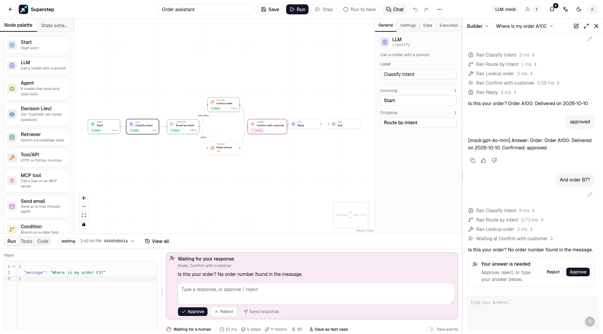
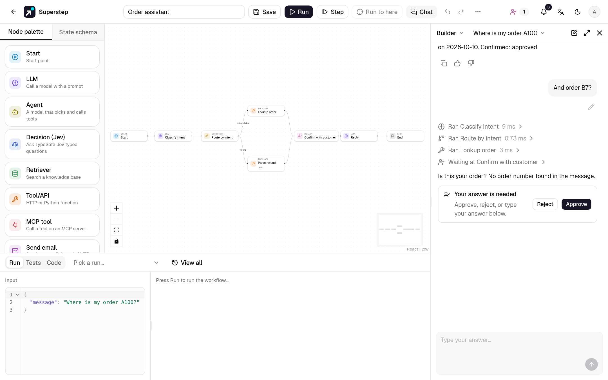
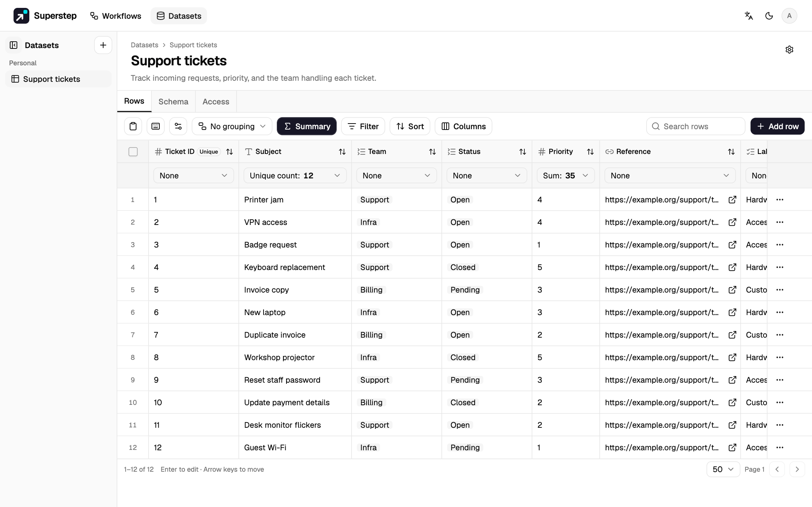
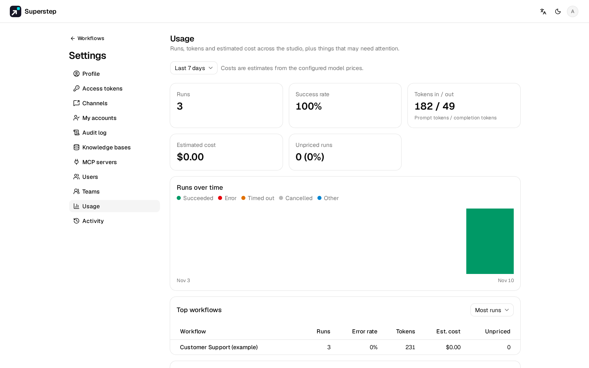
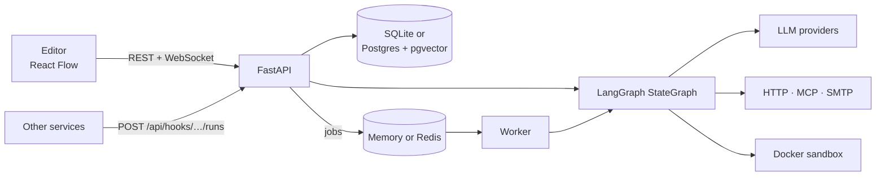

<div align="center">
  <picture>
    <source media="(prefers-color-scheme: dark)" srcset="frontend/public/brand/superstep-mark-dark.svg">
    
  </picture>

  <h3><b>Superstep</b></h3>
  <p>Open-source visual LangGraph studio<br>Drag-and-drop graphs • Live run streaming • Human-in-the-loop approvals • Python &amp; TypeScript code nodes</p>

  <p>
    <a href="https://github.com/quinguyen1502/superstep/stargazers"></a>
    <a href="LICENSE"></a>
    <a href="https://github.com/quinguyen1502/superstep/actions/workflows/ci.yml"></a>
    <a href="https://quinguyen1502.github.io/superstep/"></a>
  </p>

  <b>English</b> · <a href="README.vi.md">Tiếng Việt</a>
</div>

<p align="center"><b>Build LangGraph workflows in the browser and run them as services.</b></p>

<p align="center"><a href="https://quinguyen1502.github.io/superstep/">Documentation</a> • <a href="https://quinguyen1502.github.io/superstep/#video">Quickstart video</a> • <a href="https://quinguyen1502.github.io/superstep/reference/api/">HTTP API</a> • <a href="https://quinguyen1502.github.io/superstep/run/public-api/">Public API and SDKs</a> • <a href="https://quinguyen1502.github.io/superstep/reference/architecture/">Architecture</a></p>



<table>
  <tr>
    <td width="33%" align="center"><p>Chat with a workflow</p></td>
    <td width="33%" align="center"><p>Dataset grid and summaries</p></td>
    <td width="33%" align="center"><p>Usage dashboard</p></td>
  </tr>
</table>

## Why Superstep?

<table>
  <tr>
    <td width="50%" valign="top"><b>Visual graphs</b><br>Drag nodes, wire edges; saved as JSON, compiled to a LangGraph <code>StateGraph</code></td>
    <td width="50%" valign="top"><b>Live runs</b><br>Per-node trace and state diff as it runs; step and run-to-node debugging</td>
  </tr>
  <tr>
    <td width="50%" valign="top"><b>Human in the loop</b><br>Pause for approval in the studio, Slack, Telegram, email or Teams; optional AI review</td>
    <td width="50%" valign="top"><b>Triggers</b><br>HTTP API with tokens, signed webhooks, cron schedules, chat commands</td>
  </tr>
  <tr>
    <td width="50%" valign="top"><b>Python & TypeScript code</b><br>Code nodes in a locked Docker sandbox; any model, MCP and pgvector</td>
    <td width="50%" valign="top"><b>Workflow export</b><br>Inspect and export LangGraph code in Python or TypeScript</td>
  </tr>
</table>

## Quick start

```bash
git clone https://github.com/quinguyen1502/superstep.git
cd superstep && ./dev.sh
```

Open <http://localhost:5173> and create an account with **Sign up** (outside production a demo account, `admin@example.com` / `admin123`, also exists). The API docs are at <http://localhost:8000/docs>.
LLM nodes answer from a deterministic offline mock until you add a model
credential. The [Quickstart](https://quinguyen1502.github.io/superstep/start/quickstart/)
builds, runs, approves and triggers a first workflow in about ten minutes.

To run an instance with Docker instead, install the `superstep` CLI (also
`sstep`) and let it set one up:

```bash
curl -fsSL https://raw.githubusercontent.com/quinguyen1502/superstep/develop/scripts/install.sh | sh
superstep install           # then: superstep doctor, upgrade, backup
```

The full stack (Postgres with pgvector, Redis, API, worker, nginx):

```bash
cp .env.example .env        # set JWT_SECRET and POSTGRES_PASSWORD
docker compose up --build   # http://localhost:8080
```

## Features

1. **Visual editor.** Build workflows with LLM, Agent, Condition, Human,
   and Code nodes. Start from a template and use typed state, reducers,
   and `{{state.field}}` references that Studio checks before a run.
2. **Datasets.** Create personal or team tables with typed columns, validation,
   scoped access, and CSV import and export. Combine nested filters, grouping,
   pinned columns, and column summaries. Paste or fill cells as a batch, with undo.
   Dataset nodes and Agent tools can read, write, and aggregate rows within
   their workflow's grants.
   [Datasets guide](https://quinguyen1502.github.io/superstep/guide/datasets/)
3. **Run traces:** duration, tokens and cost per node, the input, output and
   state diff of every step, step-by-step and run-to-node debugging. Test
   cases check a workflow's results, and test runs can be compared.
4. **Agent node:** a model picks and calls the tools you allow (MCP server
   tools, HTTP requests, built-in functions, knowledge base search) until it
   answers, with a round limit and an approval before the tools you mark.
   Agents hand the conversation off to each other, a chat continues with the
   agent that answered last, and the Help desk template shows the pattern.
5. **Human in the loop:** a Human node pauses a run from a checkpoint; approve
   in the studio's Approvals inbox, or from Slack, Telegram, WhatsApp, email
   or Teams; deadlines send reminders, escalate or expire a waiting run. AI
   review can suggest an answer or approve automatically under rules, with a
   daily cap, kill switches and a notice to the run owner.
6. **Chat:** chat with a workflow in the studio, on a published page or in a
   widget; people attach images and documents, which reach LLM and Agent
   nodes. Files are stored in the database, a folder or an S3 bucket, and
   `superstep attachments migrate` moves them between backends.
7. **Triggers and schedules.** Start a sync or async run with a workflow
   token, or trigger a run from Slack or Telegram. Configure signed result
   webhooks with retries. Set cron schedules with time zones in Studio, or
   manage and preview them through the Python and TypeScript SDKs.
   [Public schedule API](https://quinguyen1502.github.io/superstep/run/public-api/#schedules)
8. **Reliability:** checkpoints in the database, leased worker jobs, and
   effectively-once side effects through idempotency keys and a result ledger.
9. **Models and tools:** OpenAI, Anthropic, OpenRouter, Ollama, LM Studio and
   OpenAI-compatible servers; pgvector knowledge bases; MCP servers; Python
   and TypeScript code in a locked Docker container.
10. **Operations and observability.** Track tokens and estimated cost by
    model, user, and team. Set monthly budgets with notifications, monitor run
    success and API availability, and collect metrics and traces with
    OpenTelemetry. Studio includes roles, an audit log, and workflow version
    history. The CLI installs, upgrades, backs up, and checks instances.
    [Observability guide](https://quinguyen1502.github.io/superstep/operate/observability/)
11. **Workflow export.** Use the Code tab to inspect generated LangGraph code
    for the selected node. Export supported workflows as a Python or TypeScript
    file or project with Dataset bindings where applicable.
    [Export guide](https://quinguyen1502.github.io/superstep/guide/python-export/)

## How it works



Editor runs execute in the API process and stream events over WebSocket. API
triggers, schedules and recovered runs go through the queue to a worker.
Details: [Architecture](https://quinguyen1502.github.io/superstep/reference/architecture/).

## Deploy

**Live demo:** [superstep-demo.onrender.com](https://superstep-demo.onrender.com) (click "Try the demo"). It runs on Render's free plan: the first load may take about 30 s while the server wakes, data resets whenever it sleeps, and changes are not saved. Code, HTTP and Send email nodes are off and models answer with a mock; see [docs/deploy/demo.md](docs/deploy/demo.md).

On your own server, `superstep install` sets up the all-in-one image or the full stack, and `superstep upgrade`, `backup` and `doctor` keep it running ([CLI](https://quinguyen1502.github.io/superstep/operate/cli/)).

Deploy the all-in-one image (UI, API and WebSocket on one port; SQLite on a volume or Postgres):

[](https://render.com/deploy?repo=https://github.com/quinguyen1502/superstep)
[](https://www.heroku.com/deploy?template=https://github.com/quinguyen1502/superstep)
[](https://cloud.digitalocean.com/apps/new?repo=https://github.com/quinguyen1502/superstep/tree/main)
[](https://app.koyeb.com/deploy?type=docker&image=ghcr.io/quinguyen1502/superstep:latest&name=superstep&ports=8000;http;/&env%5BSTUDIO_ADMIN_EMAILS%5D=&env%5BJWT_SECRET%5D=&env%5BSTUDIO_SECRET_KEY%5D=&env%5BDATABASE_URL%5D=)

Fly.io, Railway, Zeabur, Northflank, Coolify and Dokploy (the full-feature path with the Docker sandbox), Postgres and worker variants, the first admin account and the variables:
[`docs/deploy/`](docs/deploy/README.md). On managed platforms Code nodes run on the host (no Docker sandbox); read the guide first.

## Documentation

| Topic | Handbook section |
| --- | --- |
| Install, quickstart, concepts | [Get started](https://quinguyen1502.github.io/superstep/start/) |
| Editor, nodes, state, Agent node, hand-offs, Code mode, knowledge, MCP | [Build](https://quinguyen1502.github.io/superstep/guide/) |
| Traces, tests, chat and attachments, human approval, AI review, API triggers, schedules, chat triggers | [Run](https://quinguyen1502.github.io/superstep/run/) |
| Deployment, CLI, accounts, roles, providers, channels | [Operate](https://quinguyen1502.github.io/superstep/operate/) |
| Configuration, HTTP API, error codes, architecture | [Reference](https://quinguyen1502.github.io/superstep/reference/) |
| Start workflows from other services: Python and TypeScript SDKs, public API reference | [Public API and SDKs](https://quinguyen1502.github.io/superstep/run/public-api/), [reference](https://quinguyen1502.github.io/superstep/reference/public-api/) |

The handbook source is in [`handbook/`](handbook/README.md). Every variable is
in [`.env.example`](.env.example) and every error code in
[`docs/api-errors.md`](docs/api-errors.md).

## Development

```bash
cd backend && .venv/bin/python -m pytest -q
npm ci
npm run build && npm run lint && npm test
npm run test:e2e
```

| Path | Contents |
| --- | --- |
| `backend/app/` | FastAPI app: routers → services → repositories and the LangGraph engine ([layers](docs/backend-architecture.md)) |
| `frontend/` | React, TypeScript, Vite, React Flow, Tailwind v4, shadcn/ui ([UI rules](docs/ui-conventions.md)) |
| `handbook/` | The documentation site (Zensical) |
| `sdk/` | Python (`superstep`) and TypeScript (`@superstep/sdk`) clients for the public API ([SDKs](sdk/README.md)); spec in `docs/api/openapi.public.json` |
| `scripts/promo/` | The quickstart video renderer |
| `.factory/` | The delivery workflow (AI Software Factory); its store keeps requirements, decisions, tasks, reviews and QA |

## Contributing

Changes follow the delivery workflow in [`AGENTS.md`](AGENTS.md): a
requirement and a task in the factory store, a branch
`factory/task-<id>-<name>`, checks, a review, and a merge after human
approval. See [Development](https://quinguyen1502.github.io/superstep/reference/development/)
for the test setup and the conventions each layer follows.

## License

[MIT](LICENSE)
