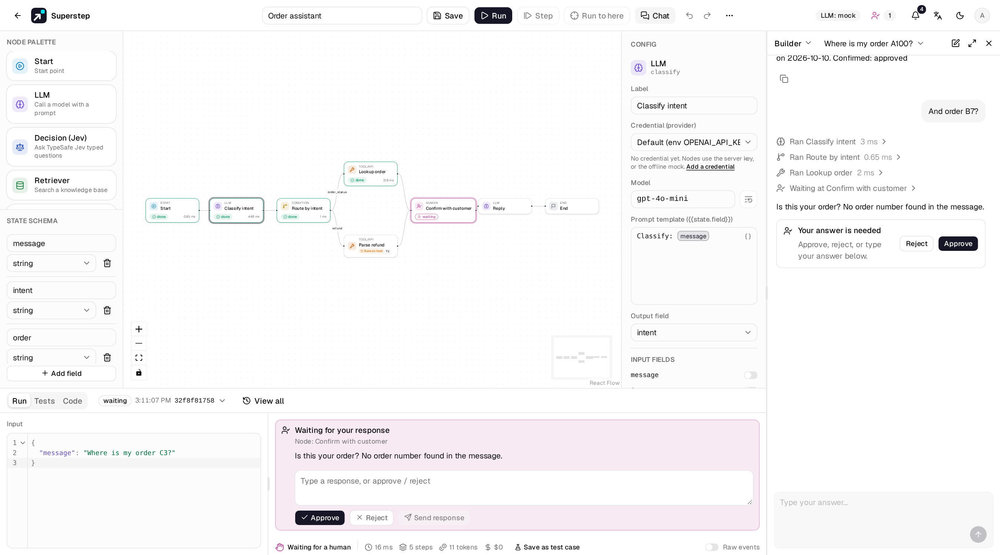
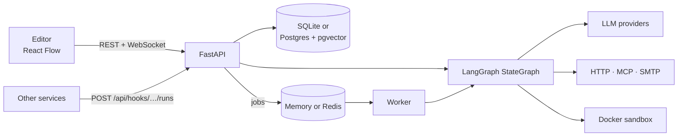

<div align="center">
  <picture>
    <source media="(prefers-color-scheme: dark)" srcset="frontend/public/brand/superstep-mark-dark.svg">
    
  </picture>

  <h3><b>Superstep</b></h3>
  <p>Open-source visual LangGraph studio<br>Drag-and-drop graphs • Live run streaming • Human-in-the-loop approvals • Python &amp; TypeScript code nodes</p>

  <p>
    <a href="https://github.com/quinguyen1502/superstep/stargazers"></a>
    <a href="LICENSE"></a>
    <a href="https://github.com/quinguyen1502/superstep/actions/workflows/ci.yml"></a>
    <a href="https://quinguyen1502.github.io/superstep/"></a>
  </p>

  <b>English</b> · <a href="README.vi.md">Tiếng Việt</a>
</div>

<p align="center"><b>Build LangGraph workflows in the browser and run them as services.</b></p>

<p align="center"><a href="https://quinguyen1502.github.io/superstep/">Documentation</a> • <a href="https://quinguyen1502.github.io/superstep/#video">Quickstart video</a> • <a href="https://quinguyen1502.github.io/superstep/reference/api/">HTTP API</a> • <a href="https://quinguyen1502.github.io/superstep/run/public-api/">Public API and SDKs</a> • <a href="https://quinguyen1502.github.io/superstep/reference/architecture/">Architecture</a></p>



<table>
  <tr>
    <td width="33%" align="center"><p>Chat with a workflow</p></td>
    <td width="33%" align="center"><p>Live run trace</p></td>
    <td width="33%" align="center"><p>LangGraph code export</p></td>
  </tr>
</table>

## Why Superstep?

<table>
  <tr>
    <td width="50%" valign="top"><b>Visual graphs</b><br>Drag nodes, wire edges; saved as JSON, compiled to a LangGraph <code>StateGraph</code></td>
    <td width="50%" valign="top"><b>Live runs</b><br>Per-node trace and state diff as it runs; step and run-to-node debugging</td>
  </tr>
  <tr>
    <td width="50%" valign="top"><b>Human in the loop</b><br>Pause for approval in the studio, Slack, Telegram, email or Teams</td>
    <td width="50%" valign="top"><b>Triggers</b><br>HTTP API with tokens, signed webhooks, cron schedules, chat commands</td>
  </tr>
  <tr>
    <td width="50%" valign="top"><b>Python & TypeScript code</b><br>Code nodes in a locked Docker sandbox; any model, MCP and pgvector</td>
    <td width="50%" valign="top"><b>Learn LangGraph</b><br>Export any workflow as one readable Python file that runs on its own</td>
  </tr>
</table>

## Quick start

```bash
git clone https://github.com/quinguyen1502/superstep.git
cd superstep && ./dev.sh
```

Open <http://localhost:5173> and create an account with **Sign up** (outside production a demo account, `admin@example.com` / `admin123`, also exists). The API docs are at <http://localhost:8000/docs>.
LLM nodes answer from a deterministic offline mock until you add a model
credential. The [Quickstart](https://quinguyen1502.github.io/superstep/start/quickstart/)
builds, runs, approves and triggers a first workflow in about ten minutes.

The full stack (Postgres with pgvector, Redis, API, worker, nginx):

```bash
cp .env.example .env        # set JWT_SECRET and POSTGRES_PASSWORD
docker compose up --build   # http://localhost:8080
```

## Features

1. **Visual editor:** 13 node types (LLM, Tool, Condition, For each, Join,
   Subgraph, MCP, Retriever, Decision, Send email, Human, Start, End) plus
   read-only Code nodes from imported repos, a typed state with reducers,
   `{{state.field}}` references checked before a run, and a template library
   to start from.
2. **Run traces:** duration, tokens and cost per node, the input, output and
   state diff of every step, step-by-step and run-to-node debugging. Test
   cases check a workflow's results, and test runs can be compared.
3. **Human in the loop:** a Human node pauses a run from a checkpoint; approve
   in the studio's Approvals inbox, or from Slack, Telegram, WhatsApp, email
   or Teams; deadlines send reminders, escalate or expire a waiting run.
4. **Triggers:** per-workflow API tokens, sync and async runs, signed result
   webhooks with retries, cron schedules with time zones, and chat triggers: a
   command to the Slack app or Telegram bot starts a run and the bot replies.
5. **Reliability:** checkpoints in the database, leased worker jobs, and
   effectively-once side effects through idempotency keys and a result ledger.
6. **Models and tools:** OpenAI, Anthropic, OpenRouter, Ollama, LM Studio and
   OpenAI-compatible servers; pgvector knowledge bases; MCP servers; Python
   code in a locked Docker container.
7. **Operations:** immutable versions with diff and restore, admin, editor
   and viewer roles, shares and teams, an audit log, and OpenTelemetry traces
   to OTLP or LangSmith.
8. **Learn LangGraph:** the Code tab shows any workflow as one readable LangGraph
   Python file that runs on its own (offline with a mock model), with the
   selected node's code highlighted, and exports it to your own project.

## How it works



Editor runs execute in the API process and stream events over WebSocket. API
triggers, schedules and recovered runs go through the queue to a worker.
Details: [Architecture](https://quinguyen1502.github.io/superstep/reference/architecture/).

## Deploy

**Live demo:** [superstep-demo.onrender.com](https://superstep-demo.onrender.com) (click "Try the demo"). It runs on Render's free plan: the first load may take about 30 s while the server wakes, data resets whenever it sleeps, and changes are not saved. Code, HTTP and Send email nodes are off and models answer with a mock; see [docs/deploy/demo.md](docs/deploy/demo.md).

Deploy the all-in-one image (UI, API and WebSocket on one port; SQLite on a volume or Postgres):

[](https://render.com/deploy?repo=https://github.com/quinguyen1502/superstep)
[](https://www.heroku.com/deploy?template=https://github.com/quinguyen1502/superstep)
[](https://cloud.digitalocean.com/apps/new?repo=https://github.com/quinguyen1502/superstep/tree/main)
[](https://app.koyeb.com/deploy?type=docker&image=ghcr.io/quinguyen1502/superstep:latest&name=superstep&ports=8000;http;/&env%5BSTUDIO_ADMIN_EMAILS%5D=&env%5BJWT_SECRET%5D=&env%5BSTUDIO_SECRET_KEY%5D=&env%5BDATABASE_URL%5D=)

Fly.io, Railway, Zeabur, Northflank, Coolify and Dokploy (the full-feature path with the Docker sandbox), Postgres and worker variants, the first admin account and the variables:
[`docs/deploy/`](docs/deploy/README.md). On managed platforms Code nodes run on the host (no Docker sandbox); read the guide first.

## Documentation

| Topic | Handbook section |
| --- | --- |
| Install, quickstart, concepts | [Get started](https://quinguyen1502.github.io/superstep/start/) |
| Editor, nodes, state, Code mode, knowledge, MCP | [Build](https://quinguyen1502.github.io/superstep/guide/) |
| Traces, tests, human approval, API triggers, schedules, chat triggers | [Run](https://quinguyen1502.github.io/superstep/run/) |
| Deployment, accounts, roles, providers, channels | [Operate](https://quinguyen1502.github.io/superstep/operate/) |
| Configuration, HTTP API, error codes, architecture | [Reference](https://quinguyen1502.github.io/superstep/reference/) |
| Start workflows from other services: Python and TypeScript SDKs, public API reference | [Public API and SDKs](https://quinguyen1502.github.io/superstep/run/public-api/), [reference](https://quinguyen1502.github.io/superstep/reference/public-api/) |

The handbook source is in [`handbook/`](handbook/README.md). Every variable is
in [`.env.example`](.env.example) and every error code in
[`docs/api-errors.md`](docs/api-errors.md).

## Development

```bash
cd backend && .venv/bin/python -m pytest -q
cd frontend && npm run build && npm run lint && npm test
cd frontend && npm run e2e
```

| Path | Contents |
| --- | --- |
| `backend/app/` | FastAPI app: routers → services → repositories and the LangGraph engine ([layers](docs/backend-architecture.md)) |
| `frontend/` | React, TypeScript, Vite, React Flow, Tailwind v4, shadcn/ui ([UI rules](docs/ui-conventions.md)) |
| `handbook/` | The documentation site (Zensical) |
| `sdk/` | Python (`superstep`) and TypeScript (`@superstep/sdk`) clients for the public API ([SDKs](sdk/README.md)); spec in `docs/api/openapi.public.json` |
| `scripts/promo/` | The quickstart video renderer |
| `.factory-state/` | Requirements, decisions, tasks, reviews and QA |

## Contributing

Changes follow the delivery workflow in [`AGENTS.md`](AGENTS.md): a
requirement and a task in `.factory-state/`, a branch
`factory/task-<id>-<name>`, checks, a review, and a merge after human
approval. See [Development](https://quinguyen1502.github.io/superstep/reference/development/)
for the test setup and the conventions each layer follows.

## License

[MIT](LICENSE)
