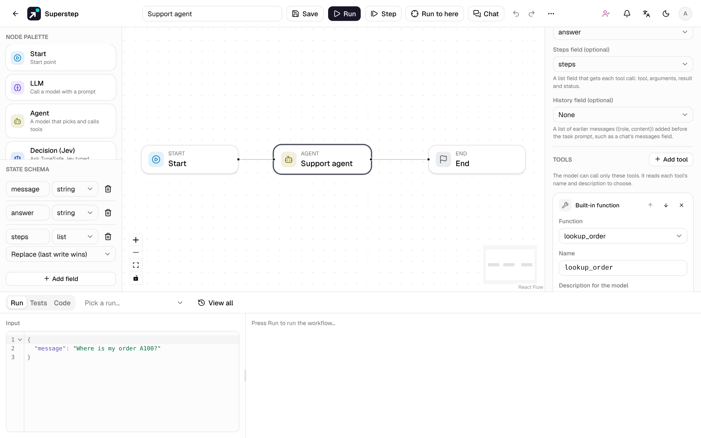
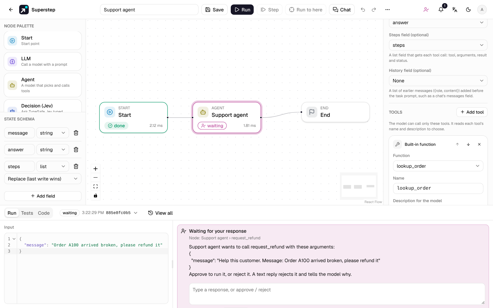
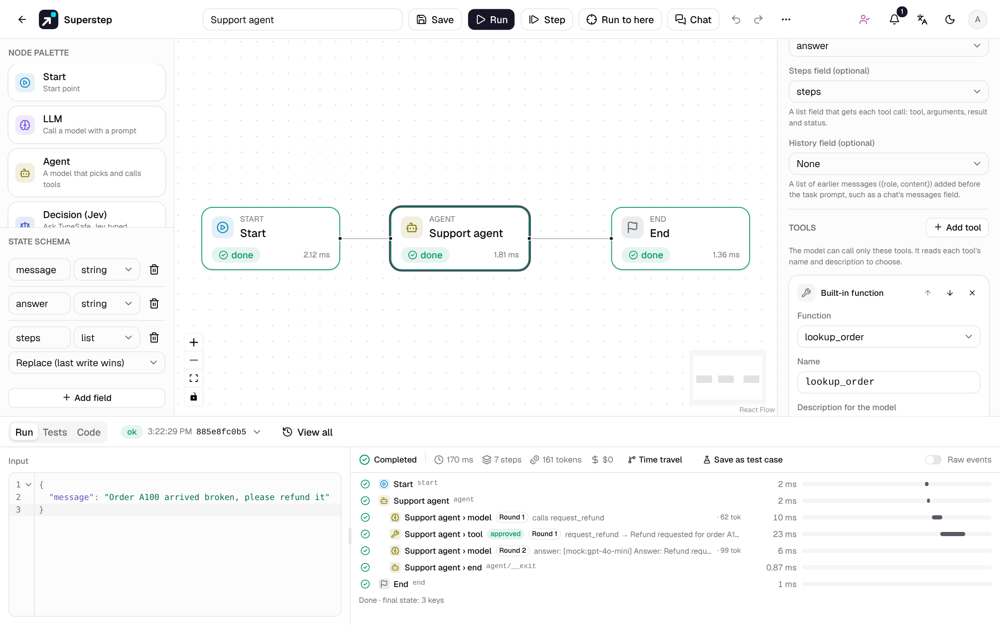

# Agent node

An **Agent** node gives a model a task and a list of tools. The model decides
which tool to call and with which arguments, reads the result, and repeats
until it answers. You choose the tools, the number of rounds, and which calls
need a person's approval first.

## When to use it

| Use | When |
| --- | --- |
| **Agent node** | The order of the steps depends on the request: "look up the order, then check the refund policy, then answer", but only when the customer asks about a refund. |
| A fixed graph (LLM, Tool, MCP tool, Retriever, Condition nodes) | Every run takes the same steps, or each branch must be drawn and reviewed. The graph decides; the model only fills in text. |
| [Subgraph](nodes.md#subgraph) | A fixed part of the graph is shared by several workflows. |

An Agent node is one node on the canvas. Put it inside a larger graph: a
Condition after it can branch on its answer, and a Human node after it can
approve the whole result.

## Settings

The settings sit in the [Config tabs](nodes.md#config-tabs): credential,
model, prompts, tools and approval in **Settings**; the output, steps and
history fields in **Data**; max rounds and retry/timeout in **Execution**.

| Setting | Notes |
| --- | --- |
| Credential, Model | As for the [LLM node](nodes.md#llm). Blank uses `OPENAI_API_KEY`, and without that the offline mock. The provider must support tool calling: OpenAI, Anthropic, OpenRouter, Ollama, LM Studio and OpenAI-compatible servers do. |
| System prompt | Optional. A template with `{{state.field}}` references. |
| Task prompt | Required. A template, for example `Help this customer. Message: {{state.message}}`. |
| Max rounds | 1–25, default 5. See [Rounds and the limit](#rounds-and-the-limit). |
| Output field | Receives the final answer. |
| Steps field | Optional, a list field. Receives every tool call: `{tool, args, result, status, ms}`, plus `approval` when a person answered. |
| History field | Optional, a list field of `{role, content}` messages (`user` or `assistant`) added before the task prompt, such as a chat's `messages` field. |
| Tools | At least one. See below. |
| Approval | Shown when a tool needs approval: channel, approvers and deadline, as on a Human node. |
| Execution | Retry, wait between tries and timeout apply to each model call and each tool call. A cache TTL is never used for them, since a cached step would skip a call or an approval. |

## Tools

**Add tool** picks the source. Every tool has:

- a **name** the model calls it by: 1–64 letters, digits, `_` or `-`, unique
  in the node;
- a **description for the model**: what it does and when to use it. The model
  chooses from the names and descriptions, so write them for the model;
- a **Needs approval** switch.

Up and down arrows set the order the model sees.

=== "MCP tool"

    A tool of one of your [MCP servers](mcp.md). Its input schema comes from
    the server's tool list, so the model knows the arguments. A shared
    workflow runs with the owner's MCP servers.

=== "HTTP request"

    Method, URL and an optional body, plus the **parameters the model fills**
    (name, type, description, required). Use `{{state.args.<name>}}` in the URL
    or body to insert a parameter. Without a body, POST, PUT and PATCH send the
    parameters as JSON, and GET adds them to the URL. The model's arguments are
    inserted as values and never rendered as templates, so an argument cannot
    read other state fields.

    The request follows the [HTTP Tool](nodes.md#tool) rules: public
    addresses only unless `STUDIO_HTTP_TOOL_ALLOW_PRIVATE=1`, no redirects,
    `STUDIO_HTTP_TOOL_TIMEOUT`, and an `Idempotency-Key` header for each call.

=== "Built-in function"

    A Python function registered in `backend/app/engine/tools.py`, for example
    `lookup_order`. Its parameters come from the registry. The function gets
    the state with the model's arguments on top.

=== "Knowledge base search"

    One of your [knowledge bases](knowledge.md) and `top_k` (1–20, default 4).
    The model writes the search query and gets the best passages.

Before a call runs, its arguments are checked against the tool's parameters
(required parameters and JSON types). An unknown tool, invalid arguments or a
tool that fails gives the model an error as the result, so it can try again or
answer without it. Results go back to the model shortened to 8,000
characters; the trace and the steps field keep 2,000.

## Rounds and the limit

One **round** is a model call plus the tool calls it asks for. Calls in one
round run one after another, in the model's order; at most 8 run, and the
others get "refused" as their result.

The loop ends when the model answers without calling a tool. When **Max
rounds** is reached, the model is called once more without tools to give its
final answer, and the trace marks **round limit reached**.

## Approval before a tool

Turn on **Needs approval** for a tool that changes something: a refund, an
e-mail, a write to another system. Before each call to it, the run pauses in
status `waiting`, as at a [Human node](../run/human-approval.md):

- The question names the Agent node and the tool, and shows the arguments. The
  step is called `Agent › tool`, for example `Support agent › request_refund`.
- **Approve** runs the call. **Reject** tells the model "Rejected by a
  reviewer". A text reply also rejects the call, and the model gets the text as
  the reason, so it can answer differently.
- The request reaches the same places as a Human node's: the run panel, the
  **Approvals** page, and the approval channel (Slack, Telegram, WhatsApp,
  email or Teams) with the approvers and deadline set on the Agent node. A
  deadline's timeout answer works the same way.
- Each call asks again; an approval covers one call. A call with an unknown
  tool or invalid arguments never runs, so it is not shown to an approver.
- In a [chat](../run/chat.md), the person chatting cannot approve the agent's
  own actions: a reviewer answers in **Approvals**.

## The offline mock

Without a credential and `OPENAI_API_KEY`, in the public demo, and in test runs
with **Use the offline mock model**, the model is a deterministic mock. It
calls the tool whose name and description share the most words with the task
(the first tool on a tie), filling text parameters with the task, then answers
with the tool's result. Templates, tests and demos run offline with it, and
approvals still ask.

## Trace and usage

The run trace groups the Agent node's steps under it, by round:

- `Agent › model` shows the round, the tools it called or its answer, and its
  tokens.
- `Agent › tool` shows the tool, a shortened result, the duration, and
  **approved** or **rejected by a reviewer** when a person answered.
- The node's token usage and cost add up in the run.

Each model call and each tool call is its own step with its own checkpoint. A
pause, a restart or a worker crash repeats at most the step that had not
finished: tools that already ran are not called again (see
[Runs across restarts](../operate/deploy.md#runs-across-restarts)).
[Time travel](../run/traces.md#time-travel-fork-from-a-checkpoint) can fork a run between two steps of the loop.

In a chat, **Steps shown to visitors** set to **Step names** lists each tool
call, for example `Support agent › lookup_order`; **Full** also shows the model
calls, with each step's input and output.

## Test an Agent node

In the [Tests](../run/tests.md) tab:

- the **Tool called** check passes when the Agent node called a tool, or did
  not. A call counts when it ran, even if the tool failed; a rejected, refused or
  invalid call does not;
- an Agent node with a tool that needs approval is listed under **Human
  answers**: give Approve, Reject or a text reply for each call, in order.

## The Support agent template

**Support agent** in the [template gallery](templates.md) has one Agent node
with three tools: `lookup_order`, a refund policy search (pick a knowledge base
first), and `request_refund`, which needs approval and is rejected after one
day without an answer. Its test cases check an order question, an approved
refund and a rejected one. `request_refund` is an example: it pays nothing.

## Export

- **Python and the LangGraph project** (see
  [Export to Python](python-export.md#an-agent-node)): the Agent node becomes
  the same steps as in the studio, with `interrupt()` before a tool that needs
  approval. Without `LLM_PROVIDER` the file uses the same mock.
- **TypeScript** is not available yet for a workflow with an Agent node, also
  inside a subgraph: the export returns `TYPESCRIPT_EXPORT_AGENT_UNSUPPORTED`.

## Errors

| Code | When |
| --- | --- |
| `AGENT_TOOLS_UNSUPPORTED` | The credential's provider cannot call tools (TypeSafe, SMTP). The model step fails when it runs. |
| `TYPESCRIPT_EXPORT_AGENT_UNSUPPORTED` | A TypeScript export of a workflow with an Agent node. |
| `WORKFLOW_INVALID` | A run of a workflow the editor marks invalid: no task prompt, no tool, max rounds out of range, a tool without its settings (server and tool, function, knowledge base or URL), two tools with one name, or a steps or history field that is not a list. |

All codes are in [Error codes](../reference/errors.md).
