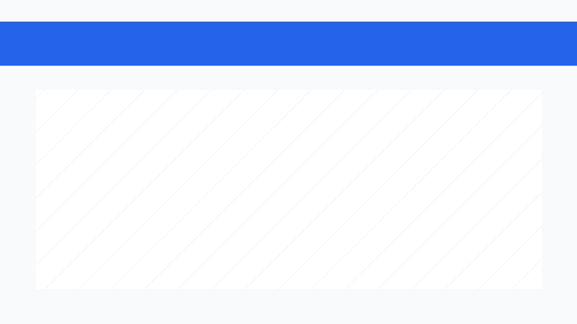
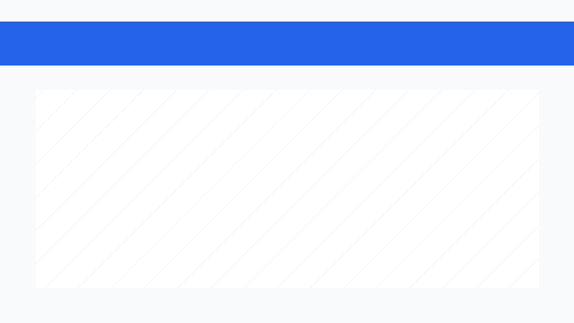

# Browser tools (first delivery)

Studio can open an **isolated browser** for Agent and recipe steps: navigate,
snapshot, extract, screenshot, and optional mutating actions (click, fill,
upload, download, evaluate). Connections live under **Settings → MCP servers**.
No start URL belongs on the connection — URLs come from chat, workflow state, or
a configured search tool at run time.

This page is the English first-delivery setup guide. Executable Python/TypeScript
exports are deferred.

## Before you start

1. Set both gates on the Studio API/worker (they default **off**):

   ```bash
   STUDIO_ENABLE_BROWSER=1
   STUDIO_ENABLE_BROWSER_RUNTIME=1
   ```

   The first exposes the `browser` / `web` managed adapters. The second allows
   trusted runs to open a worker. Discovery alone never launches Chromium.

2. For the **local** provider, build the worker and gateway images (once per
   host):

   ```bash
   docker build -t superstep-browser-worker:1 docker/browser-worker
   docker build -f docker/browser-gateway/Dockerfile -t superstep-browser-gateway:1 .
   ```

3. For the **remote** provider (self-hosted Superstep `browser_controller`, still
   labeled **Browserless** in Settings), run a controller the Studio host can
   reach over HTTPS, then approve it:

   ```bash
   # On the controller host (example)
   export STUDIO_BROWSER_CONTROL_TOKEN='…32+ printable ASCII…'
   export STUDIO_BROWSER_CONTROL_ID='controller-1'
   python -m app.browser_controller

   # On Studio
   export STUDIO_BROWSER_CONTROLLERS='[{"endpoint":"https://browser.example.org","address":"203.0.113.10"}]'
   ```

   Tokens are write-only in Settings. Arbitrary CDP/WSS endpoints are unsupported.
   See [browser-remote.md](https://github.com/quinguyen1502/superstep/blob/develop/docs/browser-remote.md) for trust boundaries.

## 1. Create a browser connection

1. Open **Settings → MCP servers → Add server**.
2. Transport: **Managed connection**.
3. Adapter: **Isolated browser**.
4. Scope: personal (**User**) unless an admin is configuring an org connection.
5. Provider:
   - **Local isolated browser (Docker)** — Studio starts the worker on this host.
   - **Browserless (controller)** — paste the controller token; the endpoint must
     already appear in `STUDIO_BROWSER_CONTROLLERS`.
6. **Allowed origins** (required): one exact `http(s)` origin per line, for
   example `https://example.org`. Empty whitelists are rejected. Internal
   addresses stay blocked by network policy even when listed incorrectly.
7. Optional **Network / Proxy**: direct, operator-default, or custom HTTP proxy
   (Basic auth uses separate encrypted username/password). SOCKS is not supported.
   Proxy failure never falls back to direct.
8. Optional **Personal login profile** (user scope only): name, HTTPS profile
   origins, and a bounded Playwright storage-state JSON seed.
9. **Safety toggles** (defaults):
   - Require approval for mutating actions — **off** (navigate / snapshot /
     extract / screenshot never wait).
   - Allow evaluate / upload / download — **off** until you need them.
10. Save, then **Discover tools**. You should see the nine browser operations
    when the adapter is enabled.



## 2. Grant tools on an Agent

1. Open a workflow, select the **Agent** node.
2. **Settings**: add MCP tools from your browser connection (`navigate`,
   `snapshot`, …). Mutating tools stay subject to the connection toggles and,
   when approval is on, Human review.
3. **Data**: for each browser tool that needs a URL, choose a **URL source**:
   - **Filled by the Agent** — from chat / model (asks when missing; no guessed site).
   - **Fixed URL** — literal `https://…` the model cannot override.
   - **Workflow state** — a `{{state.…}}` reference resolved once at runtime.
4. **Execution**: shows inherited connection limits (actions, idle, lifetime).
   Sessions persist across chat turns until idle/max lifetime or an uncertain effect.

Save the workflow.



## 3. Run a chat turn

1. Open the workflow’s chat (or a published chat that uses it).
2. Ask for a page within the whitelist, for example “Open https://example.org and
   summarise the heading.”
3. The Agent should call `navigate` then read-only tools. Mutating calls either
   run immediately (default) or wait for Human approval when the toggle is on.
4. Owner Studio trace can load a private screenshot capture; public chat shows
   only allowlisted status / operation / approval facts — not raw worker envelopes.

If the URL is outside the whitelist, the run fails with a distinct denial (not a
generic network error). Lost or expired sessions stop without silently replaying
clicks.

## 4. Optional: reusable recipe

On **Start → Settings**, enable **Reusable browser recipe**, pick the same
browser connection, then declare typed inputs/results under **Data**. Linear MCP
browser actions on that connection become a closed contract another Agent can
call as an ordinary workflow tool. Layout/selector failures stop; they do not
flip into autonomous browsing. Example workflow:
[`examples/browser/lookup_shipment.json`](https://github.com/quinguyen1502/superstep/blob/develop/examples/browser/lookup_shipment.json).

## Risks and always-on rules

| Area | Behaviour |
| --- | --- |
| Network | Exact-origin whitelist required; no silent direct fallback on proxy failure. |
| Secrets | Controller token, proxy password and profile state are write-only. |
| Mutating tools | Default off for evaluate/upload/download; approval default off but never bypasses Human when on. |
| Page content | Untrusted; shown escaped in owner trace; not executed in Studio. |
| Remote controller | Compatibility JSON is not attestation — only operator-approved endpoints run. |
| Stealth / CAPTCHA | Unsupported; no automatic challenge solving. |

## Related technical notes

- Connection UI details: [https://github.com/quinguyen1502/superstep/blob/develop/docs/browser-settings.md](https://github.com/quinguyen1502/superstep/blob/develop/docs/browser-settings.md)
- Local worker: [https://github.com/quinguyen1502/superstep/blob/develop/docs/browser-runtime.md](https://github.com/quinguyen1502/superstep/blob/develop/docs/browser-runtime.md)
- Remote controller: [https://github.com/quinguyen1502/superstep/blob/develop/docs/browser-remote.md](https://github.com/quinguyen1502/superstep/blob/develop/docs/browser-remote.md)
- Sessions: [https://github.com/quinguyen1502/superstep/blob/develop/docs/browser-sessions.md](https://github.com/quinguyen1502/superstep/blob/develop/docs/browser-sessions.md)
- Approvals: [https://github.com/quinguyen1502/superstep/blob/develop/docs/browser-approvals.md](https://github.com/quinguyen1502/superstep/blob/develop/docs/browser-approvals.md)
- Editor / recipes / filtered trace: [https://github.com/quinguyen1502/superstep/blob/develop/docs/browser-editor.md](https://github.com/quinguyen1502/superstep/blob/develop/docs/browser-editor.md)
