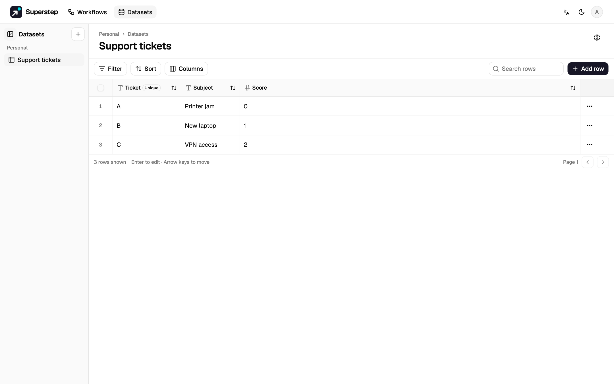
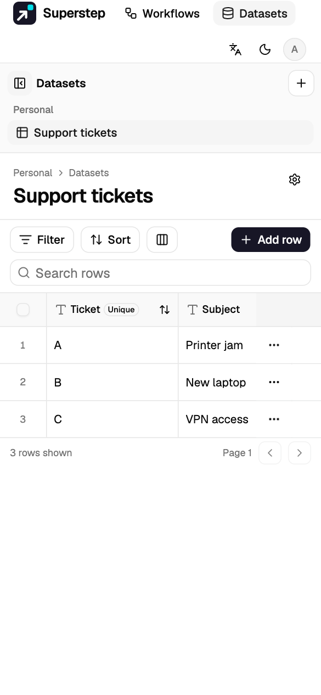
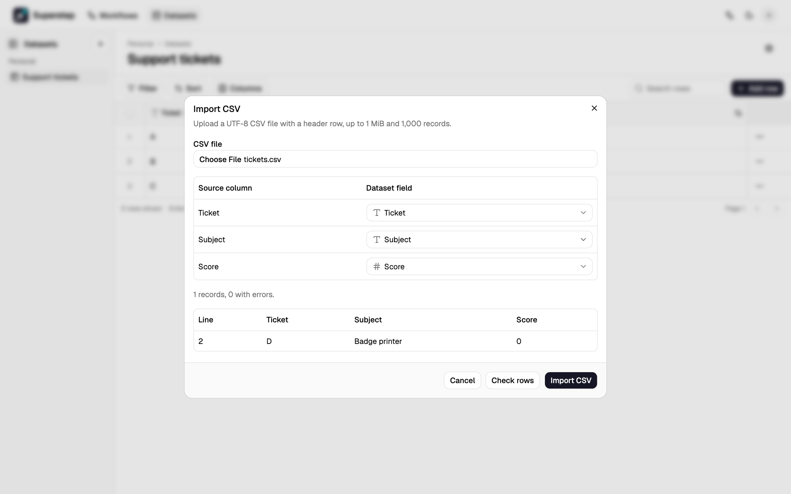

# Datasets

A dataset is a typed table owned by you or by a team. Workflows can look up and
write rows. An exported project can use the same rows through the Superstep API
or through its own SQLite or PostgreSQL database.

## Authoring

Open **Datasets** from the studio navigation.

On a narrow screen the catalog folds under the header and the grid scrolls sideways.

- **Create** asks for a name, an optional description, and a personal or team
  scope. Add columns before the first import when you already know the fields.
- Each column has a label, a stable key, and a kind: text, number, boolean,
  date, datetime, email, or select. A column can be required or unique. The
  key stays the same when you rename the label, so workflow mappings keep
  working.
- The grid edits rows. A save sends the row revision. If someone else saved
  first, Studio asks you to reload instead of overwriting that edit.
- Removing a dataset, column, or grant asks you to type the item's name.

You need `resources.manage` to create a dataset or change its schema and rows.
Anyone who can see the dataset can read rows.

## Access

The dataset menu **Access** grants one saved workflow read or write permission.
A workflow without that grant cannot run a Dataset node or Dataset tool against
it. Issue a Dataset token for an exported project that calls the Superstep API.
The token is shown once. Revoking it stops later calls. A person who cannot see
the dataset gets "not found", including for CSV download.

Write without read can insert and upsert rows but never returns cell values.
The result has only the row ID, its revision, and whether the row was inserted,
from a real run, a test or debug run, and a retried write. A Dataset node with
a write-only grant cannot choose fields to return; a saved node that still asks
for fields fails with `DATASET_GRANT_DENIED` before it writes. An Agent tool
without **Find rows** gives the model the same identifiers, even with read and
write access. Upsert still reveals whether a row with that key exists. If that
must stay hidden, use **Insert row**. An upsert that changes no value keeps the
row's revision and update time.

## CSV

**Import CSV** previews the file before it writes anything.

- The file is UTF-8, at most 1 MiB and 1,000 records. A header row is required.
- Preview suggests a field key and a kind for each column. You can change the
  mapping, skip a column, and edit the schema before import.
- Import is atomic. If any row is invalid, or repeats a unique value, nothing
  is written. The preview lists up to 100 issues.
- **Export CSV** needs read access. It includes every row. Values that a
  spreadsheet would treat as formulas are prefixed with an apostrophe. The
  download is at most 16 MiB.

## Workflows and export

A Dataset node can find rows, get one row, insert a row, or upsert a row. An
Agent tool can only read. Several nodes that use the same dataset share one
export binding.

On the **Code** tab, **Project .zip** lists each binding. Choose Superstep API,
SQLite, or PostgreSQL. The generated graph reads that choice from the
environment, so a deployment can change it without exporting again. Set:

- `DATASET_N_BACKEND` to `superstep`, `sqlite`, or `postgresql`
- `DATASET_N_ID` to the destination id or to a stable name in your database
- `DATASET_N_API_URL` and `DATASET_N_API_TOKEN` for the Superstep API
- `DATASET_N_SQLITE_PATH` or `DATASET_N_POSTGRES_DSN` for a standalone database

Run `python agent.py --setup-datasets` or the TypeScript equivalent before the
first run. Setup is safe to repeat. It creates the project tables and keeps
rows that are already stored. A snapshot is off unless you check **Include
current rows** for a standalone binding. The archive then contains at most
1,000 rows in `dataset-snapshots.json`. Setup imports a snapshot row only when
its id is not already stored, and it rejects a snapshot whose schema does not
match the binding.

## Backup, upgrade, and limits

Back up a standalone SQLite file by copying it while no writer is open, or back
up PostgreSQL with `pg_dump`. The Superstep database holds Studio rows in the
`dataset_rows` tables. Keep those tables when you roll an application version
back. Schema changes are additive. Do not delete the tables to undo an upgrade.

Supported bounds:

| Limit | Value |
| --- | --- |
| Columns | 100 |
| Rows in one dataset | 25,000 |
| One row | 64 KiB |
| CSV import | 1 MiB and 1,000 records |
| CSV export | 16 MiB |
| Snapshot in a project | 1,000 rows |
