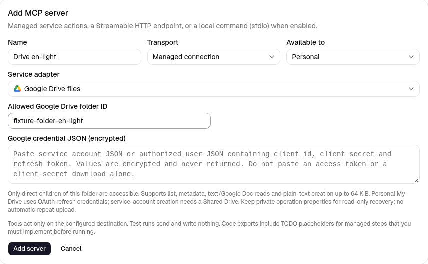

# Google Drive managed connection

Under **Settings → MCP**, add a **Managed connection → Google Drive files**.
Set one **Allowed folder ID** and paste the **Google credential JSON**. Save,
then **Discover tools** and use them from an existing MCP node or Agent slot.
No new canvas node is needed. Discovery is offline; a real call verifies the
folder and its Google permissions.



## Choose credentials

Enable the Google Drive API in your Google Cloud project. Credentials are
encrypted, never returned and blank on edit; leaving a stored value blank keeps
it. Do not put keys/tokens in workflow JSON or paste real credentials in chat.

**Personal My Drive:** use pre-provisioned OAuth credentials with offline access
and Drive permissions. The JSON format is:

```json
{
  "type": "authorized_user",
  "client_id": "YOUR_CLIENT_ID.apps.googleusercontent.com",
  "client_secret": "YOUR_CLIENT_SECRET",
  "refresh_token": "YOUR_REFRESH_TOKEN"
}
```

An access token alone or the downloaded `web`/`installed` client-secret JSON is
not enough: complete Google's consent flow with offline access first. This
adapter refreshes the existing grant at Google's fixed token endpoint; it does
not add scopes or provide an interactive consent screen. General folder reads
need an appropriate `drive.readonly` or `drive` grant; creation needs write
access such as `drive`. A narrower `drive.file` grant only sees files/folders
authorised for that app. OAuth consent/verification, testing-app token expiry
and revocation remain Google application setup. Follow Google's
[offline access guide](https://developers.google.com/identity/protocols/oauth2/web-server#offline).

**Service account:** paste the full JSON key (with `type: "service_account"`,
`client_email` and RSA private key) and grant it access to the configured folder.
Service-account calls use the Drive scope without delegated-user impersonation.
They can read accessible shared folders, but **creation requires a Shared
Drive**, detected from the folder metadata. Google service accounts have no
personal storage quota and cannot own My Drive files; sharing an ordinary
My Drive folder as editor does not remove that restriction. See
[Google's storage/ownership rules](https://developers.google.com/workspace/drive/api/guides/about-shareddrives).

For either credential type, the Google identity must be allowed to read the
folder; creation also requires permission to add children and available storage.
Shared Drive organisation restrictions still apply. Studio checks its own
personal/organisation connection policy before using the grant.

## Folder boundary and tools

Copy the folder ID from its Drive URL, not the whole URL. `root` is not accepted.
The connection grants access to **direct, non-trashed children only**. There is
no recursive search, shortcut following or arbitrary download-URL fetch.
Changing the folder invalidates old operation reconciliation; restore the
original folder before checking an old result. External moves/edits are not
locked by Studio.

| Tool | Arguments | Result |
| --- | --- | --- |
| `list_files` | Optional `name_contains`, `page_size` (1–100, default 25), `page_token` | Bounded metadata page and `next_page_token`; name search is escaped, no raw query |
| `get_file` | `file_id` | Allowed child's ID, name, MIME type, size/time/link when available |
| `read_text_file` | `file_id` | Metadata plus UTF-8 `content`; plain text types/JSON/XML or Google Doc exported as text |
| `create_text_file` | `name`, `content` | A confirmed plain-text file receipt in the configured folder |

Text reads/uploads are at most **64 KiB UTF-8**, names at most 200 characters,
search text 200, list pages 100 items and HTTP responses 64 KiB. A very large
metadata page may require a smaller page size. A whole argument object is at
most 128 KiB UTF-8 JSON. Native Google Docs export is plain text; PDFs, binary
files, updates/deletes/moves/sharing and resumable uploads are not included.
Returned file content is untrusted data. Configured credentials/access tokens
are redacted from results; response headers/raw errors are never returned.

To save a generated response, select `create_text_file`, map `name` to
`report.txt` and `content` to `{{state.answer}}`, and write the result to an object
state field such as `created`. A following `read_text_file` can use
`{{state.created.file.id}}`. For downstream confirmation, check
`state.created.outcome == "confirmed"` in the existing Code/Condition pattern.
An Agent's instructions must also require a confirmed receipt before claiming
that the file was saved.

## Creation outcomes and recovery

Studio records an intent before calling Google. Each created blob has two
private `appProperties`: a hashed operation key and a SHA-256 content checksum.
The initial receipt checks folder, MIME type, marker, content hash and Drive's
blob MD5 checksum. A lost/malformed response or worker crash may leave an
unknown outcome. Repeating the same operation or pressing **Recent operations
→ Check external result** performs only a bounded marker lookup and reads the
matching bytes to verify the stored hash; it never uploads again.

No match, multiple matches, incomplete/paginated lookup or changed file content
stays unknown. A crash before upload can therefore remain blocked even when no
file exists. Preserve the private properties, keep the original folder and use
the same Google app/account for recovery. Private properties are app-specific:
switching OAuth apps/accounts can hide them. Never start a new run merely to
bypass uncertainty; inspect the folder/provider first. Marker/hash checks are
not a universal external exactly-once guarantee. See
[Drive private file properties](https://developers.google.com/workspace/drive/api/guides/properties)
and [multipart uploads](https://developers.google.com/workspace/drive/api/guides/manage-uploads#multipart).

Confirmed operations reuse their durable result. Test/mock runs do no network,
token exchange or file creation. Standalone code export keeps managed steps as TODO placeholders that throw
until implemented with your own credentials and operation tracking outside Studio.

## Repository acceptance fixture

From `backend/`, run `.venv/bin/python -m pytest -q tests/test_managed_drive.py`.
From `frontend/`, run
`E2E_DRIVE_FIXTURE=1 npm run e2e -- managed-drive.spec.ts`.
The explicit browser fixture replaces Google HTTP only, uses synthetic OAuth
credentials and creates in-memory files. It is never the production entry point
and performs no live Drive changes. Normal browser runs skip these four fixture
variants. Backend tests cover service-account/Shared Drive and OAuth/My Drive,
export, scope violations, lost responses, crashes and read-only recovery.
