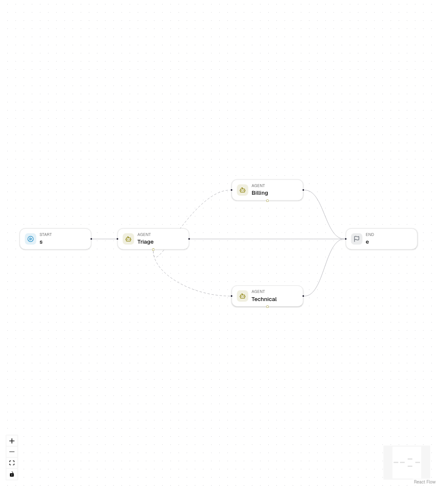

# Agent hand-offs

An Agent node can hand the conversation to another Agent node of the same
workflow. The agent that takes over sees what the person said and what the
agents answered, plus the reason for the hand-off, and answers the person
itself. Use hand-offs when each agent owns a topic, for example a help desk
with triage, billing and technical support.

## Set up a hand-off

1. Add two or more Agent nodes. Connect the first one (the entry agent) to
   Start, and each agent to where the workflow goes after it answers.
2. Select the entry agent. Under **Hand-offs** in **Settings**, choose
   **Add hand-off** and pick the target agent.
3. Describe when to hand off, for example "Duplicate charges, refunds and
   invoices". The model reads this description to decide.
4. Or drag from the dashed handle at the bottom of an Agent node to another
   Agent node. Deleting the dashed link removes the hand-off.

An agent that is reached only by hand-offs needs no incoming edge.

## What happens in a run

- The model gets one `transfer_to_<agent>` tool per target, with an optional
  `reason`.
- When it calls one, the agent stops. Other tool calls of the same round are
  not run; the model is told so.
- A **hand-off** step records who takes over and why, then the target agent
  starts with the conversation so far. Tool calls and results stay with the
  agent that made them.
- The agent that handed off does not write its output field; the target does.

## The hand-off limit

**Hand-off limit per run** (workflow setting `max_handoffs`, 0 to 20, default
5) bounds how many hand-offs one run makes. When it is reached, the transfer
tools are removed and the current agent must answer. Set it under the hand-off
list of any Agent node, or in the Config panel with nothing selected.

## In a chat

After a hand-off, the next message of the same chat session starts at the
agent that answered last, so the person keeps talking to Billing. If that
agent was deleted or is no longer a hand-off target, the chat starts at the
entry agent again. A new session always starts at the entry agent.

## Trace

The run trace and the chat steps show **Triage › hand-off** with the target
agent and the reason. The steps of the target agent follow.

## Hand-offs, supervisors and workflow tools

| Pattern | Who answers | Use it when |
| --- | --- | --- |
| Hand-off | The target agent, directly | Each agent owns a topic and talks to the person |
| Supervisor with workflow tools | The supervisor, using the results | One agent should combine what specialists found |
| Condition or Decision node | The branch's node | The route is a fixed rule, not a model's choice |

## Export

Python, the LangGraph project and TypeScript export the same steps: the
transfer tools, a `<agent>_handoff` node with a conditional edge to the target,
`MAX_HANDOFFS`, and a `start_agent` input that starts a run at a hand-off
target.

## Errors

| Code | When |
| --- | --- |
| `AGENT_HANDOFF_TARGET_INVALID` | A target is not another Agent node of this workflow, or is listed twice. |
| `AGENT_HANDOFF_LIMIT` | `max_handoffs` is not a whole number from 0 to 20. |
