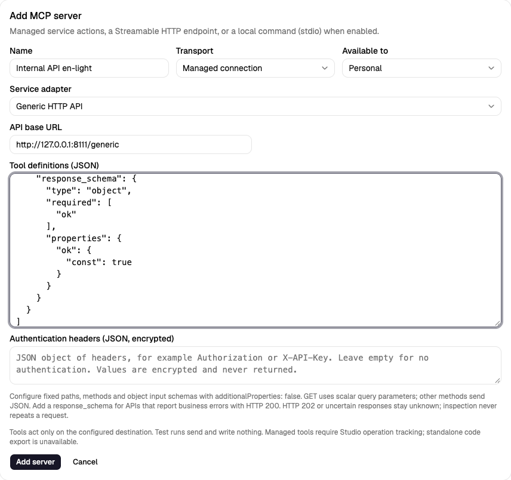
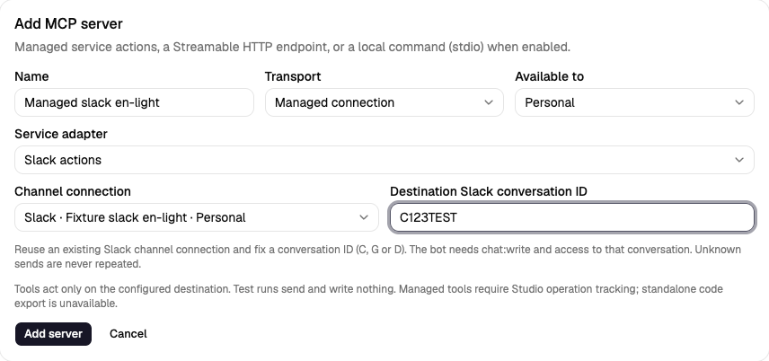
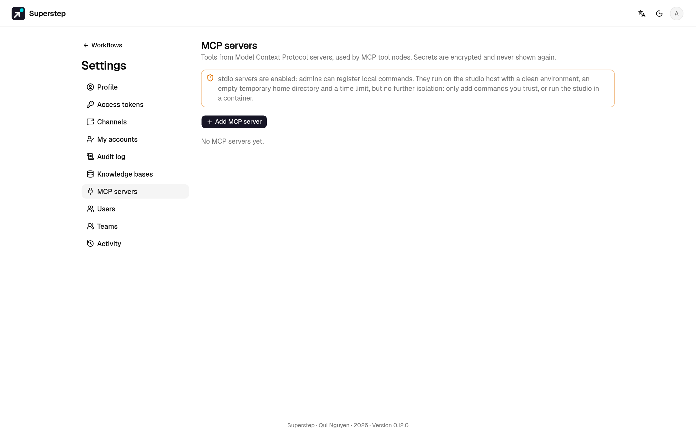

# MCP servers

## Managed connections

Under **Settings → MCP**, add a **Managed connection** and choose its service
adapter. Press **Discover tools**, then select it in the existing **MCP tool**
node or an Agent's MCP tool slot. Service-specific behavior stays in adapters;
the graph uses the same tool interface as remote MCP servers.

| Adapter | Connection settings | Tool arguments |
| --- | --- | --- |
| Telegram actions | An existing Telegram channel connection; fixed destination chat ID | `send_message`: plain `text`, optional integer `reply_to_message_id` |
| Google Sheets | Fixed spreadsheet ID and tab name; number of data columns (1–25); encrypted service-account JSON key | `append_row`: `values`, exactly the configured number of scalar values |
| Generic HTTP API | Fixed API base URL, JSON tool definitions and encrypted authentication-header JSON | Your configured tools; GET sends scalar query parameters, other methods send a JSON object |
| Slack actions | Existing Slack channel connection and fixed conversation ID (C/G/D) | `send_message`: `text`, optional `thread_ts` |
| WhatsApp actions | Existing WhatsApp channel and fixed international recipient number, digits only | `send_message`: `text` |
| Email actions | Existing email channel, fixed recipients (up to 10); studio SMTP configuration | `send_email`: `text`, optional `subject` |
| Microsoft Teams actions | Existing Teams channel with its encrypted Workflows webhook | `send_message`: `text` |

Create a [Google service account](https://developers.google.com/identity/protocols/oauth2/service-account),
enable the Sheets API and share the selected spreadsheet with its email as an
editor. Paste its JSON key in Settings. No end-user OAuth or domain-wide
delegation is needed for a directly shared sheet. Secrets are encrypted and
never returned in tool metadata/workflow JSON. Telegram reuses the channel's
secret; another user's personal channel cannot be delegated by choosing it in
an organisation MCP connection. Access and organisation policy are rechecked
at call time.

For six data columns, create headers in A–F and reserve G for the operation ID.
Do not remove or overwrite that column. The [Sheets append API](https://developers.google.com/workspace/sheets/api/reference/rest/v4/spreadsheets.values/append)
receives `RAW` values: strings stay text, including formula-looking input, and
numbers remain numbers. The extra ID allows a read-only lookup after a lost
response. Reconciliation scans at most 100,000 rows; use a new tab before that
limit. Do not share the same tab with writers that alter/remove operation IDs.

### Generic HTTP API



Choose **Generic HTTP API** under Managed connections. Set an HTTPS base URL
such as `https://api.example.com/v1`. Tool paths are fixed relative paths, not
templates; runtime arguments cannot choose the URL, method or headers. Private
addresses and plain HTTP require the explicit server-side
`STUDIO_MCP_ALLOW_PRIVATE=1` override. Each call resolves/checks its destination
and pins the connection; redirects are never followed.

Paste a JSON array into **Tool definitions**. For example:

```json
[
  {
    "name": "create_record",
    "description": "Create a record in the configured API",
    "method": "POST",
    "path": "/records",
    "input_schema": {
      "type": "object",
      "additionalProperties": false,
      "required": ["text"],
      "properties": {"text": {"type": "string", "maxLength": 4000}}
    },
    "success_statuses": [200, 201],
    "response_schema": {
      "type": "object",
      "required": ["ok"],
      "properties": {"ok": {"const": true}}
    }
  }
]
```

Methods are GET, POST, PUT, PATCH and DELETE. Input schemas must describe an
object with `additionalProperties: false`. GET properties must have scalar
types; other methods send the entire argument object as JSON. Schemas cannot
contain references. No dynamic path variables, form data or file upload is
included. Define separate fixed tools when targets differ, then **Discover
tools** and select them in an MCP node or Agent slot. Rediscover after editing.

**Authentication headers** is an optional encrypted JSON object, for example
`{"Authorization":"Bearer YOUR_API_TOKEN"}` or `{"X-API-Key":"YOUR_API_KEY"}`.
Never put credentials in the public base URL or tool definitions. Host,
transport, cookie and idempotency headers are controlled by Studio; custom
authentication cannot replace them. Saved values stay write-only. Configured
credential strings are redacted from response data; response headers and URLs
are not returned. Treat returned data as untrusted API content.

Limits: 20 tools, 32 KiB of tool JSON, 4 KiB of encrypted-header JSON, JSON
nesting 16 levels, request arguments 128 KiB and response 256 KiB. The existing
managed request timeout is 20 seconds. Only JSON responses (or an empty body)
are supported. Default successful status codes are 200, 201 and 204; configure
`success_statuses` for other completed 2xx responses. HTTP 202 remains unknown
because processing is incomplete. A malformed/oversized or response-schema-invalid
success also remains unknown. See [HTTP semantics](https://www.rfc-editor.org/rfc/rfc9110.html#name-202-accepted).

An HTTP success only confirms the configured response contract, not arbitrary
business success or delivery. Add `response_schema` when an API can report
errors with HTTP 200. The example's `ok: true` contract must match your API.
Every call sends the stable `Idempotency-Key`; remote deduplication depends on
the API's own contract. This generic adapter has no automatic external lookup:
timeout/unknown operations remain blocked and never resend, including when
**Check external result** is pressed. Inspect the external API before a new run.

### Actions using existing channels



Create the source connection in **Settings → Channels**, then select the
matching adapter under **Settings → MCP → Managed connection**. The channel
picker shows matching platform connections; credentials are reused, not copied
into another form. Owner/org access is checked again at execution. A personal
MCP connection cannot bypass organisation-channel restrictions. A deleted or
inaccessible source channel refuses the action.

- **Slack:** fix a conversation ID starting C, G or D. The bot needs
  `chat:write` and membership/access to that conversation; public posting may
  need `chat:write.public`. Text is escaped and markdown/link previews are off;
  `thread_ts` can place the message in a thread. See
  [chat.postMessage](https://docs.slack.dev/reference/methods/chat.postMessage/).
- **WhatsApp:** fix the recipient's international number without `+`. This
  adapter sends text within the customer-service window (normally 24 hours
  after the recipient's message). It does not reuse the channel's approval
  template or send approval buttons. The provider may reject delivery outside
  that window even after accepting a request. See Meta's
  [text-message contract](https://whatsapp.github.io/WhatsApp-Nodejs-SDK/api-reference/messages/text/).
- **Email:** fix up to ten unique comma-separated recipients. Uses the
  existing email channel and studio SMTP sender (`SMTP_HOST`, `SMTP_PORT`,
  `SMTP_FROM` and the existing auth/TLS options). The administrator owns those
  settings. `subject` is optional (defaults to `Superstep`); `text` is plain
  text. Header newlines are normalised. Sends share the owner's existing
  `STUDIO_EMAIL_NODE_HOURLY_LIMIT` recipient budget with Send email nodes;
  dry runs and cached results consume no additional recipients. Message-ID
  is stable for the operation; it is not a remote deduplication guarantee.
- **Teams:** choose an existing channel's Workflows webhook; that encrypted
  URL fixes the destination. Sends a text Adaptive Card without approval
  links/buttons. Acknowledgement can be HTTP 202: the specific Workflows
  contract confirms request acceptance, not downstream delivery. See
  [Teams Workflows webhooks](https://learn.microsoft.com/en-us/microsoftteams/platform/webhooks-and-connectors/how-to/add-incoming-webhook).

Text is limited to 4,000 characters; email subjects to 200. Successful results
include `delivery: "accepted"`: this confirms submission acceptance, not that
the recipient read or received it. HTTP rejection is a failure; lost responses,
malformed API success and partial/uncertain SMTP delivery stay unknown. These
adapters have no supported read-only lookup and never resend an unknown
operation, including from **Check external result**. Inspect Slack/WhatsApp,
the SMTP logs or the Teams workflow before starting a new run. This differs
from generic HTTP 202, where no completion/acceptance contract is assumed.

The signed JSON webhook channel stays inbound-only. It is an event source,
not a destination for sending messages. Existing Telegram/Sheets behavior is
unchanged; choose each connection's tools in the same MCP node/Agent interface.

For isolated browser acceptance, run from `frontend/`:
`E2E_CHANNEL_SMTP=1 npm run e2e -- managed-channel-actions.spec.ts`.
This enables only the local SMTP sink and fake channel APIs. The default
browser suite leaves studio SMTP disabled and exercises Slack/WhatsApp/Teams;
email cases require the explicit flag. Never point this fixture at live services.

### Write outcomes and recovery

Every managed write requires the workflow's stable operation key. Studio stores
an intent before calling the provider. A confirmed result is reused for the
same run/node/iteration; changed arguments or destinations are refused. MCP
nodes also participate in the existing result ledger and worker fencing.

**Recent operations** on the connection shows pending, confirmed, rejected and
unknown results, with the external operation ID. **Check external result** only
reads: Sheets can confirm a matching operation ID, but a missing row is never
permission to append again. A crash before the request can conservatively leave
an unresolved intent. Telegram cannot look up a sent message by this ID, so an
uncertain send stays blocked. Never start a new run merely to bypass an unknown
result; inspect the external service first. Restore the original destination
settings before reconciling an old operation. Rotating credentials can keep
those settings unchanged.

Only a **confirmed** write may lead to a success reply. A provider rejection or
unknown outcome stops a normal MCP node. Agent tools receive the normal tool
error; an Agent's instructions must require confirmation before claiming success.
Workflow tests and mock-model runs perform a dry run without external sends,
writes, token exchanges or intent records. HTTP/stdio MCP behavior is unchanged.
Standalone Python/TypeScript export explicitly refuses managed connections,
because their operation tracking currently requires Studio. Portable templates
contain blank resource references; bind connections after creating a workflow.

[Model Context Protocol](https://modelcontextprotocol.io) servers expose
tools. Register a server once, then call its tools from
[MCP tool](nodes.md#mcp-tool) nodes.



## Before you begin

- The `admin` or `editor` role for a personal server. Organisation servers
  and stdio commands need an admin.
- A server that speaks Streamable HTTP, or, for stdio, `STUDIO_MCP_STDIO=1`
  on the API host.

## Register a server

Open **Settings → MCP servers** and choose **Add MCP server**.

=== "Streamable HTTP"

    A URL and optional secret headers. The URL must be public; the connection
    is pinned to the checked IP. Private and loopback addresses (a sidecar
    container, for example) need `STUDIO_MCP_ALLOW_PRIVATE=1`.

=== "stdio"

    A command, its arguments (one per line) and secret environment variables, run as a child process of the API. Stdio is
    off until `STUDIO_MCP_STDIO=1`, and only an admin can register a command.
    The process gets a clean environment, an empty temporary home and
    `STUDIO_MCP_TIMEOUT` seconds (default 30), then its whole process group is
    killed.

    !!! warning
        That is not a sandbox. Run untrusted MCP servers as their own HTTP
        container instead.

**Discover tools** lists what the server offers. Scope is personal or
organisation; admins choose which roles may use organisation servers.
Secrets are encrypted, and the API returns only names and masked values.

## Call a tool

In an MCP tool node pick the server and the tool; the tool's description appears
in the config. Argument strings are
[templates](state.md#references). An argument that is exactly one reference
keeps its type. The result goes to `output_field`.

A shared workflow runs with the **owner's** MCP servers.

To let MCP clients call **your** workflows as tools, see [Workflows as MCP tools](../run/mcp-server.md).

## MCP node or Agent node

An MCP tool node calls one tool with arguments you fill in, at a fixed place
in the graph. To let a model decide whether and when to call a tool, and with
which arguments, add the tool to an [Agent node](agent.md) instead: pick the
server and the tool, and the model reads the tool's description and input
schema from the server. Only the tools you add are offered, never the server's
whole list.
