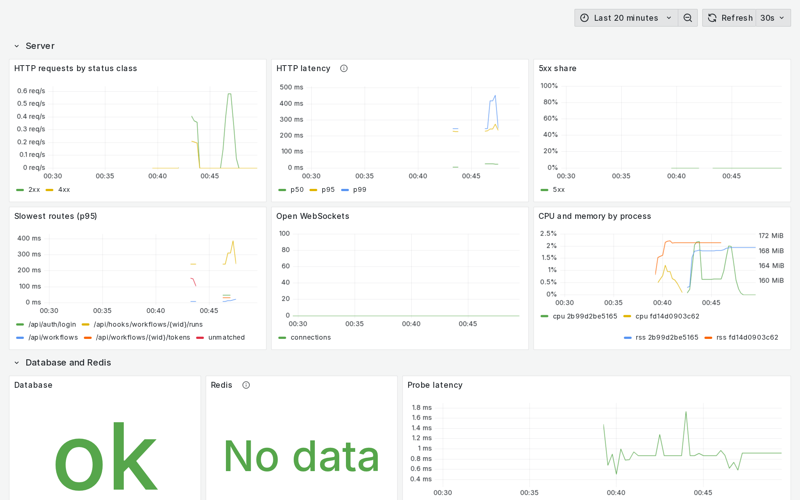
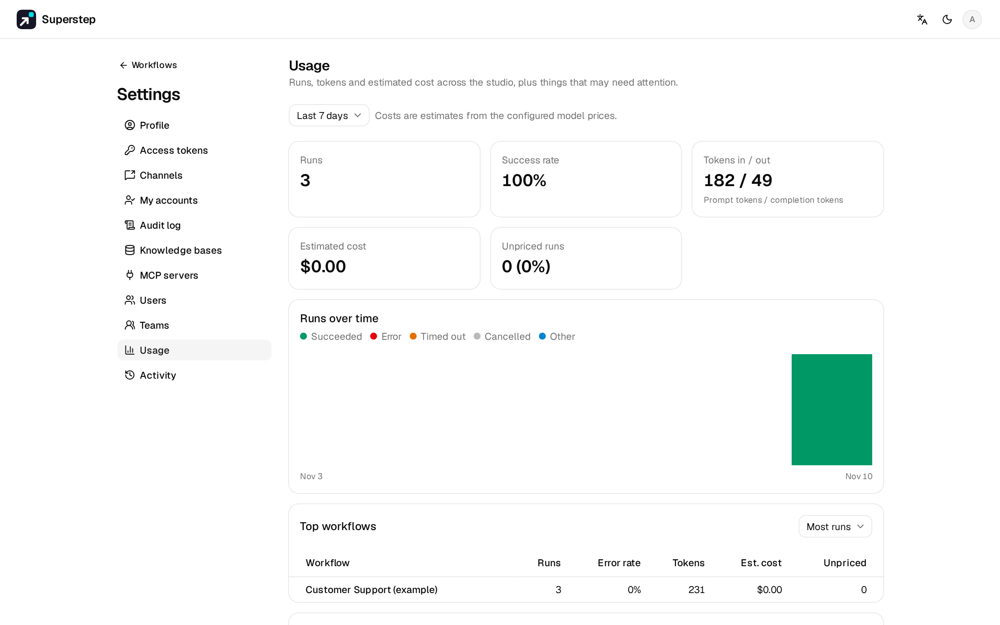

# Observability

## Health and readiness

`GET /api/health` is **liveness**: it answers 200 while the process serves
HTTP. It does not query the database. It reports `llm_mode`, `database` (the
dialect name), `run_bus` and whether the bus answers (`run_bus_ok`),
`tracing` and `import_enabled`. The `web` container answers `/healthz`.

`GET /api/ready` is **readiness**. It needs no sign-in and:

- runs `SELECT 1` on the database and pings Redis when `REDIS_URL` is set,
  each with a 2 second timeout, and reports the latency;
- reports the queue (`ready`, `delayed` and `processing` jobs, and the age
  of the oldest queued run), the live workers (busy slots, capacity and the
  age of the newest heartbeat), the run bus kind, and
  `in_memory_in_production` when production runs without Redis.

It answers 503 `SERVICE_NOT_READY` when the database fails, or when Redis is
configured and fails, with the same report in `error.details`. A queue
backlog or a missing worker never fails readiness; alert on them instead.
Neither endpoint returns a URL, host name or secret.

The Docker `HEALTHCHECK` and the Render and DigitalOcean templates keep
`/api/health`: restarting a container does not fix a dead database. Point a
load balancer or a rolling deploy at `/api/ready` when you want traffic held
back from an instance that cannot reach its database.

## Metrics

Metrics are off by default. Set `STUDIO_OTEL_METRICS=1` together with an OTLP
endpoint (`OTEL_EXPORTER_OTLP_ENDPOINT`, or
`OTEL_EXPORTER_OTLP_METRICS_ENDPOINT`) and every API and worker process pushes
OpenTelemetry metrics to it. `OTEL_METRIC_EXPORT_INTERVAL` sets how often, in
milliseconds (default 60000). The backend has no `/metrics` page of its own:
point it at an OpenTelemetry Collector, and let Prometheus or another backend
read from the collector.

Each process reports `service.name` (`OTEL_SERVICE_NAME`, default
`superstep`) and its own `service.instance.id`.

### Runs and models

| Metric | Kind | Labels | Meaning |
| --- | --- | --- | --- |
| `studio.runs` | counter | `status`, `source`, `workflow_id` | Finished runs |
| `studio.run.duration` | histogram, ms | `status`, `source`, `workflow_id` | Active run time |
| `studio.tokens` | counter | `status`, `source`, `workflow_id`, `direction` | LLM tokens per run |
| `studio.cost` | counter, USD | `status`, `source`, `workflow_id` | Estimated cost per run; runs without a price are skipped |
| `studio.errors` | counter | `status`, `source`, `workflow_id` | Error events |
| `studio.llm.tokens` | counter | `model`, `provider`, `workflow_id`, `direction` | Tokens per model call |
| `studio.llm.cost` | counter, USD | `model`, `provider`, `workflow_id` | Estimated cost of priced calls |
| `studio.llm.unpriced` | counter | `model`, `provider` | Calls to a model with no known price |
| `studio.llm.errors` | counter | `code`, `provider`, `model` | Failed model calls, by error code |
| `studio.llm.fallbacks` | counter | `primary_provider`, `fallback_provider`, `code` | Calls answered by the fallback model |
| `studio.llm.duration` | histogram, ms | `model`, `provider`, `status` | Time of one provider call; a failed primary and its fallback are two samples |
| `studio.llm.ttft` | histogram, ms | `model`, `provider`, `status` | Time to the first streamed token; streamed calls only |
| `studio.embedding.tokens` | counter | `model`, `provider`, `source` | Input tokens sent to an embedding model |
| `studio.embedding.cost` | counter, USD | `model`, `provider`, `source` | Estimated cost of priced embedding calls |
| `studio.embedding.unpriced` | counter | `model`, `provider`, `source` | Embedding calls to a model with no known price |

A provider HTTP 429 is counted as `PROVIDER_RATE_LIMITED`, apart from other
provider errors. Ad hoc runs use `workflow_id="adhoc"`. `status` on the
latency histograms is `ok` or the provider error code. Mock (offline) calls
are not measured.

Embedding `source` is `ingest` (documents added or re-indexed) or `query`
(searches, Retriever nodes and knowledge base tools of agents). The tokens of
a query embedding inside a run count in that run's input tokens and cost, and
appear on the node as `embedding_usage`; ingestion is counted in metrics only.
Prices for `text-embedding-3-small`, `text-embedding-3-large` and
`text-embedding-ada-002` are built in; add others with `STUDIO_PRICES` like
chat models. An unpriced embedding adds its tokens to the run but leaves the
run's cost as it is.

### Server

| Metric | Kind | Labels | Meaning |
| --- | --- | --- | --- |
| `studio.http.server.requests` | counter | `route`, `method`, `status_class` | HTTP requests |
| `studio.http.server.duration` | histogram, ms | `route`, `method`, `status_class` | Request time; `/api/health` and `/api/ready` are not timed |
| `studio.ws.connections` | up-down counter | none | Open WebSockets |
| `studio.process.cpu_time` | counter, s | none | CPU time of the process |
| `studio.process.rss` | gauge, bytes | none | Resident memory of the process |

`route` is the route template, such as `/api/workflows/{wid}`, never the raw
path. A request that matches no route is labelled `unmatched`.

### Database, Redis, queue and workers

| Metric | Kind | Labels | Meaning |
| --- | --- | --- | --- |
| `studio.ready.db` | gauge | none | 1 when the database probe passes, 0 when it fails |
| `studio.ready.db.latency` | gauge, ms | none | Database probe time |
| `studio.ready.redis` | gauge | none | The same for Redis; absent without `REDIS_URL` |
| `studio.ready.redis.latency` | gauge, ms | none | Redis probe time |
| `studio.queue.depth` | gauge | `state` (`ready`, `delayed`, `processing`) | Jobs in the queue |
| `studio.queue.oldest_age` | gauge, s | none | Age of the oldest queued run |
| `studio.worker.heartbeat_age` | gauge, s | none | Age of the newest worker heartbeat |
| `studio.worker.busy` | gauge | none | Busy job slots of this worker |
| `studio.worker.capacity` | gauge | none | Job slots of this worker |
| `studio.jobs.reaped` | counter | none | Jobs requeued after their lease expired |
| `studio.jobs.recovered` | counter | none | Unfinished runs requeued at start-up |
| `studio.run_bus.in_memory` | gauge | none | 1 when the process runs without `REDIS_URL` |
| `studio.db.pool.in_use` | gauge | none | Database connections checked out of this process's pool |
| `studio.db.pool.idle` | gauge | none | Idle connections in this process's pool |
| `studio.db.pool.overflow` | gauge | none | Connections beyond the pool size |

The probe gauges reuse the checks of `/api/ready`, at most once every 5
seconds per process.

### Integrations and limits

| Metric | Type | Labels | Meaning |
| --- | --- | --- | --- |
| `studio.channel.messages` | counter | `kind`, `direction`, `status` | Approval requests and chat replies sent (`out`), button presses and chat trigger messages received (`in`) |
| `studio.mcp.calls` | counter | `transport`, `status`, `code` | MCP tool calls; `code` is the error code of a failed call |
| `studio.mcp.duration` | histogram, ms | `transport`, `status`, `code` | Time of one MCP tool call |
| `studio.browser.sessions` | counter | `status` (`opened`, `closed`, `lost`, `revoked`, `expired`) | Browser sessions started and ended |
| `studio.browser.actions` | counter | `status`, `code` | Browser actions by result |
| `studio.browser.active` | gauge | none | Browser sessions open now, across all processes (reported where a worker runs) |
| `studio.sandbox.executions` | counter | `runtime`, `language`, `status` | Code node executions; `status` is `ok` or the error code |
| `studio.sandbox.duration` | histogram, ms | `runtime`, `language`, `status` | Time of one Code node execution |
| `studio.rate_limit.hits` | counter | `scope` | Requests refused by a product limit |

`kind` is the channel platform, `transport` is `stdio`, `http` or `managed`,
`runtime` is `docker`, `subprocess` or `remote`. `scope` names the limit:
`login`, `demo`, `public_chat`, `chat_trigger`, `api_trigger`,
`approval_callback`, `code`, `pat`, `email_node`, `identity_code` or `other`.
No label carries a server or connection name, a URL, a user id or the
limiter key. Provider rate limits stay in `studio.llm.errors` with
`PROVIDER_RATE_LIMITED`; the Throttling panel shows both.

### Product health

Only processes that run a worker report these (the `worker` service, or the
API when it runs the worker itself). They are refreshed at most every 30
seconds.

| Metric | Kind | Meaning |
| --- | --- | --- |
| `studio.approvals.waiting` | gauge | Human steps waiting for an answer |
| `studio.approvals.oldest_age` | gauge, s | Age of the oldest waiting human step |
| `studio.webhooks.failed` | gauge | Webhook deliveries that failed in the last hour |
| `studio.webhooks.retrying` | gauge | Webhook deliveries waiting for a retry |
| `studio.schedules.overdue` | gauge | Enabled schedules more than 5 minutes late |
| `studio.schedules.disabled` | gauge | Schedules the scheduler turned off after failures |
| `studio.chat.refused` | gauge, `code`, `kind` | Chat trigger messages refused in the last hour, by reason and platform |

### Labels and cardinality

Labels are limited to a fixed list: `status`, `source`, `workflow_id`,
`model`, `provider`, `code`, `direction`, `route`, `method`, `status_class`,
`state`, `primary_provider`, `fallback_provider`, `kind`, `transport`,
`runtime`, `language` and `scope`. Any other attribute is dropped before
export, and `kind`, `transport`, `runtime`, `language` and `scope` outside
their fixed values are exported as `other`. No metric carries a user id, run id, email, raw path
or prompt text. `workflow_id` grows with the number of workflows; drop it in
the collector if that is too many series for your backend.

## Grafana with Compose

The `observability` profile starts an OpenTelemetry Collector, Prometheus,
Grafana and Jaeger next to the studio. The backend pushes OTLP to the
collector; Prometheus scrapes the collector; the collector forwards traces to
Jaeger. The configuration lives in `deploy/observability/`.

```bash
docker compose --env-file .env --env-file deploy/observability/observability.env \
  --profile observability up --build
```

`deploy/observability/observability.env` sets
`OTEL_EXPORTER_OTLP_ENDPOINT=http://otel-collector:4318`,
`STUDIO_OTEL_METRICS=1`, a 15 second export interval, the Jaeger
`STUDIO_TRACE_URL` and `STUDIO_GRAFANA_URL=http://localhost:3000`.

| Service | Address |
| --- | --- |
| Grafana | `http://localhost:3000` (only on 127.0.0.1; `GRAFANA_PORT`) |
| Jaeger | `http://localhost:16686` |
| Prometheus, collector | inside the Compose network only |

Grafana signs in as `admin` with `GRAFANA_ADMIN_PASSWORD`, which defaults to
`admin`. Set your own password in `.env` before you expose Grafana anywhere.
`PROMETHEUS_RETENTION` (default `31d`) sets how long Prometheus keeps data. Keep at least 30 days of samples for the 30-day SLO.

The **Superstep overview** dashboard in the **Superstep** folder has these
rows:

| Row | Panels |
| --- | --- |
| Server | Requests, latency, 5xx share, slowest routes, WebSockets, CPU and memory |
| Database and Redis | Readiness, the app's connection pool, Postgres connections, transactions, cache hit ratio and size, Redis memory, clients, operations and keys |
| Queue and workers | Queue depth and oldest run, workers, heartbeats, the run bus |
| Runs and models | Runs by status, error rate, duration, tokens and cost by model and workflow, unpriced calls, model errors, fallbacks, model latency and time to first token, embedding tokens and cost |
| Integrations and limits | Channel messages, MCP calls, browser sessions and actions, sandbox executions, limit hits by scope |
| Product health | Approvals, webhooks, schedules and refused chat trigger messages |



In Prometheus the names have underscores and no unit suffix:
`studio.http.server.requests` becomes `studio_http_server_requests`, and the
collector sets the `job` (service name) and `instance` (instance id) labels.

### Postgres and Redis servers

The collector also reads the Postgres and Redis servers of the Compose stack
itself, with its `postgresql`, `sqlquery` and `redis` receivers, so
Prometheus still scrapes only the collector. The dashboard shows Postgres
connections by state against `max_connections`, commits, rollbacks and
deadlocks, the cache hit ratio and the database size, and Redis memory
against `maxmemory`, clients, operations per second, evictions and keys.
Without Redis those panels stay empty.

The collector signs in to Postgres with a read-only role in `pg_monitor`
(statistics views, no table data). Set `POSTGRES_MONITOR_PASSWORD` (and
optionally `POSTGRES_MONITOR_USER`, default `superstep_monitor`) in `.env`;
the one-shot `postgres-monitor` service creates or updates the role on each
`up`. With an empty password no role is created and the Postgres panels
stay empty. For a managed database, create the role yourself:

```sql
CREATE ROLE superstep_monitor LOGIN PASSWORD 'choose-a-password';
GRANT pg_monitor TO superstep_monitor;
```

## Alerts

The profile provisions these Grafana alert rules in the **Superstep** folder.
Thresholds are at the top of
`deploy/observability/grafana/provisioning/alerting/rules.yaml`, under
`x-thresholds`; edit them and restart Grafana. Add a contact point in Grafana
to get notified.

| Alert | Fires when | Default |
| --- | --- | --- |
| Instance down | No process reports metrics: the collector drops a silent process after 5 minutes, then the rule waits 5 more | |
| Database down | `studio.ready.db` is 0 for 1 minute | |
| Redis down | `studio.ready.redis` is 0 for 1 minute | |
| HTTP 5xx share | Share of 5xx responses over 5 minutes | above 5% for 5 minutes |
| Queue backlog (depth) | Ready jobs in the queue | above 100 for 5 minutes |
| Queue backlog (oldest run) | `studio.queue.oldest_age` | above 300 s for 5 minutes |
| Worker missing | `studio.worker.heartbeat_age`, or no heartbeat at all | above 60 s for 2 minutes |
| Run error rate | Runs ending in error or timeout over 15 minutes | above 20% for 15 minutes |
| Provider auth or unreachable | `studio.llm.errors` with `PROVIDER_AUTH_FAILED` or `PROVIDER_UNREACHABLE` | any for 5 minutes |
| Provider rate limited | `studio.llm.errors` with `PROVIDER_RATE_LIMITED` (warning) | any for 5 minutes |
| Slow provider | p95 of `studio.llm.duration` for any provider over 10 minutes | above 30 seconds for 10 minutes |
| Daily cost | Increase of `studio.cost` over 24 hours | above 50 USD |
| Overdue schedules | `studio.schedules.overdue` | above 0 for 10 minutes |
| Webhook failures | `studio.webhooks.failed` (last hour) | above 0 |
| Approvals waiting too long | `studio.approvals.oldest_age` | above 1 day |
| Integration errors | Failed MCP calls, channel sends and browser actions over 15 minutes | above 10 for 15 minutes |
| Throttling spike | `studio.rate_limit.hits` over 5 minutes | above 50 for 5 minutes |
| Channel refusals | `studio.chat.refused` (last hour, all codes) | above 20 for 10 minutes |
| In-memory run bus | `studio.run_bus.in_memory` | 1 for 5 minutes |
| Postgres connections near limit | Postgres connections over `max_connections` | above 80% for 5 minutes |
| Redis memory pressure | Redis used memory over `maxmemory`, only when `maxmemory` is set | above 90% for 5 minutes |
| Fast SLO burn | Both the 5-minute and 1-hour burn rates exceed 14.4×. |
| Slow SLO burn | Both the 30-minute and 6-hour burn rates exceed 6×. |

The daily cost covers priced runs only; the dashboard shows unpriced calls
next to it. Without Redis, the in-memory bus alert fires on purpose: use
`REDIS_URL` when you run more than one process.

## Usage page

**Settings → Usage** shows how the studio is used without Grafana. Only
people with the `users.manage` permission (admins) see it.



- Pick the last 24 hours, 7 days or 30 days.
- Cards: runs, success rate, tokens in and out, estimated cost and unpriced
  runs.
- Runs over time, stacked by status, and the top 10 workflows by runs or by
  cost. A deleted workflow shows its id.
- **Models**: calls, errors, tokens, average call time and estimated cost per
  model and provider, split into nodes, embeddings and AI review. Sort by
  cost, tokens or calls.
- **Users** and **Teams**: the top 20 by runs or by cost (the same choice as
  the workflows), with a total row. A deleted user shows as "Deleted user". A
  member of several teams counts toward each team, and the page says how many
  such users there are.
- **Product health**: waiting and expired approvals, failed and retrying
  webhook deliveries, overdue schedules and schedules the scheduler stopped,
  with the reason, and chat trigger messages refused by reason and platform
  with their share of all decided messages.

Only top-level runs are counted; a subworkflow's tokens and cost are part of
the run that called it. Cost is an estimate from the model price list. A run
that used a model with no price counts as unpriced and adds nothing to the
cost, and the cost card then reads "at least". Add the missing prices with
`STUDIO_PRICES` or `STUDIO_PRICES_FILE` (see
[Configuration](../reference/configuration.md)).

The Models table reads a per-run usage table that is written when a run
ends. Each run writes only its own calls, so subworkflow runs appear there
too and its totals can be higher than the cards. Per-model data starts when
the table was created; the page shows that date. To fill it for runs that
finished before, run once:

```bash
docker compose exec api python -m app.admin_cmd usage-backfill --days 30
```

The command prints how many runs and rows it wrote; running it again does
not duplicate rows. Per-user and per-team figures come from the database
only; no metric carries a user or team id.

When `STUDIO_GRAFANA_URL` is set, the page links to Grafana for server,
database and queue health. The same data is available from
`GET /api/admin/usage` and `GET /api/admin/usage/health`.

## Traces

OpenTelemetry emits one trace per run and one span per node, with
`gen_ai.usage.*` attributes and the cost. With no exporter configured,
tracing is a no-op. Spans go out as each node finishes; a waiting
human-in-the-loop run is traced when it ends.

| Destination | Variables |
| --- | --- |
| OTLP (Jaeger, Tempo, a collector) | `OTEL_EXPORTER_OTLP_ENDPOINT` and the standard `OTEL_*` variables (`OTEL_EXPORTER_OTLP_HEADERS`, `OTEL_SERVICE_NAME`) |
| LangSmith | `LANGSMITH_API_KEY` and `LANGSMITH_TRACING=true`, plus optional `LANGSMITH_PROJECT` and `LANGSMITH_ENDPOINT` |
| **Open trace** link in the UI | `STUDIO_TRACE_URL`, for example `http://localhost:16686/trace/{trace_id}` |

When runs are traced to LangSmith and `STUDIO_TRACE_URL` is not set, **Open
trace** opens the run in LangSmith. Test results can go to LangSmith too: see
[Workflow tests](../run/tests.md#send-results-to-langsmith).

When Studio's LangSmith exporter is on, LangChain's own LangSmith tracer is
turned off, so each LLM call is exported once.

### Requests, SQL and Redis

With an OTLP endpoint and `STUDIO_OTEL_INSTRUMENT=1`, the API also traces
each HTTP request (`GET /api/workflows/{workflow_id}`, by route template, with
the status code) and the SQL queries and Redis calls made while it is served.
SQL spans carry the statement shape without parameter values. A request that
starts a run links the run's trace to the request span, and SQL and Redis
calls made by a run appear in the run's trace. An incoming
`traceparent` header is honoured. Health and readiness checks are not traced.
Instrumentation adds a little overhead per request, so it stays off by
default.

## Jaeger with Compose

```bash
# in .env
OTEL_EXPORTER_OTLP_ENDPOINT=http://jaeger:4318
STUDIO_TRACE_URL=http://localhost:16686/trace/{trace_id}
```

```bash
docker compose --profile tracing up --build   # Jaeger UI: http://localhost:16686
```

Without Compose:

```bash
docker run -p 16686:16686 -p 4318:4318 jaegertracing/all-in-one
```

and point the backend at `http://localhost:4318`.

## Logs

The API logs to stdout. Errors in events are one line, with `sk-…`,
`Bearer …` and `api_key=…` redacted, and `?token=` shows as `token=***` in
uvicorn's access log.

Every response carries an `X-Request-ID` header; a valid incoming one is
kept. With `STUDIO_LOG_FORMAT=json` the API and the worker write one JSON
object per line, including uvicorn's access log:

```json
{"ts": "2026-11-10T08:15:02.120Z", "level": "INFO", "logger": "studio.runs", "message": "run finished", "request_id": "5f0c…", "run_id": "a1b2c3d4e5", "workflow_id": "support-triage", "trace_id": "4bf9…", "span_id": "00f0…"}
```

Only the ids that are known are written. Search the logs for a `run_id` to
see everything about one run, or for a `trace_id` to jump between the logs
and Jaeger or Tempo. `STUDIO_LOG_LEVEL` (for example `DEBUG`) sets the level
of Superstep's own loggers. The default `text` format is unchanged.

## Time zones for schedules

The backend ships the `tzdata` package, so schedules accept every IANA time
zone a browser reports, such as `Asia/Saigon`, even on images without system
zone data. A schedule whose zone still cannot be resolved is turned off with
a note; it shows under **Product health** and in `studio.schedules.disabled`.

## Monthly budgets

In **Settings → Usage**, administrators can set a monthly USD budget for a user or team. Spend comes from priced model-usage rows for runs completed this calendar month. An unpriced-row count shows when known spend is a lower bound. Team spend follows current membership. Set `STUDIO_TIMEZONE` to an IANA zone to choose the calendar boundaries. The default is UTC.

New recorded usage triggers a warning at 80% and 100%, once per threshold per budget each month. A user budget notifies the user. A team budget notifies its active members. The existing notification preferences apply and workflows continue at every spend level.

## Service level objectives

The rolling 30-day defaults are 99% run success and 99.5% API availability. Run success counts runs that complete successfully, fail, time out or expire. API availability counts responses below HTTP 500 and excludes health and readiness probes. The error budget is the allowed error fraction, and the remaining budget is its unused share.

Set `STUDIO_SLO_RUN_SUCCESS` and `STUDIO_SLO_API_AVAILABILITY` as fractions greater than zero and less than one. Restart the API and Prometheus together so the Usage card and Grafana use the same targets. Usage reads run success from the database. Grafana shows both objectives and their burn rates.

To exercise the fast alert on a local stack, sustain 20% failed runs for over an hour using an isolated workload. At the 99% target, both the short and long windows reach about 20× burn. Inspect the rule in Grafana and allow one evaluation interval for it to fire.
