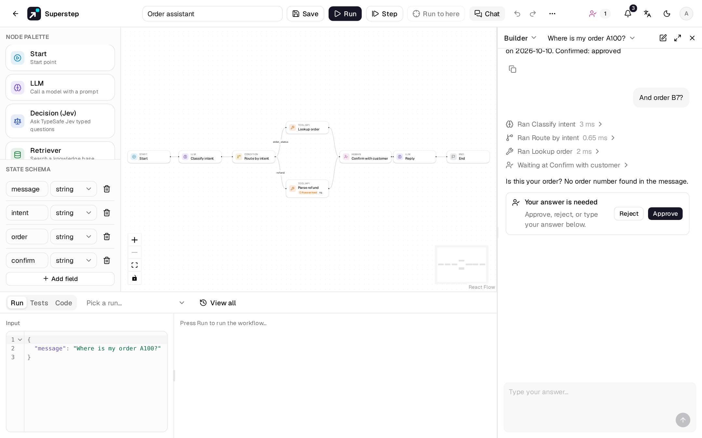
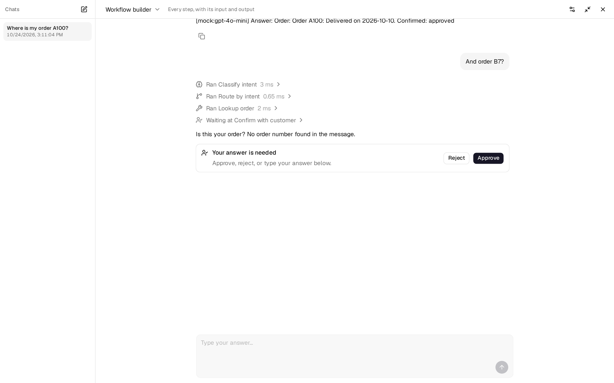
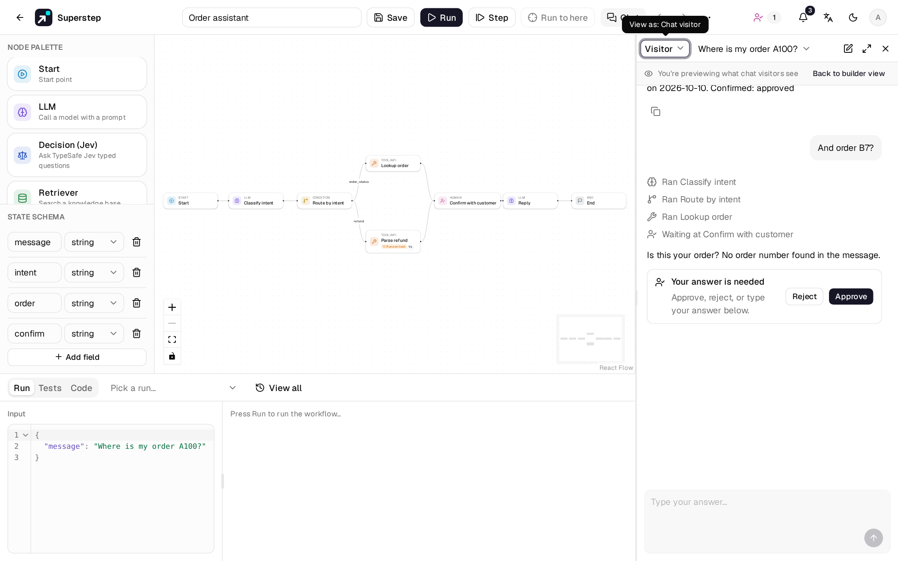
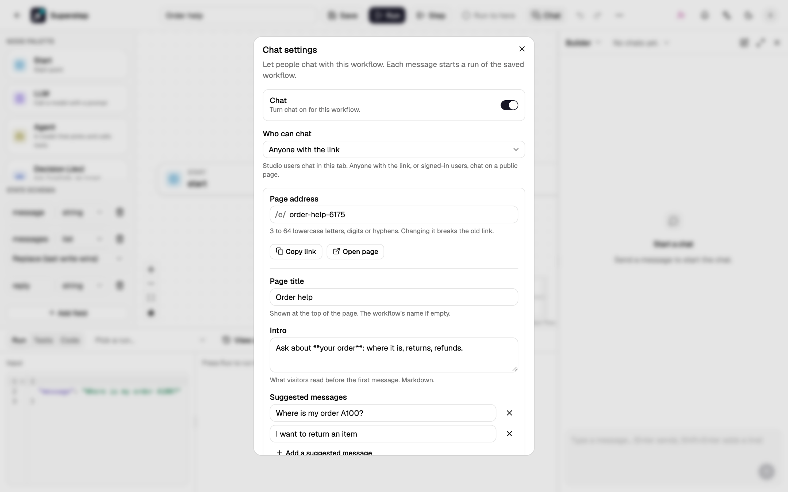
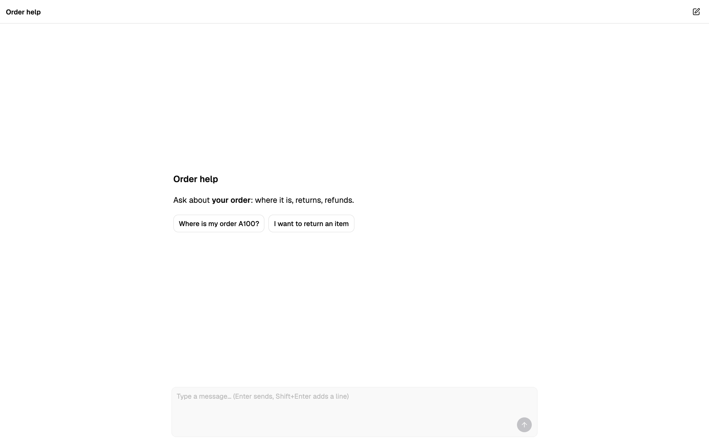
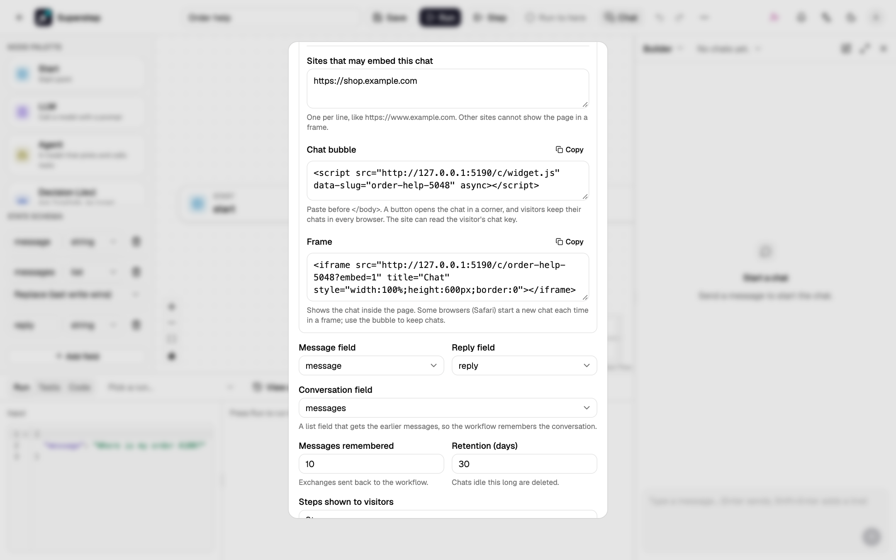

# Chat

The **Chat** panel at the right of the editor lets you talk to a workflow the way
a person chatting with it would. Each message starts a run of the **saved**
workflow; the steps and the reply stream in as it runs, and the conversation is
kept so the workflow can remember it.



## Open the panel

- **Chat** in the top bar, or ++shift+c++ on the canvas, opens and closes the
  panel. It stays open, at the width you dragged it to (340–760 px), the next
  time you open the editor in this browser.
- **Config** stays beside it, so you can change a node and try it again at once.
- **Fullscreen** (the arrows) shows the chat over the whole window, with the list
  of your chats on the left. ++esc++ goes back; the conversation and what you
  were typing stay.
- In the narrow panel, pick an earlier chat from the session picker next to
  **View as**, or start one with the **New chat** button (the pen icon).



To let people outside the studio chat with the workflow, [publish the chat](#publish-a-chat)
on a page of its own, and [embed it](#embed-the-chat-on-your-site) on your site if you like.

## Turn chat on

1. Open the workflow and choose **⋯ → Chat settings**, or the gear in the Chat
   panel. You need owner access to change them (its owner, or an admin).
2. Turn **Chat** on and check the fields:
    - **Message field**: the state field that gets each message (`string` or `list`).
    - **Reply field**: the state field shown as the answer.
    - **Conversation field**: a `list` field that gets the earlier messages (see
      [Memory](#memory)). Choose **None** for a chat without memory.
3. Save. Saving checks that the fields exist in the workflow's state.


| Setting | What it does | Default |
|---|---|---|
| Who can chat | **Studio users** chat in this panel. **Anyone with the link** or **Signed-in users** also [publish the chat](#publish-a-chat) on a public page. | Studio users |
| Messages remembered | How many earlier exchanges (one message and its answer) go to the conversation field. | 10 |
| Steps shown to visitors | **None**, **Step names** or **Full** (with each step's input and output). | Step names |
| Retention (days) | Chats with no new message for this long are deleted. | 30 |

## Chat

Type a message and press ++enter++ (++shift+enter++ adds a line). Answers are
Markdown: lists, tables, links and code blocks show formatted; raw HTML and
images from other sites are not shown, and links open in a new tab.

- **New chat** starts a conversation without memory. Your earlier chats stay in
  the list, newest first, named after their first message.
- **View as** at the top switches the view. *Workflow builder* shows every step
  with its full input and output (click a step to open it); *Chat visitor*
  previews exactly what visitors see on the public chat: what **Steps shown to
  visitors** allows. In a narrow panel the switch shows a short **Builder** or
  **Visitor** label and also holds **Chat settings**; while you preview as a
  visitor, a strip above the thread says so, with **Back to builder view**.


- Each message is a run in the run history (**Run → View all**) with the *Chat*
  badge, so you can open its full trace there.
- Chat uses the saved workflow: save your changes before you try them.

## Memory

With a conversation field set, each run gets the last *n* exchanges plus the
new message in that field, as a list of `{"role": "user" | "assistant",
"content": "…"}` items. Use it in a prompt, for example:

```text
Conversation so far:
{{state.messages}}

Answer the last user message.
```

## Human nodes in a chat

A Human node's **Answered by** option decides who answers it when the workflow
runs from a chat:

- **The person chatting** (default): the question appears in the chat with
  **Approve** and **Reject**; or type your answer in the message box. The answer goes to the node's
  output field and the run goes on.
- **A reviewer**: the chat says it is waiting for approval, and the question
  goes to the [Approvals](human-approval.md) page (and its channels) as usual.
  The chat shows the answer once the run goes on.

An [Agent node](../guide/agent.md#approval-before-a-tool)'s tool approvals are
always a reviewer's: the person chatting does not approve the agent's own
actions.

A new message cannot be sent while the chat waits for an answer. The node's
[deadline](human-approval.md#deadlines) applies in both cases; when it passes,
its timeout action decides what happens.

## Publish a chat

Set **Who can chat** to **Anyone with the link** or **Signed-in users**, and keep
**Chat** on. The chat now has a page of its own at `/c/<address>`, where people
who never open the studio can talk to the workflow.



| Setting | What it does | Default |
|---|---|---|
| Page address | The `<address>` in `/c/<address>`: 3 to 64 lowercase letters, digits or hyphens, not used by another chat. Changing it breaks the old link. | the workflow's id |
| Page title | Shown at the top of the page. | the workflow's name |
| Logo | A PNG, JPEG or WebP image of up to 256 KB. **Upload logo** picks it; **Save** stores it. It shows at the top of the page, over the intro and in the browser tab. | the title's first letter, and a picture over the intro |
| Intro | What visitors read before their first message. Markdown. | empty |
| Suggested messages | Up to 4 buttons a visitor can click to start. | none |
| Messages per day | Visitor messages per day (UTC) for this chat, so a busy or abused page cannot run up your model bill. `0` means no cap. | 500 |

**Copy link** and **Open page** appear once the chat is published.



On the page:

- **Anyone with the link**: a visitor needs no account. The browser keeps a
  private cookie for this chat, so the visitor finds their earlier chats when
  they come back, and nobody else can read them.
- **Signed-in users**: any account of this studio can chat, also one that may
  not open the workflow. A visitor who is not signed in goes to the sign-in page
  and comes back to the chat.
- Each message runs the saved workflow as its **owner**: with the owner's
  credentials, knowledge bases and MCP servers, as Slack and Telegram chats do.
  The runs are in the workflow's History.
- The page shows what **Steps shown to visitors** allows. It never shows the
  workflow, its state or who owns it.
- [Human nodes](#human-nodes-in-a-chat) work as in the panel: the visitor
  answers questions for **The person chatting**, and waits for a reviewer
  otherwise.
- The page follows the visitor's language (English or Vietnamese) and light or
  dark setting.

**Limits.** Besides the chat's messages per day, the server limits each visitor
and each IP address (10 and 30 messages a minute by default). A visitor over a
limit is told when to try again, and no run starts. Operators change the limits
with the `STUDIO_PUBLIC_CHAT_RATE_*` settings (see
[Configuration](../reference/configuration.md)). The public demo publishes no
chats.

To take the page down, set **Who can chat** back to **Studio users** or turn
**Chat** off. The page then says the chat is not available.

### Visitor chats

When the chat is published, the panel gets a **Visitors** list (in the narrow
panel, a group in the session picker). It shows each visitor's chat read-only,
with every step, until **Retention** deletes it. It shows no names or visitor
ids. Visitors are not told that chats are kept, so say so in the intro if it
matters.

Under each finished answer, the visitor can mark it helpful or not. A "not
helpful" mark can include a short note about what went wrong. They can change
the mark or remove it. The same controls are on the embedded chat, because
that is this page.

In the Chat tab the builder sees the mark and the note on the answer. **Thumbs
down** in the Visitors list keeps only the chats that have one. A line above
the conversation shows how many marks were up, how many were down, and the
share of down, over the last 7 days and the last 30 days. **Save as test
case** on a rated answer opens a draft test of that run. When LangSmith
tracing is on, the mark is also sent to that run's trace as feedback named
`user_rating`.

## Embed the chat on your site

A chat open to **Anyone with the link** can also appear on another site.

1. Add the site under **Sites that may embed this chat**, one per line, like
   `https://www.example.com` (`http://localhost:<port>` also works, for testing).
   Other sites cannot show the page in a frame.
2. Copy one of the two snippets that appear:
    - **Chat bubble**: paste it before `</body>`. A round button in the corner
      opens the chat. Visitors keep their chats on that site in every browser.
    - **Frame**: shows the chat inside the page, where you put it. Some browsers
      (Safari) clear what a frame stores, so a visitor may start afresh on each
      visit; use the bubble to keep chats.



```html
<script src="https://studio.example.com/c/widget.js" data-slug="order-help" async></script>
```

The bubble takes `data-position="left"` to sit on the left, and
`data-open="true"` to start open. It keeps the visitor's chat key in the site's
own storage, so scripts on that site can read it and open that visitor's chats:
embed the bubble only on sites you trust with them.

The rest of the studio cannot be shown in a frame on any site.

## Errors

| Code | Meaning |
|---|---|
| `CHAT_NOT_ENABLED` | Chat is off for this workflow. |
| `CHAT_SETTINGS_INVALID` | A setting is wrong; `field` names it. |
| `CHAT_SESSION_NOT_FOUND` | The chat does not exist, or is not yours. |
| `CHAT_MESSAGE_EMPTY` / `CHAT_MESSAGE_TOO_LONG` | The message is empty, or over 4000 characters. |
| `CHAT_RUN_WAITING` | The chat waits for a Human node's answer. |
| `CHAT_ANSWER_BY_REVIEWER` | A reviewer answers this step, in Approvals. |
| `CHAT_NOT_PUBLISHED` | The public page is off, or its address changed. |
| `CHAT_SLUG_INVALID` / `CHAT_SLUG_TAKEN` | The page address has the wrong form, or another chat uses it. |
| `CHAT_SIGN_IN_REQUIRED` | The chat is for signed-in users. |
| `CHAT_DAILY_LIMIT` | The chat has used its messages for today. |
| `CHAT_EMBED_ORIGIN_INVALID` | An embed site is not an address like `https://example.com`. |
| `CHAT_LOGO_INVALID` | The logo is not a PNG, JPEG or WebP image, or it is over 256 KB. SVG is not accepted. |
| `RATE_LIMITED` | Too many messages from this visitor or address; `retry_after` says when to try again. |

See also [Chat triggers](chat-triggers.md) for Slack and Telegram.
