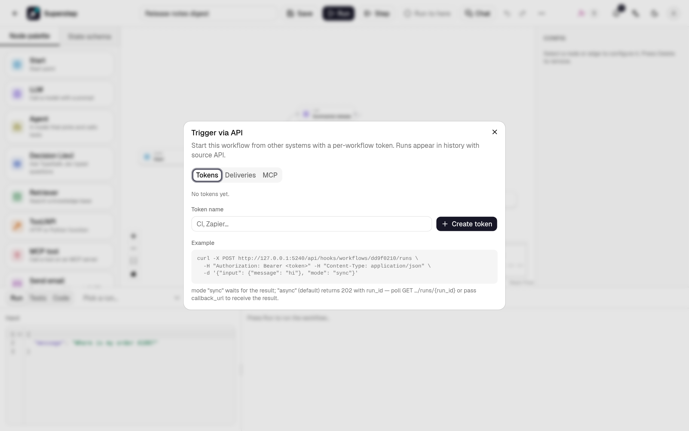

# Public API and SDKs

For the published chat's HTTP and streaming API, see [Chat API](chat-api.md)
and [Third-party authentication](chat-third-party-auth.md). The SDK helpers
below cover workflow runs and headless chat. Chat support is available in the
repository ahead of the next owner-approved package release.

Other services start a workflow over HTTP with a **workflow token**, then poll
for the result. The same token manages that workflow's schedules. This page
covers those public endpoints, the official Python and TypeScript SDKs, and
the errors to handle. For callbacks, signatures and deliveries, see
[API triggers and webhooks](api-triggers.md). Every field is in the
[Public API reference](../reference/public-api.md).

## Concepts

| Term | Meaning |
| --- | --- |
| Workflow token | A secret `wft_...` for **one** workflow. Send it as `X-Workflow-Token: wft_...` or `Authorization: Bearer wft_...`. It starts runs and manages schedules of that workflow. It also works with the [LangGraph-compatible API](agent-server-api.md) and the [MCP server](mcp-server.md) of the same workflow. |
| Run | One execution of the workflow's latest saved version. `input` is its initial state. |
| Status | `queued` and `running` while it goes; then `ok`, `error`, `cancelled`, `timeout`, `waiting` (paused at a Human node) or `expired`. |
| Envelope | Every response is `{"success", "data", "error"}`. On failure `error.code` is a stable code; `error.message` is English for logs. |

| Method and path | Operation | Purpose |
| --- | --- | --- |
| `POST /api/hooks/workflows/{wid}/runs` | `startRun` | Start a run. `202` with `poll_url` and a `Location` header, or `200` with the result in `sync` mode. |
| `GET /api/hooks/workflows/{wid}/runs/{run_id}` | `getRun` | Status and, once finished, `final_state`, `error`, `metrics`. |
| `GET /api/hooks/workflows/{wid}/schedules` | `listSchedules` | Schedules of this workflow. |
| `POST /api/hooks/workflows/{wid}/schedules` | `createSchedule` | Create a cron schedule. `201` with the schedule. |
| `PATCH /api/hooks/workflows/{wid}/schedules/{sid}` | `updateSchedule` | Change the fields you send. |
| `DELETE /api/hooks/workflows/{wid}/schedules/{sid}` | `deleteSchedule` | Delete one schedule. `data` is `{"ok": true}`. |
| `POST /api/hooks/workflows/{wid}/schedules/preview` | `previewSchedule` | Next fire times of an expression. Nothing is stored. |

## Create a token

1. Open the workflow in the editor and save it.
2. Open **⋯ → API**, enter a name and select **Create token**.
3. Copy the token (`wft_...`) and the signing secret (`whsec_...`). Each is
   shown once; store them in your secret manager.



Only the workflow's owner, or an admin, can create tokens. Revoke a token in
the same dialog; requests with it then fail with `401 TRIGGER_TOKEN_INVALID`.
The workflow id (`wid`) is the last part of the editor URL.

## Start a run

=== "curl"

    ```bash
    curl -i -X POST "$SUPERSTEP_BASE_URL/api/hooks/workflows/$WID/runs" \
      -H "X-Workflow-Token: $SUPERSTEP_TOKEN" \
      -H "Content-Type: application/json" \
      -d '{"input": {"message": "where is my order A100"}}'
    ```

=== "Python"

    ```python
    from superstep import Client

    client = Client(workflow_id="example", token="wft_...", base_url="https://superstep.example.com")
    started = client.run({"message": "where is my order A100"})
    print(started.run_id, started.status)  # ... queued
    ```

=== "TypeScript"

    ```ts
    import { Superstep } from '@superstep/sdk'

    const client = new Superstep({ workflowId: 'example', token: 'wft_...', baseUrl: 'https://superstep.example.com' })
    const started = await client.run({ message: 'where is my order A100' })
    console.log(started.run_id, started.status) // ... queued
    ```

The answer is `202 Accepted`:

```json
{
  "success": true,
  "data": {"run_id": "3f9c2a1b7d", "status": "queued",
           "poll_url": "https://superstep.example.com/api/hooks/workflows/example/runs/3f9c2a1b7d"},
  "error": null
}
```

| Body field | Meaning |
| --- | --- |
| `input` | The initial state, a JSON object (default `{}`). |
| `mode` | `async` (default) answers at once. `sync` waits up to `STUDIO_SYNC_WAIT_MAX` seconds (default 30) and answers `200` with the result; a run still going then answers `202` with the current result and `poll_url`. |
| `callback_url` | Optional public URL that receives the result when the run ends. See [Verify callbacks](api-triggers.md#verify-callbacks). |

## Poll for the result

=== "curl"

    ```bash
    curl "$SUPERSTEP_BASE_URL/api/hooks/workflows/$WID/runs/3f9c2a1b7d" \
      -H "Authorization: Bearer $SUPERSTEP_TOKEN"
    ```

=== "Python"

    ```python
    run = client.get_run(started.run_id)
    if run.done:
        print(run.status, run.final_state)
    ```

=== "TypeScript"

    ```ts
    import { isDone } from '@superstep/sdk'

    const run = await client.getRun(started.run_id)
    if (isDone(run)) console.log(run.status, run.final_state)
    ```

```json
{
  "success": true,
  "data": {
    "run_id": "3f9c2a1b7d", "workflow_id": "example", "status": "ok", "source": "api",
    "final_state": {"intent": "order_status"}, "error": null, "waiting": null,
    "metrics": {"duration_ms": 412.0, "tokens_in": 0, "tokens_out": 0, "cost_usd": 0.0, "error_count": 0},
    "trace_url": null, "started": 1761292800.0, "ended": 1761292800.4
  },
  "error": null
}
```

Poll every second or two and back off for long runs; polling is not rate
limited. A run that ends in `error` carries the failing node's error in
`error`; one in `waiting` names the Human node and its prompt in `waiting`.
A run waiting for a [workflow tool](../guide/agent.md#workflows-as-tools)'s
child run has `waiting.child_run_id` instead, and a child run has
`parent_run_id`.

## Run and wait

`run_and_wait` (Python) and `runAndWait` (TypeScript) start a run and poll
until it is done. The poll interval starts at 1 s and grows by 1.5 times up to
10 s. They return the run whatever its final status, so check `status`; after
`timeout` they raise `WaitTimeoutError` carrying the last state.

=== "Python"

    ```python
    from superstep import Client, WaitTimeoutError

    client = Client()  # SUPERSTEP_WORKFLOW_ID, SUPERSTEP_TOKEN, SUPERSTEP_BASE_URL
    try:
        run = client.run_and_wait({"message": "hi"}, timeout=120, poll_interval=0.5)
    except WaitTimeoutError as err:
        print("still", err.run.status)
    else:
        print(run.status, run.final_state)
    ```

    `AsyncClient` has the same methods as coroutines:

    ```python
    from superstep import AsyncClient

    async with AsyncClient() as client:
        run = await client.run_and_wait({"message": "hi"})
    ```

=== "TypeScript"

    ```ts
    import { Superstep } from '@superstep/sdk'

    const client = new Superstep() // SUPERSTEP_WORKFLOW_ID, SUPERSTEP_TOKEN, SUPERSTEP_BASE_URL
    const run = await client.runAndWait(
      { message: 'hi' },
      { timeoutMs: 120_000, pollIntervalMs: 500, signal: AbortSignal.timeout(130_000) },
    )
    console.log(run.status, run.final_state)
    ```

=== "curl"

    ```bash
    # Let the server wait (up to STUDIO_SYNC_WAIT_MAX seconds).
    curl -X POST "$SUPERSTEP_BASE_URL/api/hooks/workflows/$WID/runs" \
      -H "X-Workflow-Token: $SUPERSTEP_TOKEN" -H "Content-Type: application/json" \
      -d '{"input": {"message": "hi"}, "mode": "sync"}'
    ```

## Install the SDKs

| Language | Install | Source |
| --- | --- | --- |
| Python 3.9+ | `pip install superstep` | [`sdk/python`](https://github.com/quinguyen1502/superstep/tree/develop/sdk/python) |
| TypeScript, Node 18+ | `npm install @superstep/sdk` | [`sdk/typescript`](https://github.com/quinguyen1502/superstep/tree/develop/sdk/typescript) |

Both read `SUPERSTEP_BASE_URL`, `SUPERSTEP_TOKEN` and `SUPERSTEP_WORKFLOW_ID`
when an option is not passed. Until the first release, install them from a
checkout: `pip install ./sdk/python`, or `npm install ./sdk/typescript`.

## Headless chat

Use `new Superstep({baseUrl}).chat(slug, {getToken})` in TypeScript, or
`Client(base_url=...).chat(slug, token=...)` / `AsyncClient` in Python. These
clients read sessions/history, stream typed events and a final result, answer
Human text/form questions, upload files and rate answers. Sign short-lived
user tokens in your own backend with `@superstep/sdk/server` `mintChatToken`
or Python `mint_chat_token`; the app-key secret stays on that backend.

For the current source version, build the TypeScript SDK before using its
local package; install Python with `pip install './sdk/python[chat]'` for
socket support. The [TypeScript README](https://github.com/quinguyen1502/superstep/tree/develop/sdk/typescript)
and [Python README](https://github.com/quinguyen1502/superstep/tree/develop/sdk/python)
describe callback refresh, explicit cancellation and bounded history recovery
without automatically replaying an ambiguous message.

The [chat host example](https://github.com/quinguyen1502/superstep/tree/develop/examples/chat-host)
demonstrates a loopback Node host on a separate origin, server-owned sessions,
two customers, a Human approval form, files, ratings and key revocation. It
serves a headless SDK portal, [React toolkit](chat-react.md) page and
[widget](chat-widget.md) page with the same protected token endpoint. It is a local
sign-in demonstration; replace its stub before deploying an account system. CI keeps screenshots as
downloadable artifacts, outside Git.

TypeScript targets SDK 0.2.0. Python retains the SDK/CLI/server's shared version
until the next approved release; no Python downgrade to 0.2.0 is planned.
Package publication and release tags require the owner's release approval.

## Schedules

A workflow token manages cron schedules of that one workflow. Each fire starts
a run as the token's owner, using the schedule's `input`. A workflow holds at
most 20 schedules. These calls are not rate limited. With `STUDIO_WORKER=0`
on every process, a schedule is stored and does not fire.

=== "curl"

    ```bash
    curl -X POST "$SUPERSTEP_BASE_URL/api/hooks/workflows/$WID/schedules" \
      -H "X-Workflow-Token: $SUPERSTEP_TOKEN" \
      -H "Content-Type: application/json" \
      -d '{"name":"Morning","cron":"0 9 * * MON-FRI","timezone":"Asia/Ho_Chi_Minh","input":{"message":"hi"}}'
    ```

=== "Python"

    ```python
    schedule = client.create_schedule(
        "0 9 * * MON-FRI", name="Morning", timezone="Asia/Ho_Chi_Minh", input={"message": "hi"})
    client.update_schedule(schedule["id"], enabled=False)
    client.preview_schedule("@daily", timezone="UTC")  # Unix times; nothing is stored
    client.delete_schedule(schedule["id"])
    ```

=== "TypeScript"

    ```ts
    const schedule = await client.createSchedule('0 9 * * MON-FRI', {
      name: 'Morning', timezone: 'Asia/Ho_Chi_Minh', input: { message: 'hi' },
    })
    await client.updateSchedule(schedule.id, { enabled: false })
    await client.previewSchedule('@daily', { timezone: 'UTC' })  // Unix seconds; nothing is stored
    await client.deleteSchedule(schedule.id)
    ```

`list_schedules()` / `listSchedules()` returns the workflow's schedules.
`preview_schedule` / `previewSchedule` returns the next fire times.

## Errors

Errors use the envelope and a stable `code`:

```json
{"success": false, "data": null,
 "error": {"code": "TRIGGER_TOKEN_INVALID", "message": "Missing, invalid or revoked workflow token", "details": null}}
```

| HTTP | Code | Cause | Python / TypeScript error |
| --- | --- | --- | --- |
| 401 | `TRIGGER_TOKEN_INVALID` | Missing, wrong or revoked token, or a token of another workflow | `AuthenticationError` |
| 404 | `RUN_NOT_FOUND` | Unknown run, or a run of another workflow | `NotFoundError` |
| 404 | `SCHEDULE_NOT_FOUND` | Unknown schedule of this workflow | `NotFoundError` |
| 400 | `SCHEDULE_CRON_INVALID` | The cron expression or time zone is not valid | `InvalidRequestError` |
| 400 | `SCHEDULE_LIMIT` | The workflow already has 20 schedules | `InvalidRequestError` |
| 400 | `RUN_INPUT_INVALID` | `input` is not a JSON object | `InvalidRequestError` |
| 400 | `CALLBACK_URL_INVALID` | `callback_url` is not a public http(s) URL | `InvalidRequestError` |
| 422 | `VALIDATION_ERROR` | Malformed body; `details` lists `{field, message}` | `InvalidRequestError` |
| 413 | `RUN_INPUT_TOO_LARGE` | `input` is over `STUDIO_INPUT_MAX_BYTES` (default 256 KB) | `PayloadTooLargeError` |
| 429 | `RATE_LIMITED` | Too many runs started with this token | `RateLimitError` (`retry_after` / `retryAfter`) |
| 500 | `INTERNAL_ERROR` | Server error | `ServerError` |

The SDKs also raise `APIConnectionError` (network failure, or a response that
is not the envelope), `WaitTimeoutError` and `ConfigError`. All codes are in
[Error codes](../reference/errors.md).

## Rate limits

Each token may start `STUDIO_TRIGGER_RATE_LIMIT` runs per
`STUDIO_TRIGGER_RATE_WINDOW` seconds (default 60 per 60). Over the limit the
answer is `429 RATE_LIMITED` with a `Retry-After` header in seconds. Polling
is not limited. With Redis the counter is shared by all API processes;
without it each process counts on its own.

=== "Python"

    ```python
    import time
    from superstep import RateLimitError

    try:
        client.run({"message": "hi"})
    except RateLimitError as err:
        time.sleep(err.retry_after or 1)
    ```

=== "TypeScript"

    ```ts
    import { RateLimitError } from '@superstep/sdk'

    try {
      await client.run({ message: 'hi' })
    } catch (err) {
      if (!(err instanceof RateLimitError)) throw err
      await new Promise((r) => setTimeout(r, (err.retryAfter ?? 1) * 1000))
    }
    ```

## OpenAPI

The public endpoints have their own spec, without the studio's internal API:

| Where | What |
| --- | --- |
| `/openapi.public.json` on a running server | The public spec |
| `/docs/public` on a running server | Swagger UI for the public spec |
| `docs/api/openapi.public.json` in the repository | The committed copy the SDKs are generated from |
| [Public API reference](../reference/public-api.md) | The spec rendered in this handbook |

Generate a client in another language from that file with any OpenAPI
generator.
