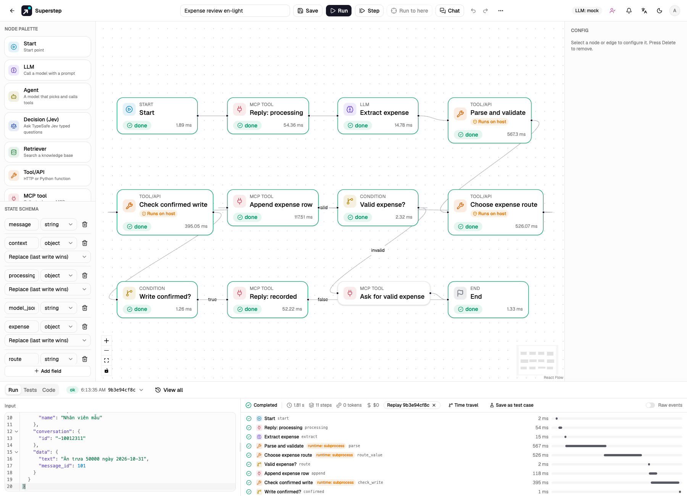

# Telegram expense workflow

Import the [portable expense template](https://github.com/quinguyen1502/superstep/blob/develop/examples/telegram-expenses.template.json)
through **New workflow → Import template**, then use the imported card. It uses
existing MCP, LLM, Code and Condition nodes.

The flow replies “processing”, extracts and validates a single expense, appends
one row and replies “recorded” only after a confirmed write. Missing/invalid
amounts and unrelated messages take the feedback branch. “Pending approval” is a row
status; this example does not implement an approval process.

The screenshot is an acceptance run with fake providers and synthetic input.

## Prepare the server and account

- An account with `code.write` (admin by default) must review and import the Code
  template. Enable Python Code nodes with `STUDIO_ENABLE_CODE_NODES=1`.
- Use the documented [Docker or remote Code runtime](../guide/code-mode.md) for
  deployment. The parser uses only Python's standard library and needs no package.
  The subprocess runtime is used only for trusted local acceptance tests.
- Run the worker, configure a public HTTPS `STUDIO_PUBLIC_URL`, and use a separate
  test bot/sheet while validating. No live credentials belong in template JSON.
- Create the primary OpenRouter credential and a fallback Ollama credential under
  Settings. Choose installed models; the template's model names are examples.
  [Model fallback](../guide/nodes.md) makes at most two calls per
  node attempt and does not hide authentication/permission failures.

## Connect Telegram and Sheets

1. In **Settings → Channels**, save a Telegram bot connection. The bot must receive
   ordinary messages in the selected group (configure its privacy mode accordingly).
2. In **Settings → MCP**, create a managed Telegram connection referencing that
   channel, with the **fixed destination chat ID** of this group. Discover tools.
3. Create a Google service account, enable Sheets API, share a dedicated spreadsheet
   with its email as an editor and create an `Expenses` tab. In Settings → MCP,
   create a managed Google Sheets connection with that spreadsheet/tab, **7 data
   columns** and the service-account JSON key. Discover tools.
4. Set up these headers. Keep H intact: it is written by the managed adapter.

| Column | Header | Value |
| --- | --- | --- |
| A | expense_date | YYYY-MM-DD, from the message when supplied |
| B | employee | Authenticated event actor name, falling back to actor ID |
| C | description | Validated model text |
| D | category | Validated model text |
| E | amount_vnd | Positive whole VND amount |
| F | status | Pending approval |
| G | submitted_at | Submission timestamp at UTC+07:00 |
| H | operation_id | Stable operation key added by the adapter |

The original six expense columns are preserved; G records submission time and H
supports reconciliation. Values use RAW input, so formula-looking text remains
text. Limit this tab to 100,000 rows and retain the ID column.

## Bind the imported graph

- On **Extract expense**, select the primary credential/model and the fallback
  credential/model. Resource IDs are deliberately blank in the portable file.
- On **Reply: processing**, **Reply: recorded** and **Ask for valid expense**,
  select the managed Telegram connection.
- On **Append expense row**, select the managed Sheets connection. Keep its
  `values` argument as `{{state.expense.values}}`.
- In **⋯ → Chat triggers**, choose the bot connection, the exact group and
  **An event (run as owner)**. Set the exact type to `message.text`.
  Enter explicit allowed Telegram sender IDs; `*` deliberately permits everyone
  in that group to use the trigger owner's resources without a studio account.
- Map state `message` to `data.text`, and state `context` to `$`.
  Metadata is untrusted data; it cannot choose credentials or tool destinations.

A new import shows validation issues until connections and fallback credentials
are selected. Save when those issues are resolved. Do not register a production
webhook while n8n still owns the bot.

## Data rules and observable failures

The parser accepts a JSON object with boolean `is_expense`, numeric `amount`,
`description`, `category` and optional `expense_date`. It accepts optional JSON
code fences but never executes model output. Amount must be a positive whole
number at most 1,000,000,000,000 VND. Numeric strings, booleans and fractional
amounts take the feedback branch. Description/category have bounded lengths.
Adjust these reviewed business rules in Code if your policy differs.

Explicit dates must be YYYY-MM-DD. If no expense date is supplied, use the
submission date in Vietnam's UTC+07:00. Submission time remains separate in G;
the model cannot overwrite it or the employee identity. Malformed JSON and
exhausted model failover appear as errors in History/trace, without a sheet write.

Append has two attempts. After an uncertain first response, the second attempt
only reconciles the existing operation; it does not append again. A confirmed
matching row may then allow the success reply. Rejection or an unresolved outcome
stops before success. **Recent operations → Check external result** can check
later; it does not restart an errored workflow or send a final reply. Do not
start a new run to bypass an unresolved write. Inspect the external service first.

A normal workflow test or mock-model run sends no managed messages or writes.
The stock model mock does not extract expense JSON; use a controlled provider
fixture/canned JSON to exercise this exact business schema. The repository's
integration tests mock providers while executing the actual parser in a subprocess.

From `backend/`, run `.venv/bin/python -m pytest -q tests/test_expense_integration.py`.
From `frontend/`, run
`E2E_EXPENSE_FIXTURE=1 E2E_CODE_RUNTIME=subprocess npm run e2e -- expense-workflow.spec.ts`.
The browser fixture requires that explicit flag and replaces models/Google HTTP;
Telegram uses the local fake API. It performs no live provider writes.

## Controlled acceptance and cutover

Check valid expense, missing/negative amount, unrelated text, malformed JSON,
primary-model failure, Sheets rejection, lost response and duplicate delivery.
Verify that a success message follows one confirmed sheet append, and that dates
and actor identity are correct. Inspect run trace and Recent operations as well
as the sheet. Duplicate event IDs and a worker replay reuse the recorded effects.

For live migration, pause submissions, let n8n's pending executions finish and
reconcile the sheet. Record the last processed update/message boundary. Disable
the old workflow, register Superstep's webhook, verify with a controlled new
message and resume submissions. Telegram has one webhook per bot. Existing n8n
delivery history is not imported: replaying old messages can create new expenses.
If rollback is needed, stop the Superstep binding and restore the old callback
after reconciling operations. Registration and real writes require operator
approval; the example's tests never perform this cutover.
