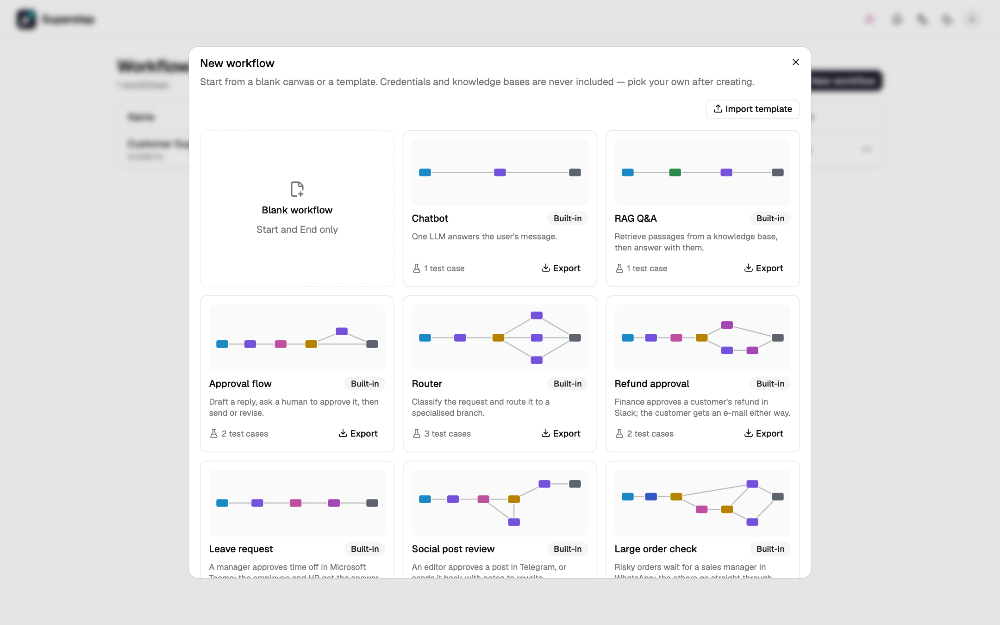
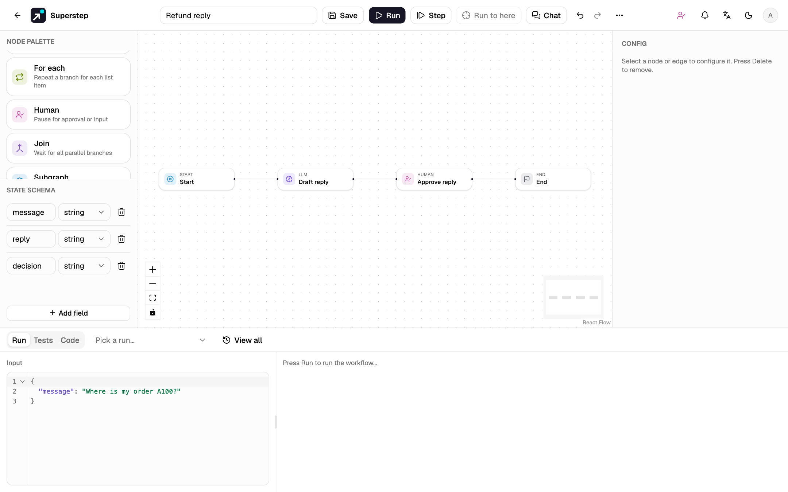
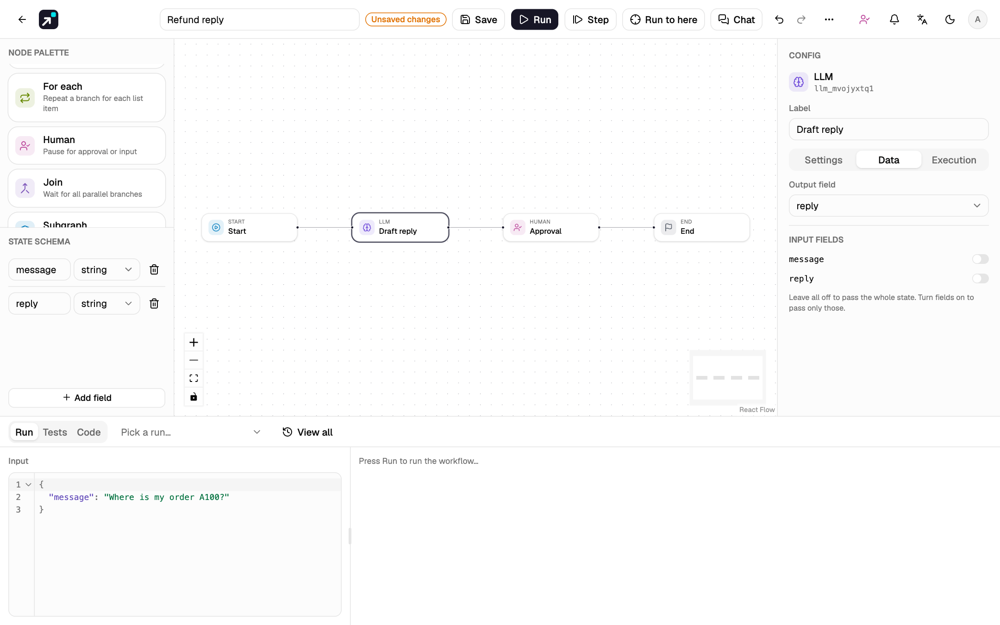
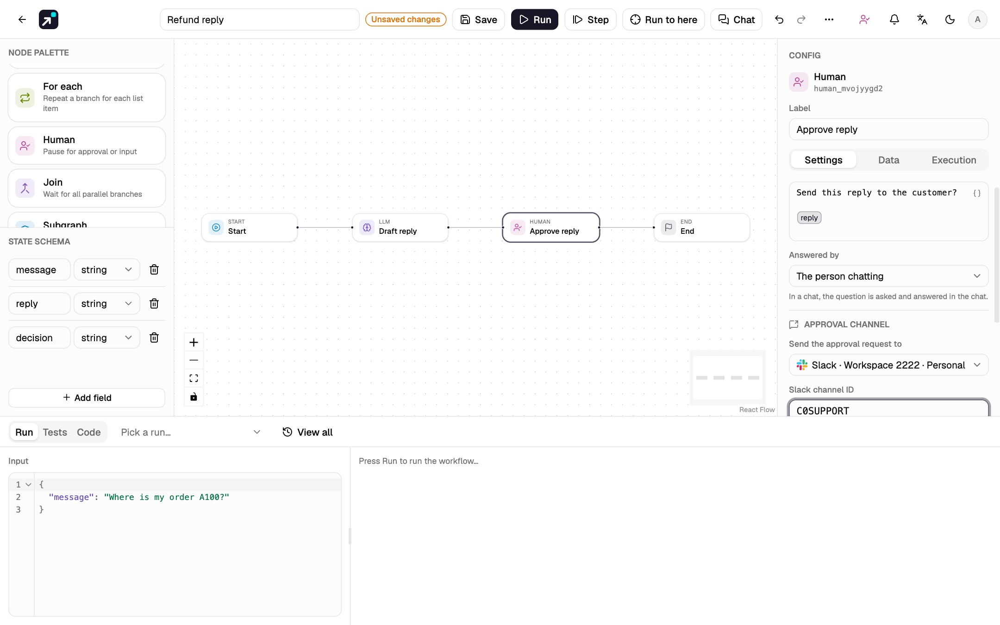
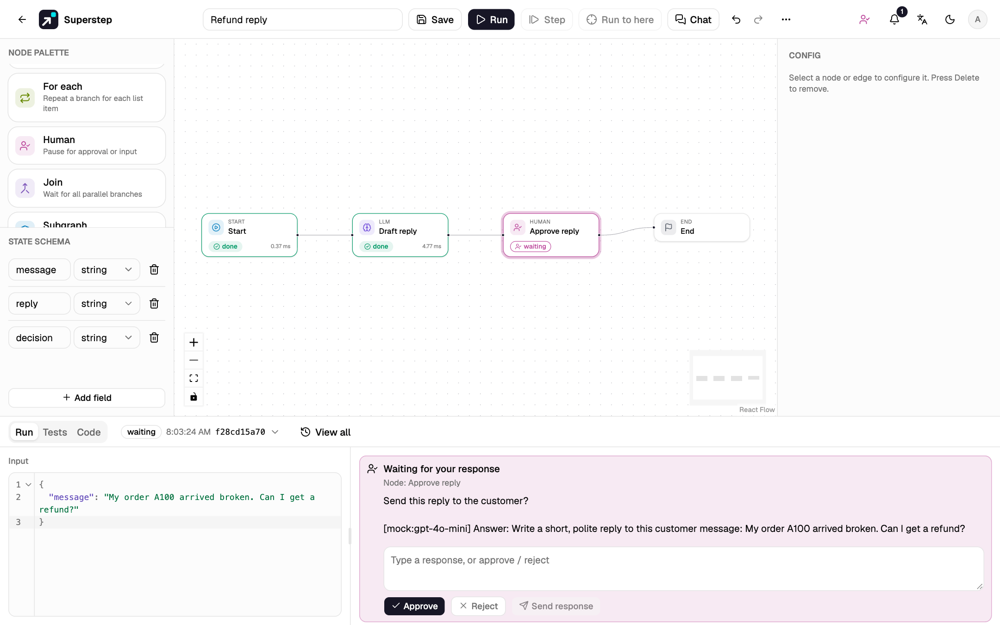
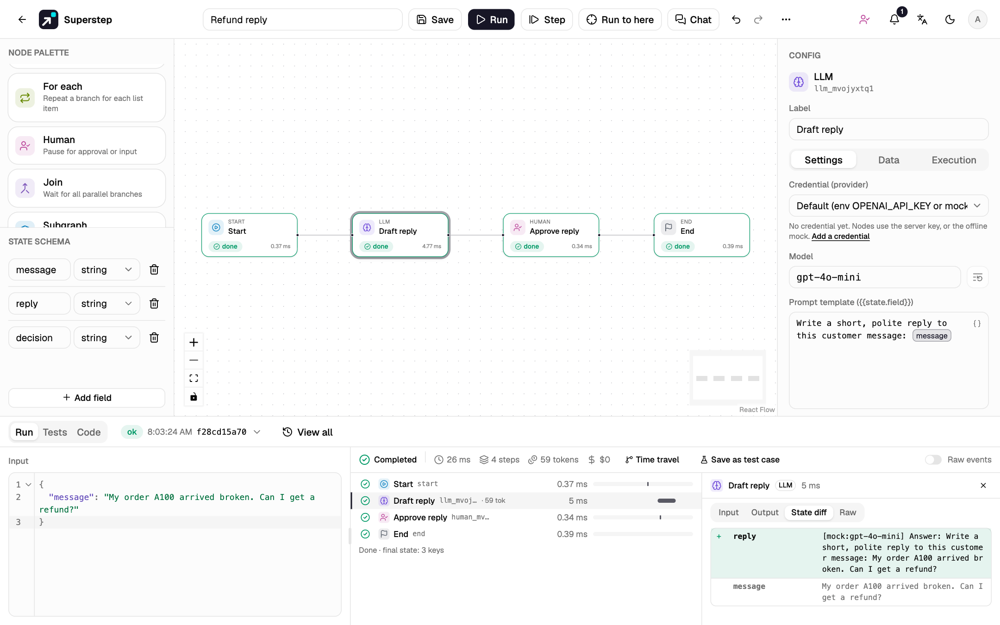
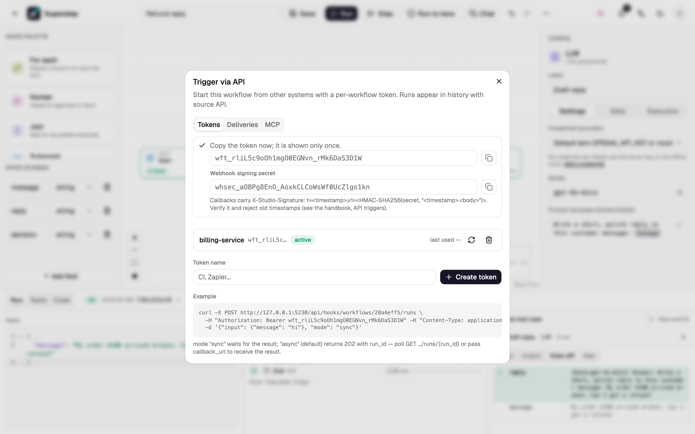
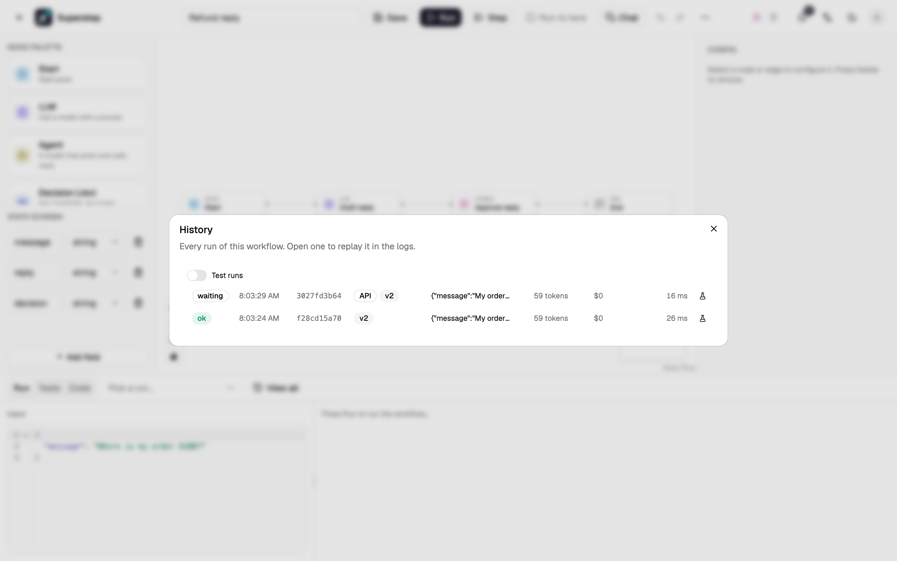

# Quickstart

Build a workflow that drafts a reply to a customer message, waits for a
person to approve it, and can be called from another service over HTTP.

| | |
| --- | --- |
| **You will build** | Start → LLM (draft a reply) → Human (approve it) → End |
| **You will use** | The editor, the state schema, a run trace, an API token and a schedule |
| **Time** | About 10 minutes |
| **Video** | The [video on the home page](../index.md#video) follows the same steps |

## Before you begin

- A running studio: `./dev.sh` from a clone of the repository (see
  [Install](install.md)). The UI is at <http://localhost:5173>.
- An account: create one with **Sign up** on the sign-in page. The default
  `editor` role is enough for this guide.
- No model key is needed. Without a credential, LLM nodes answer from a
  deterministic offline mock that echoes the end of the prompt.

## 1. Create a blank workflow

1. On **Workflows**, select **New workflow**.
2. In the gallery, select **Blank workflow**. The editor opens with a Start
   node, an End node and one edge between them.
3. Rename it in the name field of the header, for example `Refund reply`.



## 2. Add and connect the nodes

1. Drag **LLM** from the **Node palette** onto the canvas. Scroll the palette
   down to **Human** and drag it next to the LLM node.
2. Select the edge from Start to End and press ++delete++.
3. Connect the nodes: drag from the right handle of **Start** to the left
   handle of **LLM**, then **LLM** to **Human**, then **Human** to **End**.
4. Press ++shift+l++ to tidy the layout (also **⋯ → Tidy up the layout**).

!!! success "Check"
    The canvas shows four nodes in one row: Start → LLM → Human → End.



## 3. Configure the LLM node

The state is the typed record that every node reads from and writes to. A new
workflow has one field, `message`, which holds the run input.

1. Select the **LLM** node. Its settings open in the **Config** panel.
2. Set **Label** to `Draft reply`.
3. Replace the **Prompt template** with:

    ```text
    Write a short, polite reply to this customer message: {{state.message}}
    ```

    `{{state.message}}` shows as a tag. Typing `{{` lists the state fields; a
    field that is not in the state is marked as unknown.

4. Under **State schema** in the left panel, select **Add field** and name
   the new field `reply`.
5. Open the **Data** tab and set **Output field** to `reply`. The node writes
   its answer there.



## 4. Configure the Human node

1. Select the **Human** node and set **Label** to `Approve reply`.
2. Set **Question for the human** to:

    ```text
    Send this reply to the customer?

    {{state.reply}}
    ```

3. Add a state field `decision` and, in the **Data** tab, set it as the
   **Output field**. It
   receives `approved`, `rejected` or a typed answer.
4. Optional: back in the **Settings** tab, under **Approval channel**, set **Send the approval request to**
   a connected Slack, Telegram, WhatsApp, e-mail or Teams channel, then its
   target (for Slack, the channel id). **Approvers (e-mails)** lists who else
   may answer. Channels are connected under **Settings → Channels**; see
   [Approval channels](../operate/channels.md). The quickstart works with
   **Studio only**.

    

5. Select **Save** (++ctrl+s++ or ++cmd+s++). The backend validates the graph
   and stores it as a new version.

!!! info "Validation"
    Save and Run check the graph first: unreachable nodes, references to
    fields that are not in the state, and edges to missing nodes are listed
    before anything runs. See [The editor](../guide/editor.md).

## 5. Run it and approve

1. In the **Run** tab at the bottom, type into **Input** (left) and enter:

    ```json
    {"message": "My order A100 arrived broken. Can I get a refund?"}
    ```

2. Select **Run** (++ctrl+enter++). The LLM node finishes, and the run stops
   at the Human node with status `waiting`.

    

3. Read the question and the drafted reply, then select **Approve**. The run
   resumes from its checkpoint and finishes.

!!! tip "Answer from chat or e-mail"
    With a channel set on the Human node, the same request also goes there:
    **Approve** and **Reject** buttons in Slack and Telegram, two reply
    buttons in WhatsApp, and links in e-mail and Teams that open the studio.
    Only the run's owner and the listed approvers can answer, once. Answering
    in the studio closes the request everywhere. See
    [Human approval](../run/human-approval.md#approve-from-chat).

!!! success "Check"
    The logs (right of the input) show **Completed** with four steps: Start, Draft reply,
    Approve reply and End.

## 6. Read the trace

Select **Draft reply** on the canvas or in the logs. The step opens with
**Input**, **Output**, **State diff** and **Raw** events. The state diff shows
`reply` added by this step.



## 7. Call it over HTTP

1. Open **⋯ → API**, enter a token name such as `billing-service`, and select
   **Create token**. The token (`wft_…`) and the signing secret (`whsec_…`)
   are shown once; copy them now.

    

2. Start a run from a terminal. Replace `<wid>` with the workflow id from the
   address bar and `wft_…` with your token:

    ```bash
    curl -X POST http://localhost:5173/api/hooks/workflows/<wid>/runs \
      -H "Authorization: Bearer wft_…" -H "Content-Type: application/json" \
      -d '{"input": {"message": "My order A100 arrived broken. Can I get a refund?"}}'
    ```

    The response is `202` with a `run_id` and `"status": "queued"`.

3. Open **Run → View all** (reload the page first). The API run has an
   **API** badge and status `waiting`: it stopped at the Human node, like the
   studio run.



## 8. Put it on a schedule

1. Open **⋯ → Schedules**.
2. Enter a name and the cron expression `0 9 * * 1-5` (09:00 on weekdays).
   The dialog previews the next run times in the selected time zone.
3. Select **Add schedule**.

## What you learned

- A workflow is a graph of typed nodes over a shared state; nodes read it
  with `{{state.field}}` and write one **Output field**
  ([State and references](../guide/state.md)).
- Every save is a version, and every run records the version it used
  ([Versions](../guide/versions.md)).
- A Human node pauses a run in `waiting` and resumes it from a checkpoint;
  the request can also go to chat or e-mail
  ([Human approval](../run/human-approval.md)).
- Each step of a run keeps its input, output and state diff
  ([Runs and traces](../run/traces.md)).
- A workflow token lets another service start runs, and schedules start them
  on a timetable ([API triggers](../run/api-triggers.md),
  [Schedules](../run/schedules.md)).

## Next steps

- Add a model: [LLM providers](../operate/providers.md).
- Branch on the decision with a **Condition** node: [Nodes](../guide/nodes.md).
- Keep test cases with an input, the Human answer and what the run should show:
  [Workflow tests](../run/tests.md).
- See the workflow as LangGraph Python and run it on its own:
  [Export to Python](../guide/python-export.md).
- Send approvals to Slack, Telegram, WhatsApp, e-mail or Teams:
  [Approval channels](../operate/channels.md).
- Run the full stack with Postgres, Redis and a worker:
  [Deploy with Compose](../operate/deploy.md).
