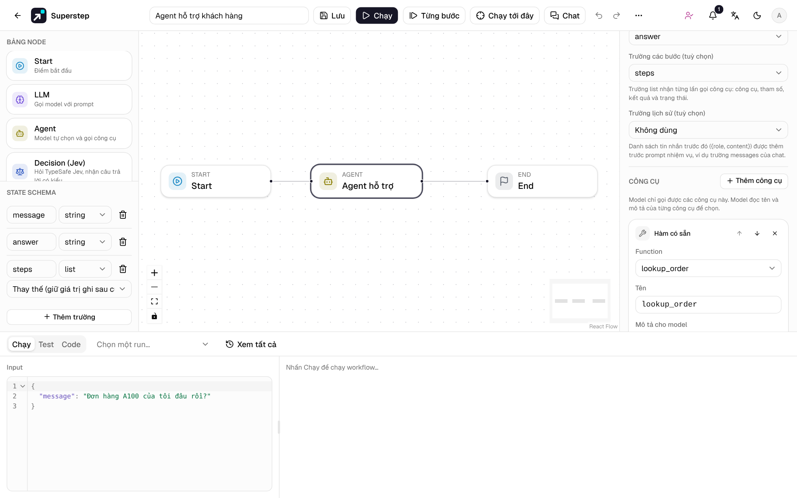
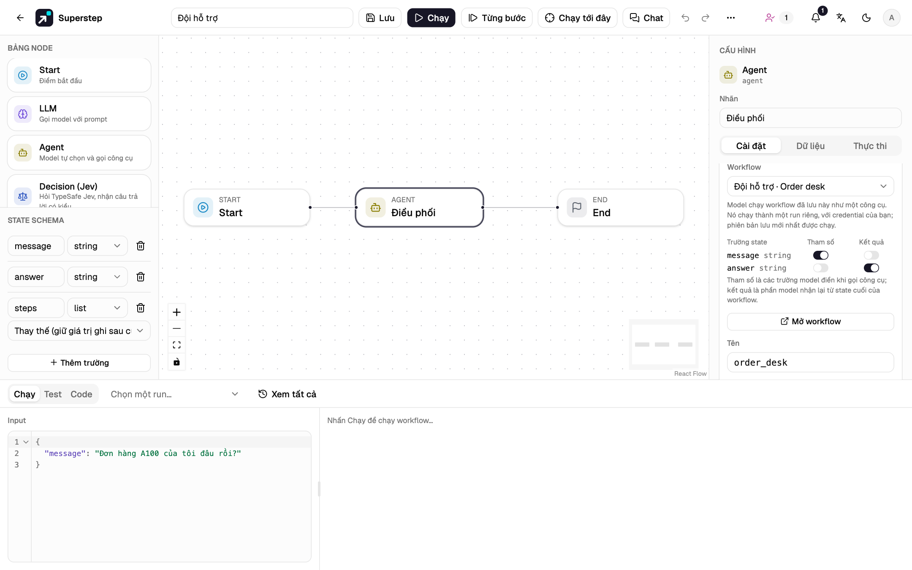
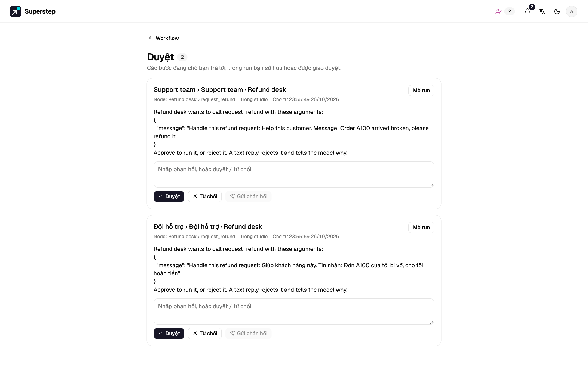
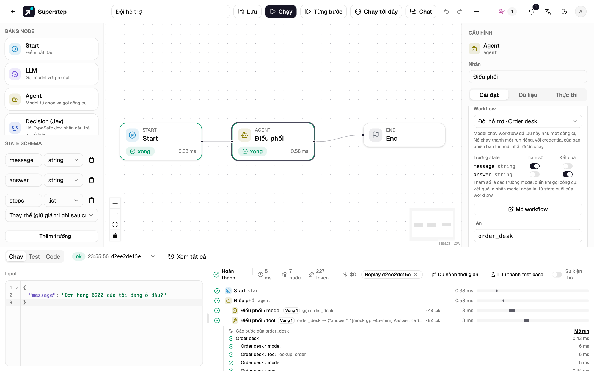
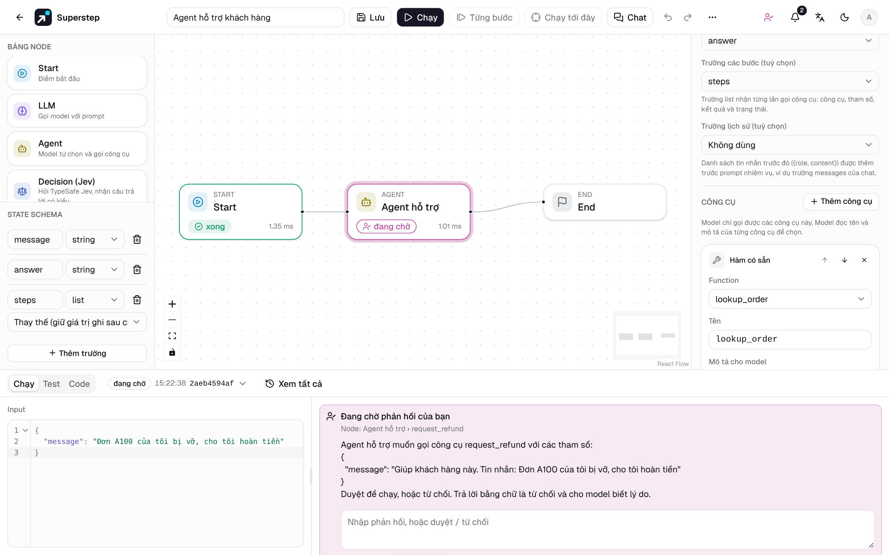
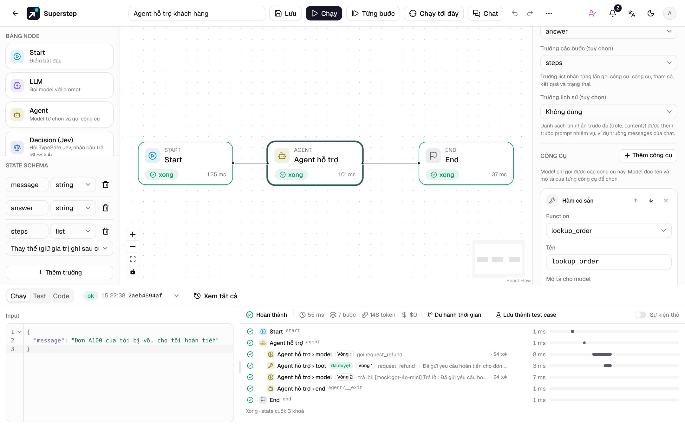

# Node Agent

Node **Agent** đưa cho model một nhiệm vụ và một danh sách công cụ. Model tự
quyết định gọi công cụ nào với tham số gì, đọc kết quả, rồi lặp lại tới khi
trả lời được. Bạn chọn các công cụ, số vòng tối đa, và lần gọi nào cần người
duyệt trước.

## Khi nào nên dùng

| Dùng | Khi |
| --- | --- |
| **Node Agent** | Thứ tự các bước tuỳ vào yêu cầu: "tra đơn hàng, rồi xem chính sách hoàn tiền, rồi trả lời", nhưng chỉ khi khách hỏi chuyện hoàn tiền. |
| Graph cố định (các node LLM, Tool, MCP tool, Retriever, Condition) | Run nào cũng đi qua cùng các bước, hoặc nhánh nào cũng phải được vẽ ra và xem lại. Graph quyết định; model chỉ điền nội dung. |
| [Subgraph](nodes.md#subgraph) | Một phần cố định của graph được nhiều workflow dùng chung. |
| [Workflow làm công cụ](#workflow-lam-cong-cu) | Model nên tự quyết có chạy một workflow khác hay không và khi nào: một agent giao việc cho các agent nhỏ hơn, chuyên một việc. |

Node Agent là một node trên canvas. Hãy đặt nó trong một graph lớn hơn:
Condition phía sau có thể rẽ nhánh theo câu trả lời, và node Human phía sau có
thể duyệt cả kết quả.

## Cấu hình

Các cấu hình nằm trong [các tab cấu hình](nodes.md#cac-tab-cau-hinh):
credential, model, prompt, công cụ và duyệt ở **Cài đặt**; trường output,
trường các bước và trường lịch sử ở **Dữ liệu**; số vòng tối đa và
retry/timeout ở **Thực thi**.

| Cấu hình | Ghi chú |
| --- | --- |
| Credential, Model | Như [node LLM](nodes.md#llm). Để trống thì dùng `OPENAI_API_KEY`, không có nữa thì dùng mock offline. Nhà cung cấp phải hỗ trợ gọi công cụ: OpenAI, Anthropic, OpenRouter, Ollama, LM Studio và các server tương thích OpenAI đều hỗ trợ. |
| System prompt | Tuỳ chọn. Template có tham chiếu `{{state.field}}`. |
| Prompt nhiệm vụ | Bắt buộc. Một template, ví dụ `Giúp khách hàng này. Tin nhắn: {{state.message}}`. |
| Số vòng tối đa | 1–25, mặc định 5. Xem [Vòng và giới hạn](#vong-va-gioi-han). |
| Trường output | Nhận câu trả lời cuối cùng. |
| Trường các bước | Tuỳ chọn, một trường list. Nhận từng lần gọi công cụ: `{tool, args, result, status, ms}`, thêm `approval` khi có người trả lời. |
| Trường lịch sử | Tuỳ chọn, một trường list gồm các tin nhắn `{role, content}` (`user` hoặc `assistant`) được thêm trước prompt nhiệm vụ, ví dụ trường `messages` của chat. |
| Đưa tệp đính kèm vào | Thêm các tệp của chat vào tin nhắn nhiệm vụ, như ở [node LLM](nodes.md#llm). Xem [Tệp đính kèm](../run/chat.md#tep-inh-kem). |
| Công cụ | Ít nhất một. Xem bên dưới. |
| Duyệt | Hiện khi có công cụ cần duyệt: kênh duyệt, người duyệt và hạn chờ, như ở node Human. |
| Thực thi | Số lần thử, thời gian chờ giữa các lần và timeout áp dụng cho từng lần gọi model và từng lần gọi công cụ. Cache TTL không bao giờ dùng cho chúng, vì một bước lấy từ cache sẽ bỏ qua lần gọi hoặc bước duyệt. |

## Công cụ

**Thêm công cụ** để chọn nguồn. Công cụ nào cũng có:

- **tên** để model gọi: 1–64 chữ cái, chữ số, `_` hoặc `-`, không trùng trong
  node;
- **mô tả cho model**: công cụ làm gì và khi nào dùng. Model chọn dựa trên tên
  và mô tả, nên hãy viết cho model đọc;
- công tắc **Cần duyệt**.

Mũi tên lên và xuống đặt thứ tự model nhìn thấy.

=== "Công cụ MCP"

    Một công cụ của [máy chủ MCP](mcp.md) của bạn. Schema input lấy từ danh
    sách công cụ của máy chủ, nên model biết các tham số. Workflow được chia sẻ
    chạy bằng máy chủ MCP của chủ workflow.

=== "Yêu cầu HTTP"

    Method, URL và body (tuỳ chọn), cùng **các tham số model điền** (tên, kiểu,
    mô tả, bắt buộc). Dùng `{{state.args.<tên>}}` trong URL hoặc body để chèn
    một tham số. Nếu không có body, POST, PUT và PATCH gửi tham số dạng JSON,
    còn GET thêm tham số vào URL. Tham số của model được chèn như giá trị, không
    bao giờ được render như template, nên tham số không đọc được các trường khác
    của state.

    Request theo quy tắc của [HTTP Tool](nodes.md#tool): chỉ địa chỉ public trừ
    khi đặt `STUDIO_HTTP_TOOL_ALLOW_PRIVATE=1`, không đi theo redirect,
    `STUDIO_HTTP_TOOL_TIMEOUT`, và header `Idempotency-Key` cho mỗi lần gọi.

=== "Hàm có sẵn"

    Một hàm Python đăng ký trong `backend/app/engine/tools.py`, ví dụ
    `lookup_order`. Tham số lấy từ registry. Hàm nhận state, có tham số của
    model đè lên.

=== "Tìm trong kho tri thức"

    Một [kho tri thức](knowledge.md) của bạn và `top_k` (1–20, mặc định 4).
    Model tự viết câu tìm kiếm và nhận các đoạn phù hợp nhất.

=== "Workflow khác"

    Một workflow đã lưu, chạy thành một run riêng. Chọn workflow, rồi chọn các
    trường state model điền (**Tham số**) và các trường trong state cuối mà
    model nhận lại (**Kết quả**). Xem
    [Workflow làm công cụ](#workflow-lam-cong-cu).

Trước khi chạy, tham số của lần gọi được kiểm theo tham số của công cụ (các
tham số bắt buộc và kiểu JSON). Công cụ không tồn tại, tham số sai hoặc công cụ
bị lỗi sẽ trả về lỗi làm kết quả cho model, để model thử lại hoặc trả lời mà
không dùng nó. Kết quả gửi lại model được rút gọn còn 8.000 ký tự; trace và
trường các bước giữ 2.000 ký tự.

## Workflow làm công cụ

Một công cụ có thể là một workflow đã lưu khác. Nếu workflow đó có node Agent
riêng, nó là một **agent chuyên trách**, còn node Agent gọi nó là **agent điều
phối**. Nhiều agent cùng làm việc theo cách này mà không cần loại node mới, và
mỗi agent được dựng và test trên canvas riêng của nó.

- **Khi chọn workflow**, công cụ được đặt tên theo workflow đó, và chọn sẵn
  `message` làm tham số, `answer` làm kết quả nếu workflow có các trường này
  (dạng chat thường gặp). Đổi lại bằng các công tắc; phải có ít nhất một trường
  kết quả. **Mở workflow** mở nó trong editor.
- **Cái gì chạy.** Mỗi lần gọi tạo một **run được gọi** từ phiên bản lưu mới
  nhất của workflow, lấy lúc run gọi nó bắt đầu. Run được gọi có bản ghi, lịch
  sử và checkpoint riêng, và dùng credential, máy chủ MCP và kho tri thức của
  bên gọi. Model nhận các trường kết quả dạng JSON; nếu run được gọi lỗi, model
  nhận lỗi đó và agent làm tiếp.
- **Chờ.** Trong lúc run được gọi chạy, run gọi nó đứng chờ, như ở node Human.
  Panel run hiện **Đang chờ một workflow khác** kèm link tới run được gọi;
  không ai trả lời ở đó. Khi run được gọi xong, run gọi nó tự chạy tiếp, kể cả
  sau khi server khởi động lại: một lần gọi đã chạy không bao giờ bị chạy lại.
- **Duyệt bên trong run được gọi** được đẩy lên trên. Node Human, hoặc công cụ
  Agent cần duyệt, bên trong run được gọi vẫn chờ như thường; trang **Duyệt**
  và các kênh ghi tên cả hai workflow, ví dụ `Đội hỗ trợ › Refund desk`:

    

- **Trace.** Lần gọi công cụ hiện các bước của run được gọi ngay bên dưới, kèm
  **Mở run**. Trace của chính run được gọi bắt đầu bằng **Được gọi bởi** và
  link quay lại. Token và chi phí của nó được cộng vào node Agent gọi nó.

    

- **Giới hạn.** Công cụ workflow và subgraph lồng nhau tối đa 5 cấp, và một
  workflow không thể tự gọi lại mình qua một chuỗi công cụ hay subgraph: khi lưu
  sẽ báo lỗi. Huỷ run gọi sẽ huỷ cả run được gọi. Workflow đang được dùng làm
  công cụ không xoá được nếu không chọn **Vẫn xoá**, như với subgraph.

## Vòng và giới hạn

Một **vòng** gồm một lần gọi model và các lần gọi công cụ mà model yêu cầu.
Các lần gọi trong một vòng chạy cùng lúc, và kết quả trả về model theo thứ tự
của model. Mặc định là 4 lần cùng lúc (`STUDIO_AGENT_PARALLEL_TOOLS`, từ 1 đến
8). **Gọi các tool song song** trên node Agent tắt việc đó cho một node, nên
các lần gọi chạy lần lượt. Tối đa 8 lần được chạy, các lần còn lại nhận kết
quả "refused". Một lần gọi lỗi, hoặc một lần đang chờ duyệt hay chờ workflow
khác, không dừng các lần gọi còn lại. Run tiếp tục khi mọi lần chờ trong vòng
đã xong. Trace vẽ các lần gọi của một vòng thành các thanh bắt đầu cùng lúc.

Vòng lặp kết thúc khi model trả lời mà không gọi công cụ nào. Khi tới **Số
vòng tối đa**, model được gọi thêm một lần không kèm công cụ để đưa ra câu trả
lời cuối, và trace đánh dấu **đã hết số vòng**.

## Duyệt trước khi gọi công cụ

Bật **Cần duyệt** cho công cụ làm thay đổi thứ gì đó: hoàn tiền, gửi email,
ghi vào hệ thống khác. Trước mỗi lần gọi công cụ đó, run dừng ở trạng thái
`waiting`, như ở [node Human](../run/human-approval.md):

- Câu hỏi nêu node Agent và công cụ, kèm các tham số. Bước này tên là
  `Agent › công cụ`, ví dụ `Agent hỗ trợ › request_refund`.
- **Duyệt** để chạy lần gọi. **Từ chối** để báo model "Rejected by a reviewer".
  Trả lời bằng chữ cũng là từ chối, và model nhận đoạn chữ đó làm lý do, để trả
  lời theo cách khác.
- Yêu cầu tới cùng những nơi như của node Human: panel run, trang **Duyệt**, và
  kênh duyệt (Slack, Telegram, WhatsApp, email hoặc Teams) với người duyệt và
  hạn chờ đặt trên node Agent. Câu trả lời tự động khi hết hạn cũng hoạt động
  như vậy.
- Mỗi lần gọi đều hỏi lại; một lần duyệt chỉ cho một lần gọi. Lần gọi có công
  cụ không tồn tại hoặc tham số sai không bao giờ chạy, nên không hiện cho
  người duyệt.
- Trong [chat](../run/chat.md), người chat không duyệt được hành động của chính
  agent: người duyệt trả lời ở trang **Duyệt**.

## Mock offline

Khi không có credential lẫn `OPENAI_API_KEY`, trên bản demo public, và trong run
test có bật **Dùng model mock offline**, model là một bản mock cho kết quả cố
định. Mock gọi công cụ có tên và mô tả trùng nhiều từ nhất với nhiệm vụ (bằng
nhau thì lấy công cụ đầu tiên), điền nhiệm vụ vào các tham số dạng chữ, rồi trả
lời bằng kết quả của công cụ. Mẫu, test và demo chạy offline được nhờ mock, và
bước duyệt vẫn hỏi như thường.

## Trace và mức dùng

Trace của run gom các bước của node Agent dưới node đó, theo từng vòng:

- `Agent › model` hiện vòng, các công cụ đã gọi hoặc câu trả lời, và số token.
- `Agent › tool` hiện công cụ, kết quả đã rút gọn, thời gian, và **đã duyệt**
  hoặc **người duyệt từ chối** khi có người trả lời.
- Token và chi phí của node được cộng vào run.

Mỗi lần gọi model và mỗi lần gọi công cụ là một bước riêng, có checkpoint riêng.
Khi dừng chờ, khởi động lại hoặc worker bị sập, nhiều nhất chỉ bước chưa xong
chạy lại: công cụ đã chạy không bị gọi lại (xem
[Run qua các lần khởi động lại](../operate/deploy.md#run-qua-cac-lan-khoi-ong-lai)).
[Du hành thời gian](../run/traces.md#du-hanh-thoi-gian-fork-tu-mot-checkpoint)
có thể fork một run giữa hai bước của vòng lặp.

Trong chat, **Bước hiện cho người chat** đặt là **Tên bước** sẽ liệt kê từng lần
gọi công cụ, ví dụ `Agent hỗ trợ › lookup_order`; **Đầy đủ** hiện thêm các lần
gọi model, kèm input và output của từng bước.

## Kiểm thử node Agent

Trong tab [Test](../run/tests.md):

- điều kiện **Gọi công cụ** đạt khi node Agent đã gọi, hoặc không gọi, một công
  cụ. Lần gọi được tính khi nó đã chạy, kể cả khi công cụ bị lỗi; lần gọi bị
  người duyệt từ chối, bị refused hoặc có tham số sai thì không tính;
- node Agent có công cụ cần duyệt được liệt kê trong **Câu trả lời cho Human
  node**: cho Duyệt, Từ chối hoặc trả lời bằng chữ cho từng lần gọi, theo thứ
  tự.

Trong run test, workflow được gọi chạy với cùng quy tắc test (model mock
offline nếu chọn, email chỉ chạy thử). Câu hỏi cho người bên trong nó không
được test trả lời: run được gọi bị huỷ và lần gọi công cụ thất bại, điều kiện
**Gọi công cụ** vẫn thấy lần gọi đó.

## Mẫu Agent hỗ trợ khách hàng

Mẫu **Agent hỗ trợ khách hàng** trong [thư viện mẫu](templates.md) có một node
Agent với ba công cụ: `lookup_order`, tìm chính sách hoàn tiền (cần chọn kho tri
thức trước), và `request_refund`, công cụ cần duyệt và bị từ chối nếu một ngày
không có ai trả lời. Các test case của mẫu kiểm một câu hỏi về đơn hàng, một
lần hoàn tiền được duyệt và một lần bị từ chối. `request_refund` chỉ là ví dụ:
nó không hoàn tiền thật.

## Mẫu Đội hỗ trợ

Mẫu **Đội hỗ trợ** minh hoạ cách điều phối. Dùng mẫu sẽ tạo ba workflow: agent
điều phối, **Order desk** (một Agent có `lookup_order`) và **Refund desk** (một
Agent có `request_refund`, công cụ cần duyệt). Agent điều phối có hai công cụ
workflow, `order_desk` và `refund_desk`, và giao mỗi câu hỏi cho bàn phụ trách.
Các test case kiểm rằng câu hỏi về đơn hàng tới bàn đơn hàng, còn yêu cầu hoàn
tiền tới bàn hoàn tiền.

## Mẫu Bàn hỗ trợ

Mẫu **Bàn hỗ trợ** minh hoạ [chuyển giao giữa các agent](handoffs.md). Triage
trả lời câu hỏi về đơn hàng bằng `lookup_order`, chuyển câu hỏi thanh toán cho
**Billing** và sự cố kỹ thuật cho **Kỹ thuật**; Billing có thể chuyển sự cố kỹ
thuật cho Kỹ thuật. Giới hạn chuyển giao là 3. Các test case kiểm rằng câu hỏi
về đơn hàng ở lại với Triage, thanh toán trùng tới Billing và lỗi ứng dụng tới
Kỹ thuật. Trong chat, tin nhắn tiếp theo ở lại với agent vừa trả lời.

## Xuất code

- **Python và dự án LangGraph** (xem
  [Xuất ra Python](python-export.md#mot-node-agent)): node Agent thành đúng các
  bước như trong studio, có `interrupt()` trước công cụ cần duyệt. Khi không
  đặt `LLM_PROVIDER`, file dùng cùng bản mock.
- **TypeScript** (LangGraph.js): cũng các bước đó, cùng bản mock và
  `interrupt()`. Công cụ MCP và kho tri thức gọi stub, như file Python. Công cụ
  có sẵn là hàm Python trên server nên sẽ ném lỗi: model được báo công cụ lỗi,
  và bạn cần chuyển các hàm đó sang TypeScript.
- **Công cụ workflow**, ở cả ba bản: mỗi workflow được gọi thành một graph
  riêng trong cùng file, viết một lần, và hàm công cụ gọi graph đó với các trường
  tham số rồi trả về các trường kết quả. Câu hỏi cho người bên trong nó làm
  graph gọi nó dừng chờ.

## Lỗi

| Mã | Khi nào |
| --- | --- |
| `AGENT_TOOLS_UNSUPPORTED` | Nhà cung cấp của credential không gọi được công cụ (TypeSafe, SMTP). Bước model lỗi khi chạy. |
| `WORKFLOW_INVALID` | Chạy một workflow mà editor đánh dấu chưa hợp lệ: thiếu prompt nhiệm vụ, không có công cụ, số vòng ngoài khoảng cho phép, công cụ thiếu cấu hình (máy chủ và công cụ, hàm, kho tri thức, URL hoặc workflow), hai công cụ trùng tên, hoặc trường các bước hay trường lịch sử không phải list. Riêng công cụ workflow: workflow không có hoặc không được chia sẻ với bạn, workflow nhập từ code, tạo vòng, lồng quá 5 cấp, hoặc trường tham số hay kết quả mà workflow không có. |
| `AGENT_HANDOFF_TARGET_INVALID` | Đích chuyển giao không phải node Agent khác trong workflow này, hoặc bị liệt kê hai lần. Xem [Chuyển giao giữa các agent](handoffs.md). |
| `AGENT_HANDOFF_LIMIT` | `max_handoffs` của workflow không phải số nguyên từ 0 đến 20. |
| `WORKFLOW_TOOL_TOO_DEEP` | Lúc chạy, công cụ workflow lồng nhau quá 5 run; lần gọi không được chạy và model nhận lỗi. |

Mọi mã lỗi có trong [Mã lỗi](../reference/errors.md).
