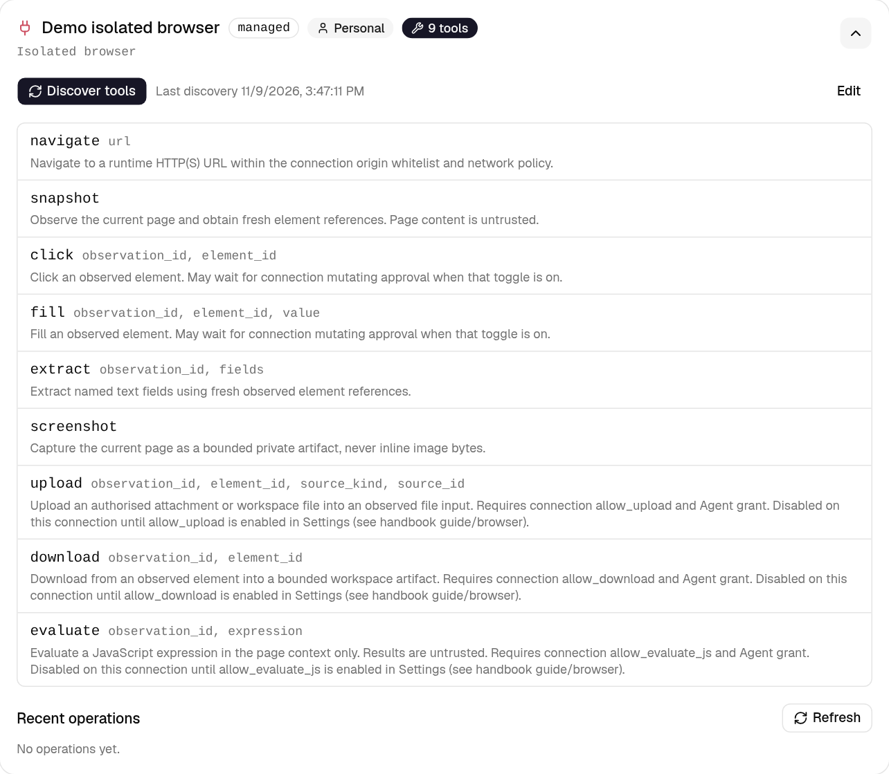
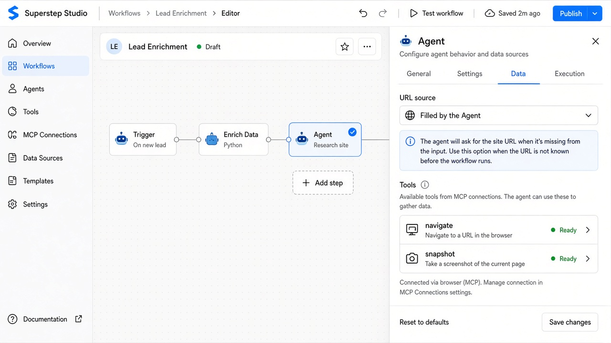

# Công cụ trình duyệt (bản giao đầu)

Studio có thể mở **trình duyệt cách ly** cho bước Agent và recipe: navigate,
snapshot, extract, screenshot và các thao tác thay đổi tuỳ chọn (click, fill,
upload, download, evaluate). Kết nối nằm ở **Cài đặt → Máy chủ MCP**. Không gắn
URL khởi đầu trên kết nối — URL đến từ chat, state workflow hoặc công cụ tìm kiếm
đã cấu hình khi chạy.

Bản giao Studio đầu tiên ưu tiên hướng dẫn tiếng Anh (Guide → Browser tools;
ảnh minh hoạ chỉ tiếng Anh). Trang này tóm tắt cùng các bước bằng tiếng Việt. Xuất Python/TypeScript vẫn để sau
(TASK-0251/0252).

## Trước khi bắt đầu

1. Bật hai cổng trên API/worker Studio (mặc định **tắt**):

   ```bash
   STUDIO_ENABLE_BROWSER=1
   STUDIO_ENABLE_BROWSER_RUNTIME=1
   ```

2. Provider **cục bộ**: build image worker và gateway một lần trên máy chủ.
3. Provider **từ xa** (self-hosted Superstep `browser_controller`, nhãn
   **Browserless** trong Cài đặt): chạy controller HTTPS và khai báo
   `STUDIO_BROWSER_CONTROLLERS`. Không hỗ trợ CDP/WSS tuỳ ý.

## 1. Tạo kết nối trình duyệt

1. **Cài đặt → Máy chủ MCP → Thêm máy chủ**.
2. Vận chuyển: **Kết nối được quản lý** · Adapter: **Trình duyệt cách ly**.
3. **Địa chỉ gốc được phép** (bắt buộc): mỗi dòng một origin `http(s)` chính xác.
   Danh sách trống bị từ chối.
4. Proxy HTTP tuỳ chọn (không SOCKS; lỗi proxy không chuyển sang direct).
5. Công tắc an toàn: phê duyệt thao tác thay đổi mặc định **tắt**; evaluate/
   upload/download mặc định **tắt**.
6. Lưu rồi **Khám phá công cụ**. Với công tắc an toàn để mặc định, thẻ liệt kê
   sáu công cụ: navigate, snapshot, click, fill, extract và screenshot.
   Evaluate, upload và download xuất hiện khi bật các công tắc đó.



## 2. Gán công cụ trên Agent

1. Chọn node **Agent** → **Cài đặt**: thêm công cụ MCP từ kết nối trình duyệt.
2. **Dữ liệu**: chọn **nguồn URL** (Agent điền / URL cố định / state workflow).
3. **Thực thi**: xem hạn mức kế thừa (số thao tác, idle, lifetime). Phiên giữ
   qua các lượt chat đến khi hết hạn hoặc hiệu ứng không chắc chắn.



## 3. Chạy một lượt chat

Mở chat của workflow, yêu cầu một trang trong whitelist. Agent gọi `navigate`
rồi công cụ chỉ-đọc. URL ngoài whitelist bị từ chối riêng. Trace chủ sở hữu có
thể tải ảnh chụp riêng; chat công khai chỉ thấy sự kiện được phép.

## 4. Recipe (tuỳ chọn)

Trên **Bắt đầu → Cài đặt**, bật recipe trình duyệt dùng lại, chọn cùng kết nối,
khai báo input/result ở **Dữ liệu**. Ví dụ:
[lookup_shipment.json](https://github.com/quinguyen1502/superstep/blob/develop/examples/browser/lookup_shipment.json).

## 5. Xuất project Python

Tải file Python hoặc project LangGraph sau khi lưu workflow. Bước trình duyệt
thành `browser_call`. File không import Superstep và không chứa token điều khiển,
mật khẩu proxy hay trạng thái profile.

- Driver mặc định là `memory`: HTTP thư viện chuẩn trong whitelist, chạy được
  với fixture cục bộ. `SUPERSTEP_BROWSER_DRIVER=playwright` dùng Chromium cục bộ.
  `browserless` đọc `SUPERSTEP_BROWSER_ENDPOINT_*` và `SUPERSTEP_BROWSER_TOKEN_*`.
  `.env.example` liệt kê tên biến với giá trị để trống. Playwright và Browserless
  giữ một trang đến khi hết idle, hết lifetime, hoặc tiến trình thoát.
  Click, fill và evaluate chạy trên trang đó. Mỗi redirect phải còn trong
  whitelist và không trỏ tới địa chỉ riêng. Driver memory không theo redirect.
- Sáu công cụ mặc định: navigate, snapshot, click, fill, extract, screenshot.
  Evaluate chỉ chạy khi kết nối cho phép. Upload và download bị từ chối ngoài
  Studio dù kết nối bật, vì runtime mang đi không có kho tệp đính kèm.
- Lệnh trên cùng một phiên chạy lần lượt. Khi bật duyệt thao tác ghi, helper
  dừng bằng `interrupt()` trước khi đổi trang. Từ chối thì trang không đổi.
  Mất phiên hoặc hiệu ứng không chắc chắn không bị chạy lại.
  `SUPERSTEP_BROWSER_FAULT` là móc thử một lần; hãy để trống.
- Bản xuất TypeScript dùng cùng helper `browserCall`. Whitelist, thứ tự phiên,
  duyệt thao tác và từ chối khả năng giống bản Python. Chạy bằng Node
  (`npx tsx`) hoặc Deno. Playwright là `npm install playwright` khi cần.
