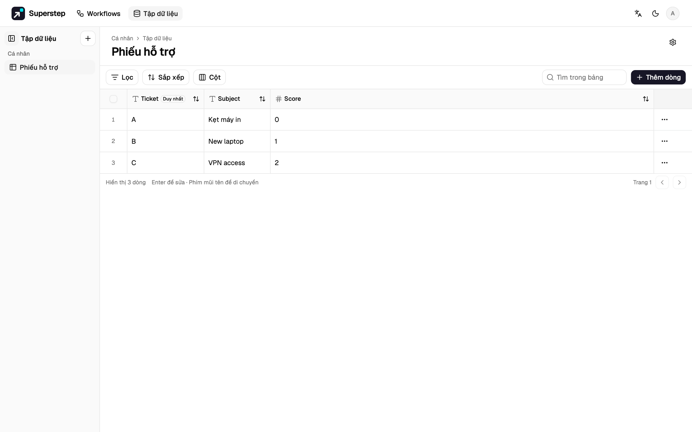
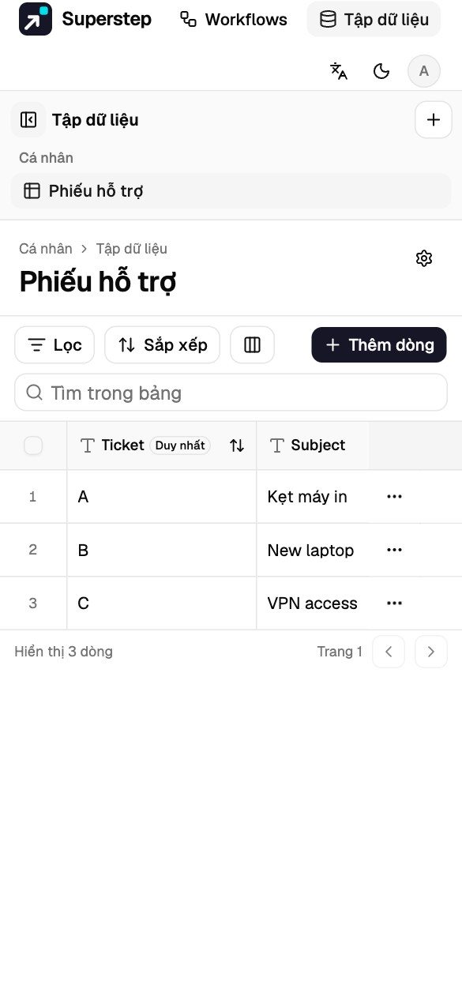
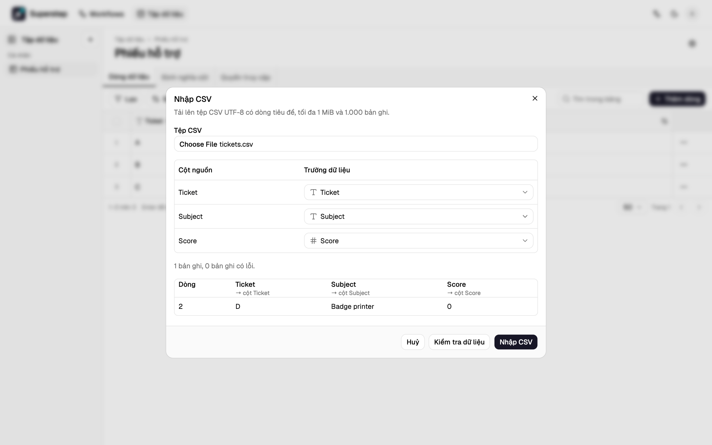

# Tập dữ liệu

Tập dữ liệu là một bảng có kiểu, thuộc về bạn hoặc một nhóm. Workflow có thể tra
cứu và ghi dòng. Dự án xuất ra có thể dùng cùng các dòng đó qua API Superstep
hoặc qua cơ sở SQLite hay PostgreSQL riêng.

## Soạn thảo

Mở **Tập dữ liệu** từ điều hướng của studio.

Trên màn hình hẹp, danh mục xếp dưới tiêu đề và lưới cuộn ngang.

- **Tạo** hỏi tên, mô tả không bắt buộc, và phạm vi cá nhân hoặc nhóm. Hãy thêm
  cột trước lần nhập đầu nếu bạn đã biết các trường.
- Mỗi cột có nhãn, khoá ổn định, và kiểu: văn bản, số, boolean, ngày, ngày giờ,
  email, hoặc chọn. Cột có thể bắt buộc hoặc duy nhất. Khoá không đổi khi bạn
  đổi nhãn, nên ánh xạ trong workflow vẫn đúng.
- Bắt buộc được chọn khi thêm cột. Duy nhất có thể bật sau trong **Sửa cột**,
  ví dụ sau khi nhập CSV chưa có khoá. Studio kiểm tra các dòng hiện có trước.
  Nếu có dòng trùng giá trị, Studio cho biết số dòng và dẫn tới các dòng đó để
  bạn sửa. Không thể tắt Duy nhất khi còn workflow dùng trường này để tìm dòng
  cho Upsert hoặc Xoá dòng.
- Lưới sửa dòng. Lần lưu gửi revision của dòng. Nếu người khác đã lưu trước,
  Studio bảo bạn tải lại thay vì ghi đè sửa đổi đó.
- Xoá tập dữ liệu, cột, hoặc quyền yêu cầu bạn gõ đúng tên mục đó.
- Xoá cột sẽ xoá giá trị của cột đó trong mọi dòng. Khoá của cột vẫn được giữ
  nên không dùng lại được, và cột đã xoá không tính vào giới hạn 100 cột.
- Cột bắt buộc thêm vào tập dữ liệu đã có dòng cần giá trị mặc định. Mọi dòng
  hiện có nhận giá trị mặc định, miễn là không dòng nào vượt giới hạn 64 KiB.
- **Tìm trong bảng** và bộ lọc **Chứa** không phân biệt chữ hoa chữ thường, nên
  "webhook" cũng tìm thấy "Webhook", và "đơn" tìm thấy "ĐƠN". Sắp xếp văn bản
  cũng không phân biệt chữ hoa chữ thường. **Bằng** và khoá duy nhất khớp đúng
  giá trị. **Không bằng** khớp cả ô để trống. Mỗi điều kiện lọc có giải thích
  cho toán tử của nó.

Bạn cần `resources.manage` để tạo tập dữ liệu hoặc đổi dòng. Ai nhìn thấy tập
dữ liệu thì đọc được dòng.

Tập dữ liệu cá nhân do chủ sở hữu quản lý. Tập dữ liệu nhóm do thành viên đã tạo
nó và quản trị viên quản lý. Các thành viên khác trong nhóm có
`resources.manage` thêm, sửa, nhập và xoá dòng. Chỉ người quản lý mới sửa tập dữ
liệu, đổi cột, quản lý quyền truy cập và token, hoặc xoá tập dữ liệu. Studio hiện
các thao tác này ở trạng thái tắt, kèm giải thích, cho các thành viên khác. Quản
trị viên có thể chuyển tập dữ liệu nhóm cho thành viên khác bằng **Chuyển quyền
sở hữu** trong menu tập dữ liệu.

## Quyền truy cập

Menu **Quyền truy cập** cấp cho một workflow đã lưu quyền đọc hoặc ghi. Workflow
không có quyền đó không chạy được node Tập dữ liệu hoặc công cụ Tập dữ liệu trên
bảng này. Xoá dòng là một quyền riêng: chọn **Cho phép xoá dòng** trên quyền đã
cấp. Chỉ quyền đọc và ghi thì không được Xoá dòng.

Phát hành token Tập dữ liệu cho dự án xuất ra gọi API Superstep. Token chỉ
hiện một lần. Xoay token vẫn giữ người đã phát hành, nên khoá mới có cùng quyền.
Thu hồi token thì các lần gọi sau dừng. Token cũng cần **Cho phép
xoá dòng** thì dự án mới xoá được dòng. Người không nhìn thấy tập dữ liệu nhận
kết quả không tìm thấy, kể cả khi tải CSV.

Nơi bắt đầu lần chạy quyết định quyền đã cấp cho phép gì:

| Lần chạy bắt đầu từ | Tìm, Lấy, Thêm, Thêm hoặc cập nhật | Xoá dòng |
| --- | --- | --- |
| Chạy trong Studio, lịch chạy, hoặc kiểm thử workflow | Khi có quyền | Khi có quyền và **Cho phép xoá dòng** |
| Chat trong Studio, chat công khai, hoặc trigger API | Khi có quyền | Không bao giờ |
| Chế độ demo | Không bao giờ | Không bao giờ |

Công cụ workflow theo lần chạy đã gọi nó. Workflow chưa lưu không dùng được tập
dữ liệu. Gỡ quyền cũng chặn lần chạy đang chờ tiếp tục.

Quyền ghi mà không có quyền đọc được chèn và upsert dòng nhưng không bao giờ
nhận giá trị ô. Kết quả chỉ có mã dòng, revision và cho biết dòng có được thêm
mới hay không, dù là run thật, run kiểm thử hay gỡ lỗi, hoặc lần ghi được
thử lại. Node Tập dữ liệu có quyền chỉ ghi không chọn được trường trả về; node
đã lưu mà vẫn yêu cầu trường sẽ lỗi `DATASET_GRANT_DENIED` trước khi ghi. Công
cụ của Agent không có **Tìm dòng** chỉ đưa cho mô hình các mã định danh đó, kể
cả khi có quyền đọc và ghi. Upsert vẫn cho biết đã có dòng mang khoá đó hay
chưa. Nếu điều này cần được giữ kín, hãy dùng **Thêm dòng**. Upsert không đổi giá
trị nào thì giữ nguyên revision và thời điểm cập nhật của dòng.

## CSV

**Nhập CSV** xem trước tệp trước khi ghi.

- Tệp là UTF-8, tối đa 1 MiB và 1.000 bản ghi. Bắt buộc có dòng tiêu đề.
- Bản xem trước gợi ý khoá trường và kiểu cho mỗi cột. Bạn có thể đổi ánh xạ,
  bỏ qua một cột, và sửa lược đồ trước khi nhập.
- Việc nhập là nguyên tử. Nếu có dòng không hợp lệ, hoặc trùng giá trị duy nhất,
  thì không ghi gì. Bản xem trước liệt kê tối đa 100 lỗi.
- **Xuất CSV** cần quyền đọc. Tệp gồm mọi dòng. Giá trị mà bảng tính coi là công
  thức được thêm dấu nháy đơn ở đầu. Bản tải về tối đa 16 MiB.

## Workflow và xuất dự án

Node Tập dữ liệu có thể tìm dòng, lấy một dòng, chèn dòng, upsert dòng, hoặc
xoá dòng. **Xoá dòng** chọn dòng theo id dòng lấy từ state, hoặc theo một trường
duy nhất và giá trị của nó, rồi trả về id dòng đã xoá. Nếu dòng đã không còn thì
bước đó lỗi.

Công cụ của Agent mặc định chỉ đọc. Trong **Thao tác Agent được dùng**, bạn có
thể cho phép thêm **Thêm dòng** và **Thêm hoặc cập nhật dòng**, rồi chọn các
trường Agent được ghi. Thêm hoặc cập nhật cần một trường khoá duy nhất. Công cụ
của Agent không xoá được dòng. Agent ghi bằng quyền ghi của workflow. Gọi lại
cùng một lệnh của mô hình thì không ghi hai lần. Vết chạy chỉ hiện thao tác và
số dòng, không hiện giá trị.

Nhiều node và công cụ dùng cùng một tập dữ liệu thì chung một binding khi xuất.

Ở tab **Mã**, **Dự án .zip** liệt kê từng binding. Chọn API Superstep, SQLite,
hoặc PostgreSQL. Đồ thị sinh ra đọc lựa chọn đó từ biến môi trường, nên lúc
triển khai có thể đổi backend mà không cần xuất lại. Đặt:

- `DATASET_N_BACKEND` là `superstep`, `sqlite`, hoặc `postgresql`
- `DATASET_N_ID` là id đích, hoặc một tên ổn định trong cơ sở dữ liệu của bạn
- `DATASET_N_API_URL` và `DATASET_N_API_TOKEN` cho API Superstep
- `DATASET_N_SQLITE_PATH` hoặc `DATASET_N_POSTGRES_DSN` cho cơ sở độc lập

Chạy `python agent.py --setup-datasets` hoặc lệnh TypeScript tương ứng trước
lần chạy đầu. Setup lặp lại vẫn an toàn. Lệnh tạo các bảng của dự án và giữ
những dòng đã có. Xoá dòng và thao tác ghi của Agent cũng chạy trên cơ sở dữ
liệu độc lập, và mỗi lần ghi được lưu lại để lần thử lại trả về kết quả đầu. Ảnh chụp tắt trừ khi bạn chọn **Kèm các dòng hiện tại** cho
binding độc lập. Khi đó gói chứa tối đa 1.000 dòng trong
`dataset-snapshots.json`. Setup chỉ nhập dòng ảnh chụp khi id đó chưa được lưu,
và từ chối ảnh chụp có lược đồ không khớp binding.

## Sao lưu, nâng cấp, và giới hạn

Sao lưu tệp SQLite độc lập bằng cách chép tệp khi không có tiến trình ghi, hoặc
sao lưu PostgreSQL bằng `pg_dump`. Cơ sở Superstep giữ dòng của Studio trong
các bảng `dataset_rows`. Hãy giữ các bảng đó khi bạn lùi một phiên bản ứng
dụng. Thay đổi lược đồ chỉ thêm. Đừng xoá bảng để hoàn tác một lần nâng cấp.

Giới hạn được hỗ trợ:

| Giới hạn | Giá trị |
| --- | --- |
| Số cột | 100 cột đang dùng, 200 khi tính cả cột đã xoá |
| Số dòng trong một tập dữ liệu | 25.000 |
| Một dòng | 64 KiB |
| Nhập CSV | 1 MiB và 1.000 bản ghi |
| Xuất CSV | 16 MiB |
| Ảnh chụp trong một dự án | 1.000 dòng |
