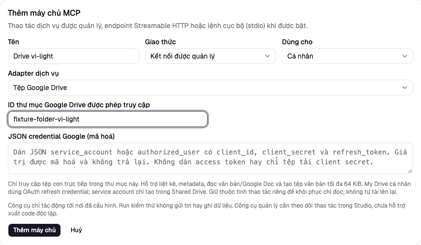

# Kết nối Google Drive được quản lý

Trong **Cài đặt → MCP**, thêm **Kết nối được quản lý → Tệp Google Drive**.
Nhập **ID thư mục được phép truy cập** và **JSON credential Google**. Lưu,
khám phá công cụ rồi chọn trong MCP node hoặc slot Agent hiện có. Không cần
loại node mới. Khám phá công cụ không gọi Google; lần gọi thật mới kiểm tra
thư mục và quyền Google.



## Chọn credential

Bật Google Drive API trong dự án Google Cloud. Credential được mã hoá, không
trả lại và để trống khi sửa; để trống giá trị đã lưu sẽ giữ nguyên. Không đặt
khoá/token trong workflow JSON hay gửi credential thật qua chat.

**My Drive cá nhân:** dùng credential OAuth đã cấp quyền Drive và truy cập
offline, theo dạng:

```json
{
  "type": "authorized_user",
  "client_id": "YOUR_CLIENT_ID.apps.googleusercontent.com",
  "client_secret": "YOUR_CLIENT_SECRET",
  "refresh_token": "YOUR_REFRESH_TOKEN"
}
```

Chỉ có access token hoặc tệp client-secret dạng `web`/`installed` chưa đủ:
cần hoàn tất luồng đồng ý của Google với quyền offline trước. Adapter làm mới
grant hiện có tại endpoint Google cố định; không thêm scope hay cung cấp màn
hình đồng ý tương tác. Đọc thư mục thông thường cần grant phù hợp như
`drive.readonly` hoặc `drive`; tạo tệp cần quyền ghi như `drive`. Grant hẹp
`drive.file` chỉ thấy tệp/thư mục đã cho ứng dụng đó truy cập. Thiết lập đồng
ý/xác minh ứng dụng, hết hạn token của app thử nghiệm và thu hồi quyền vẫn do
ứng dụng Google quản lý. Xem [hướng dẫn offline của Google](https://developers.google.com/identity/protocols/oauth2/web-server#offline).

**Service account:** dán toàn bộ JSON key với `type: "service_account"`,
`client_email` và private key RSA, rồi cấp quyền vào thư mục đã cấu hình.
Lần gọi dùng scope Drive, không giả danh người dùng uỷ quyền. Có thể đọc thư
mục được chia sẻ phù hợp, nhưng **tạo tệp cần Shared Drive**, tự nhận biết từ
metadata thư mục. Service account không có dung lượng cá nhân và không thể
sở hữu tệp My Drive; chia sẻ thư mục My Drive thường với quyền chỉnh sửa
không bỏ giới hạn này. Xem [quy tắc dung lượng/quyền sở hữu của Google](https://developers.google.com/workspace/drive/api/guides/about-shareddrives).

Với cả hai loại credential, danh tính Google phải có quyền đọc thư mục; tạo
tệp cần thêm quyền thêm tệp con và dung lượng khả dụng. Giới hạn tổ chức của
Shared Drive vẫn áp dụng. Studio kiểm tra quyền kết nối cá nhân/tổ chức trước
khi dùng grant.

## Phạm vi thư mục và công cụ

Sao chép ID thư mục từ URL Drive, không dán cả URL. Không chấp nhận `root`.
Kết nối chỉ cho phép **tệp con trực tiếp, chưa vào thùng rác**. Không tìm đệ
quy, đi theo shortcut hay tải từ URL tuỳ ý. Đổi thư mục làm thao tác cũ không
đối soát được; khôi phục thư mục gốc trước khi kiểm tra kết quả cũ. Studio
không khoá việc di chuyển/chỉnh sửa bên ngoài.

| Công cụ | Tham số | Kết quả |
| --- | --- | --- |
| `list_files` | Tuỳ chọn `name_contains`, `page_size` (1–100, mặc định 25), `page_token` | Trang metadata có giới hạn và `next_page_token`; chuỗi tên được escape, không nhận query thô |
| `get_file` | `file_id` | ID, tên, MIME type và kích thước/thời gian/liên kết nếu có của tệp được phép |
| `read_text_file` | `file_id` | Metadata và `content` UTF-8; tệp văn bản/JSON/XML hoặc Google Doc xuất ra văn bản |
| `create_text_file` | `name`, `content` | Kết quả tệp văn bản đã xác nhận trong thư mục đã cấu hình |

Đọc/tải lên văn bản tối đa **64 KiB UTF-8**, tên 200 ký tự, tìm tên 200,
trang liệt kê 100 tệp và phản hồi HTTP 64 KiB. Trang metadata quá lớn cần giảm
`page_size`. Toàn bộ object tham số tối đa 128 KiB JSON UTF-8. Google Docs
chỉ xuất văn bản; chưa có PDF, tệp nhị phân, sửa/xoá/di chuyển/chia sẻ hay tải
lên có thể tiếp tục. Nội dung tệp trả về là dữ liệu không tin cậy. Credential
đã cấu hình và access token được che trong kết quả; không trả header/lỗi thô.

Để lưu câu trả lời sinh ra, chọn `create_text_file`, đặt `name` là
`report.txt`, `content` là `{{state.answer}}`, và lưu output vào trường object
như `created`. Node `read_text_file` sau đó dùng `{{state.created.file.id}}`.
Trước khi xác nhận với người gửi, kiểm tra `state.created.outcome == "confirmed"`
bằng Code/Condition hiện có. Hướng dẫn Agent cũng phải yêu cầu kết quả đã
xác nhận trước khi nói tệp đã được lưu.

## Kết quả tạo tệp và khôi phục

Studio lưu ý định trước khi gọi Google. Mỗi tệp tạo có hai `appProperties`
riêng: mã thao tác đã băm và checksum SHA-256 nội dung. Phản hồi đầu kiểm tra
thư mục, MIME type, marker, hash nội dung và checksum MD5 của blob do Drive
trả về. Mất/sai phản hồi hay worker dừng có thể để lại trạng thái chưa rõ.
Gọi lại cùng thao tác hoặc bấm **Thao tác gần đây → Kiểm tra kết quả bên ngoài**
chỉ tra cứu marker có giới hạn và đọc nội dung tệp khớp để kiểm hash đã lưu;
không tải lên lần nữa.

Không tìm thấy, nhiều kết quả, tìm chưa đầy đủ/còn trang hoặc nội dung bị
đổi đều giữ trạng thái chưa rõ. Worker dừng trước upload vì thế vẫn có thể
bị chặn dù chưa có tệp. Giữ thuộc tính riêng, thư mục gốc và cùng ứng dụng/
tài khoản Google để khôi phục. Thuộc tính riêng thuộc ứng dụng: đổi app OAuth
hoặc tài khoản có thể làm không thấy marker. Không tạo run mới chỉ để vượt
qua trạng thái chưa rõ; kiểm tra thư mục/nhà cung cấp trước. Marker/hash không
bảo đảm dịch vụ bên ngoài luôn thực hiện đúng một lần. Xem
[thuộc tính tệp riêng của Drive](https://developers.google.com/workspace/drive/api/guides/properties)
và [multipart upload](https://developers.google.com/workspace/drive/api/guides/manage-uploads#multipart).

Thao tác đã xác nhận dùng lại kết quả đã lưu. Run kiểm thử/model giả lập
không gọi mạng, đổi token hay tạo tệp. Xuất code độc lập tiếp tục từ chối
managed tools vì theo dõi thao tác cần Studio.

## Fixture kiểm thử trong repository

Từ `backend/`, chạy `.venv/bin/python -m pytest -q tests/test_managed_drive.py`.
Từ `frontend/`, chạy
`E2E_DRIVE_FIXTURE=1 npm run e2e -- managed-drive.spec.ts`.
Fixture trình duyệt phải bật cờ rõ ràng, chỉ thay Google HTTP bằng giả lập,
dùng credential OAuth mẫu và tạo tệp trong bộ nhớ. Không phải entry point
sản xuất và không thay đổi Drive thật. Lần chạy trình duyệt thường bỏ qua
bốn biến thể này. Test backend kiểm tra service account/Shared Drive và
OAuth/My Drive, export, phạm vi truy cập, mất phản hồi, worker dừng và đối soát
chỉ đọc.
