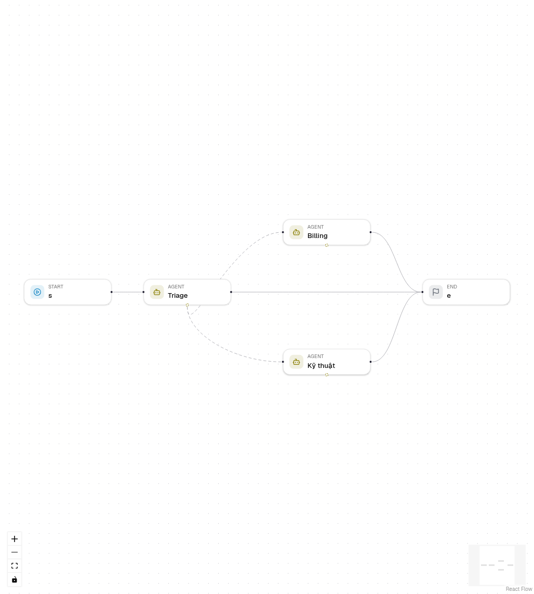

# Chuyển giao giữa các agent

Một node Agent có thể chuyển cuộc trò chuyện cho một node Agent khác trong
cùng workflow. Agent nhận việc thấy những gì người dùng đã nói và các agent đã
trả lời, cùng lý do chuyển giao, rồi tự trả lời người dùng. Dùng chuyển giao khi
mỗi agent phụ trách một chủ đề, ví dụ bàn hỗ trợ có phân loại, thanh toán và kỹ
thuật.

## Thiết lập chuyển giao

1. Thêm hai node Agent trở lên. Nối agent đầu tiên (agent tiếp nhận) với
   Start, và mỗi agent tới nơi workflow đi tiếp sau khi nó trả lời.
2. Chọn agent tiếp nhận. Ở mục **Chuyển giao** trong **Cài đặt**, chọn
   **Thêm chuyển giao** rồi chọn agent đích.
3. Mô tả khi nào nên chuyển, ví dụ "Thanh toán trùng, hoàn tiền và hoá đơn".
   Model đọc mô tả này để quyết định.
4. Hoặc kéo từ chấm nét đứt ở cạnh dưới node Agent tới một node Agent khác.
   Xóa đường nét đứt sẽ bỏ chuyển giao đó.

Agent chỉ được tới bằng chuyển giao không cần cạnh đi vào.

## Điều gì xảy ra khi chạy

- Model nhận một công cụ `transfer_to_<agent>` cho mỗi agent đích, kèm
  `reason` không bắt buộc.
- Khi model gọi công cụ đó, agent dừng. Các lời gọi công cụ khác trong cùng
  vòng không chạy, và model được báo điều đó.
- Bước **chuyển giao** ghi ai nhận việc và vì sao, rồi agent đích bắt đầu với
  cuộc trò chuyện đến lúc đó. Lời gọi công cụ và kết quả ở lại với agent đã gọi.
- Agent đã chuyển giao không ghi trường đầu ra; agent đích ghi.

## Giới hạn chuyển giao

**Giới hạn chuyển giao mỗi run** (thiết lập workflow `max_handoffs`, từ 0
đến 20, mặc định 5) giới hạn số lần chuyển giao trong một run. Khi đạt giới
hạn, công cụ chuyển giao bị bỏ và agent hiện tại phải tự trả lời. Đặt giá trị
này dưới danh sách chuyển giao của bất kỳ node Agent nào, hoặc trong bảng Cấu
hình khi không chọn gì.

## Trong chat

Sau một lần chuyển giao, tin nhắn tiếp theo trong cùng phiên chat bắt đầu ở
agent trả lời gần nhất, nên người dùng tiếp tục nói chuyện với Billing. Nếu
agent đó đã bị xóa hoặc không còn là đích chuyển giao, chat bắt đầu lại ở agent
tiếp nhận. Phiên mới luôn bắt đầu ở agent tiếp nhận.

Điều này cần Start nối thẳng vào agent tiếp nhận. Khi có node khác nằm giữa
Start và agent đầu tiên (che dữ liệu cá nhân, bộ lọc, tra cứu khách hàng), các
node đó chạy ở mọi tin nhắn, và chat khi đó bắt đầu ở agent tiếp nhận mỗi lần
thay vì bỏ qua chúng.

## Trace

Trace của run và các bước trong chat hiện **Triage › hand-off** cùng agent đích
và lý do. Các bước của agent đích nối tiếp sau đó.

## Chuyển giao, agent điều phối và công cụ workflow

| Cách làm | Ai trả lời | Dùng khi |
| --- | --- | --- |
| Chuyển giao | Agent đích, trực tiếp | Mỗi agent phụ trách một chủ đề và nói chuyện với người dùng |
| Agent điều phối với công cụ workflow | Agent điều phối, dựa trên kết quả | Một agent cần tổng hợp những gì các chuyên gia tìm được |
| Node Condition hoặc Decision | Node của nhánh | Đường đi là một quy tắc cố định, không do model chọn |

## Xuất code

Python, dự án LangGraph và TypeScript xuất cùng các bước: công cụ chuyển giao,
node `<agent>_handoff` có cạnh điều kiện tới agent đích, `MAX_HANDOFFS`, và
đầu vào `start_agent` để bắt đầu run ở một agent đích.

## Lỗi

| Mã | Khi nào |
| --- | --- |
| `AGENT_HANDOFF_TARGET_INVALID` | Đích không phải node Agent khác trong workflow này, hoặc bị liệt kê hai lần. |
| `AGENT_HANDOFF_LIMIT` | `max_handoffs` không phải số nguyên từ 0 đến 20. |
