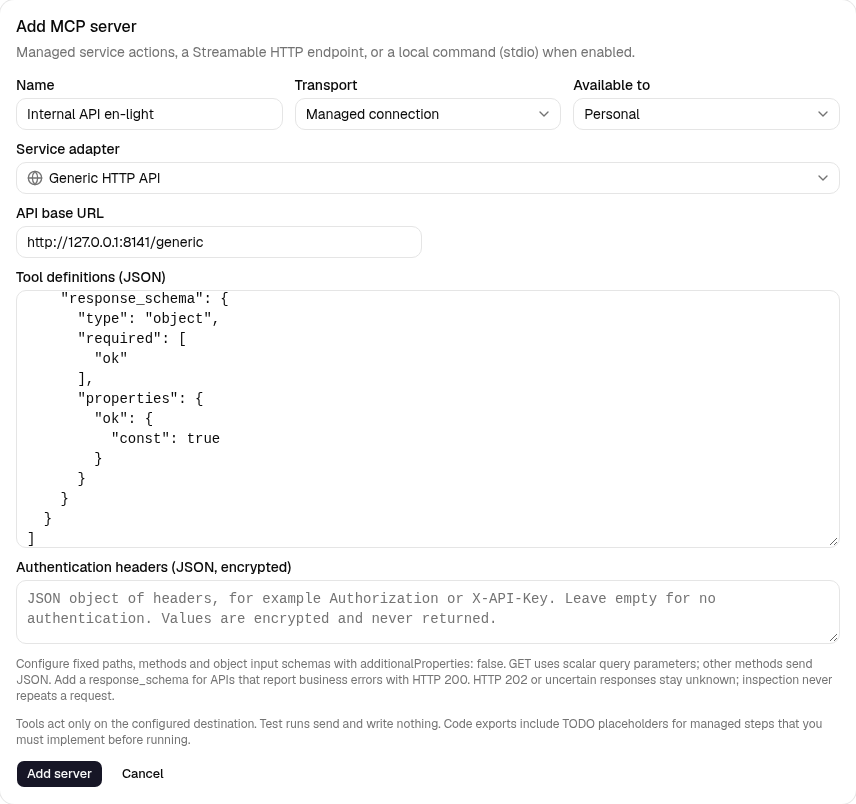
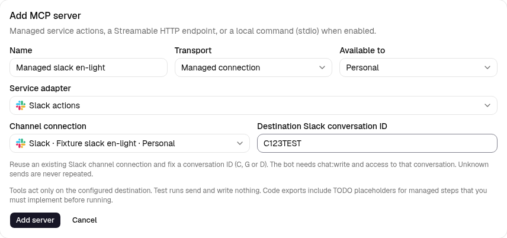
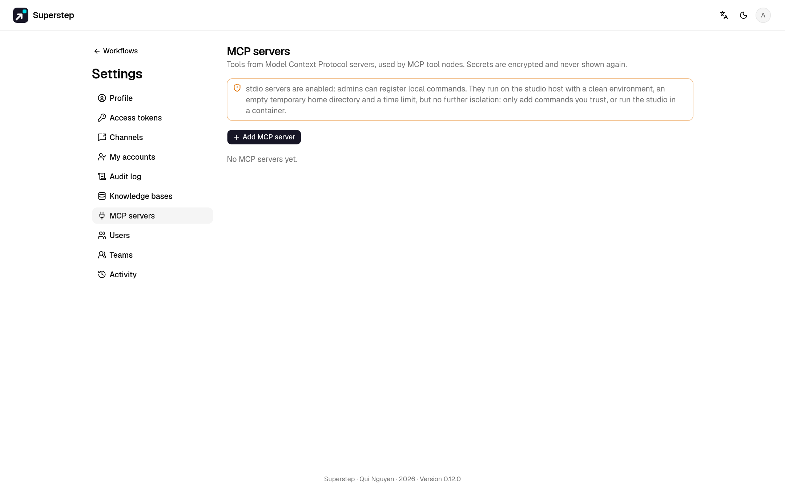

# Máy chủ MCP

## Kết nối được quản lý

Trong **Cài đặt → MCP**, thêm **Kết nối được quản lý**, chọn adapter dịch vụ,
rồi bấm khám phá công cụ. Chọn kết nối này trong node **MCP tool** hoặc slot
công cụ MCP của Agent như với máy chủ MCP từ xa. Logic riêng của dịch vụ nằm
trong adapter, không tạo loại node riêng trên canvas.

| Adapter | Cấu hình kết nối | Tham số công cụ |
| --- | --- | --- |
| Thao tác Telegram | Kết nối Telegram đã có; ID cuộc chat nhận tin cố định | `send_message`: `text` thuần, `reply_to_message_id` dạng số nguyên nếu cần |
| Thao tác Google Sheets | ID spreadsheet và tên tab cố định; số cột dữ liệu (1–25); khoá JSON service account được mã hoá | `append_row`: `values` với đúng số phần tử vô hướng đã cấu hình |
| HTTP API tổng quát | URL gốc cố định, JSON định nghĩa công cụ và JSON header xác thực được mã hoá | Các công cụ đã khai báo; GET gửi query dạng đơn, phương thức khác gửi object JSON |
| Thao tác Slack | Kết nối kênh Slack và ID cuộc trò chuyện nhận cố định (C/G/D) | `send_message`: `text`, thêm `thread_ts` nếu cần |
| Thao tác WhatsApp | Kênh WhatsApp và số quốc tế cố định của người nhận, chỉ chữ số | `send_message`: `text` |
| Thao tác email | Kênh email, tối đa 10 nơi nhận cố định; cấu hình SMTP của studio | `send_email`: `text`, thêm `subject` nếu cần |
| Thao tác Microsoft Teams | Kênh Teams đã có với webhook Workflows được mã hoá | `send_message`: `text` |
| [Tệp Google Drive](google-drive.md) | ID thư mục cố định; JSON service account hoặc OAuth người dùng được mã hoá | Liệt kê/tìm, metadata, đọc văn bản/Google Doc có giới hạn, tạo tệp văn bản |

Tạo [service account Google](https://developers.google.com/identity/protocols/oauth2/service-account),
bật Sheets API, chia sẻ spreadsheet cho email đó với quyền chỉnh sửa rồi dán
khoá JSON vào Cài đặt. Sheet được chia sẻ trực tiếp không cần OAuth người dùng
hay uỷ quyền toàn miền. Secret được mã hoá, không trả lại trong metadata công cụ
hoặc workflow JSON. Telegram dùng lại secret của kết nối kênh; không thể chọn
kênh cá nhân của người khác để cấp quyền qua kết nối MCP tổ chức. Quyền sử dụng
và chính sách tổ chức được kiểm tra lại khi gọi.

Với sáu cột dữ liệu, đặt tiêu đề tại A–F và dành cột G cho ID thao tác. Giữ
nguyên cột này. [API append của Sheets](https://developers.google.com/workspace/sheets/api/reference/rest/v4/spreadsheets.values/append)
nhận giá trị `RAW`: chuỗi vẫn là văn bản, kể cả nội dung giống công thức; số
vẫn là số. ID bổ sung cho phép tìm kết quả khi mất phản hồi. Đối soát đọc tối
đa 100.000 dòng; chuyển sang tab mới trước giới hạn đó. Không để công cụ khác
sửa hoặc xoá ID thao tác trong cùng tab.

### HTTP API tổng quát



Chọn **HTTP API tổng quát** trong kết nối được quản lý. Nhập URL gốc HTTPS,
ví dụ `https://api.example.com/v1`. Đường dẫn công cụ là đường dẫn tương đối
cố định, không dùng template. Tham số lúc chạy không được chọn URL, phương
thức hay header. Địa chỉ nội bộ và HTTP thường cần máy chủ bật rõ
`STUDIO_MCP_ALLOW_PRIVATE=1`. Mỗi yêu cầu kiểm tra địa chỉ và kết nối tới IP
đã xác minh; không đi theo redirect.

Dán mảng JSON vào **Định nghĩa công cụ**, ví dụ:

```json
[
  {
    "name": "create_record",
    "description": "Create a record in the configured API",
    "method": "POST",
    "path": "/records",
    "input_schema": {
      "type": "object",
      "additionalProperties": false,
      "required": ["text"],
      "properties": {"text": {"type": "string", "maxLength": 4000}}
    },
    "success_statuses": [200, 201],
    "response_schema": {
      "type": "object",
      "required": ["ok"],
      "properties": {"ok": {"const": true}}
    }
  }
]
```

Hỗ trợ GET, POST, PUT, PATCH và DELETE. Schema input phải là object với
`additionalProperties: false`. Thuộc tính GET có kiểu vô hướng; phương thức
khác gửi toàn bộ object tham số làm JSON. Schema không được chứa tham chiếu.
Chưa có biến đường dẫn động, form data hay tải tệp. Khai báo công cụ cố định
riêng khi cần đích khác nhau, bấm **Khám phá công cụ** rồi chọn trong MCP node
hoặc slot Agent. Khám phá lại sau khi sửa cấu hình.

**Header xác thực** là object JSON được mã hoá, có thể để trống, ví dụ
`{"Authorization":"Bearer YOUR_API_TOKEN"}` hoặc `{"X-API-Key":"YOUR_API_KEY"}`.
Không đặt credential trong URL gốc hay định nghĩa công cụ công khai. Studio
quản lý header host, truyền tải, cookie và ID thao tác; header xác thực không
được ghi đè chúng. Giá trị đã lưu không trả lại. Chuỗi credential đã cấu hình
được che trong dữ liệu phản hồi; không trả lại header hay URL phản hồi. Xem
dữ liệu API nhận được là nội dung không tin cậy.

Giới hạn: 20 công cụ, JSON định nghĩa 32 KiB, JSON header 4 KiB, JSON sâu tối
đa 16 cấp, tham số 128 KiB và phản hồi 256 KiB. Thời gian chờ yêu cầu quản lý
là 20 giây. Chỉ hỗ trợ phản hồi JSON hoặc body rỗng. Mã thành công mặc định
là 200, 201, 204; dùng `success_statuses` cho mã 2xx đã hoàn tất khác. HTTP
202 luôn chưa rõ kết quả vì xử lý chưa xong. Phản hồi thành công nhưng JSON
sai, quá lớn hoặc sai schema cũng chưa rõ kết quả. Xem
[ngữ nghĩa HTTP](https://www.rfc-editor.org/rfc/rfc9110.html#name-202-accepted).

HTTP thành công chỉ xác nhận hợp đồng phản hồi đã cấu hình, không tự xác
nhận mọi kết quả nghiệp vụ hay giao tin. Thêm `response_schema` nếu API có
thể báo lỗi bằng HTTP 200; điều kiện `ok: true` trong ví dụ phải khớp API của
bạn. Mỗi yêu cầu gửi `Idempotency-Key` cố định; việc chống trùng bên ngoài
phụ thuộc hợp đồng của API. Adapter tổng quát chưa có cách tra cứu kết quả
bên ngoài tự động: thao tác timeout/chưa rõ luôn bị chặn, không gửi lại, kể
cả khi bấm **Kiểm tra kết quả bên ngoài**. Kiểm tra API trước khi tạo run mới.

### Thao tác dùng lại kết nối kênh



Tạo kết nối nguồn trong **Cài đặt → Kênh**, sau đó chọn adapter tương ứng
trong **Cài đặt → MCP → Kết nối được quản lý**. Danh sách kênh chỉ hiện đúng
nền tảng; dùng lại credential đã lưu, không cần sao chép sang form khác.
Quyền cá nhân/tổ chức được kiểm tra lại khi chạy. Kết nối MCP cá nhân không
được vượt chính sách kênh tổ chức. Kênh bị xoá hoặc mất quyền sẽ từ chối gửi.

- **Slack:** chọn ID cuộc trò chuyện bắt đầu bằng C, G hoặc D. Bot cần
  `chat:write` và quyền vào nơi nhận; gửi kênh công khai có thể cần thêm
  `chat:write.public`. Văn bản được escape, tắt markdown và xem trước liên
  kết; `thread_ts` cho phép trả lời trong thread. Xem
  [chat.postMessage](https://docs.slack.dev/reference/methods/chat.postMessage/).
- **WhatsApp:** cố định số quốc tế của người nhận, không có dấu `+`. Adapter
  gửi văn bản trong cửa sổ dịch vụ khách hàng (thường 24 giờ sau tin của người
  nhận). Không dùng lại mẫu yêu cầu duyệt của kênh hay gửi nút duyệt. Nhà cung
  cấp có thể từ chối giao ngoài cửa sổ đó dù đã nhận yêu cầu. Xem
  [hợp đồng tin văn bản của Meta](https://whatsapp.github.io/WhatsApp-Nodejs-SDK/api-reference/messages/text/).
- **Email:** tối đa 10 nơi nhận duy nhất, cách nhau bằng dấu phẩy. Dùng kênh
  email và địa chỉ SMTP của studio (`SMTP_HOST`, `SMTP_PORT`, `SMTP_FROM`
  cùng tuỳ chọn xác thực/TLS hiện có) do quản trị viên cấu hình. `subject`
  tuỳ chọn, mặc định `Superstep`; `text` là văn bản thuần. Xuống dòng trong
  header được chuẩn hoá. Dùng chung hạn mức người nhận
  `STUDIO_EMAIL_NODE_HOURLY_LIMIT` với node Send email của chủ workflow;
  run giả lập và kết quả dùng lại không tính thêm. Message-ID cố định cho
  thao tác, không bảo đảm SMTP bên ngoài chống trùng.
- **Teams:** chọn kênh Workflows đã có; URL mã hoá cố định nơi nhận. Gửi
  Adaptive Card văn bản, không có liên kết hay nút duyệt. Phản hồi có thể là
  HTTP 202: hợp đồng Workflows chỉ xác nhận nhận yêu cầu, chưa xác nhận giao
  tin sau đó. Xem [webhook Teams Workflows](https://learn.microsoft.com/en-us/microsoftteams/platform/webhooks-and-connectors/how-to/add-incoming-webhook).

Văn bản tối đa 4.000 ký tự; tiêu đề email tối đa 200. Kết quả thành công có
`delivery: "accepted"`: chỉ xác nhận nhận yêu cầu gửi, không khẳng định người
nhận đã đọc hay nhận tin. Bị HTTP từ chối là lỗi; mất phản hồi, API thành công
nhưng sai định dạng và SMTP nhận một phần/chưa rõ đều giữ trạng thái chưa rõ.
Các adapter này chưa hỗ trợ tra cứu chỉ đọc và không gửi lại thao tác chưa
rõ, kể cả khi bấm **Kiểm tra kết quả bên ngoài**. Kiểm tra Slack/WhatsApp,
log SMTP hoặc workflow Teams trước khi tạo run mới. Khác với adapter HTTP
tổng quát, trường hợp HTTP 202 ở Teams có hợp đồng nhận yêu cầu cụ thể.

Webhook JSON có chữ ký vẫn chỉ nhận sự kiện, không phải nơi gửi tin. Telegram
và Sheets giữ hành vi hiện có; chọn công cụ của mỗi kết nối trong cùng giao
diện node MCP hoặc Agent.

Để kiểm thử trình duyệt riêng, chạy từ `frontend/`:
`E2E_CHANNEL_SMTP=1 npm run e2e -- managed-channel-actions.spec.ts`.
Cờ này bật SMTP sink cục bộ và dùng API kênh giả lập. Bộ trình duyệt mặc định
không bật SMTP của studio, kiểm tra Slack/WhatsApp/Teams; email cần bật cờ rõ
ràng. Không trỏ fixture này tới dịch vụ thật.

### Kết quả ghi và khôi phục

Mỗi thao tác ghi cần ID cố định từ workflow. Studio lưu ý định trước khi gọi
dịch vụ. Kết quả đã xác nhận được dùng lại cho cùng run/node/lần lặp; đổi tham
số hoặc nơi ghi sẽ bị từ chối. MCP node cũng dùng sổ kết quả và cơ chế chặn
worker đã mất quyền xử lý hiện có.

**Thao tác gần đây** hiển thị chờ xác nhận, đã xác nhận, bị từ chối hoặc chưa
rõ kết quả cùng ID thao tác bên ngoài. **Kiểm tra kết quả bên ngoài** chỉ đọc:
Sheets có thể xác nhận ID đã ghi, nhưng không tìm thấy dòng không có nghĩa là
được append lại. Máy chủ dừng trước khi gửi cũng có thể để lại ý định chưa rõ.
Telegram không tìm được tin đã gửi theo ID này, nên thao tác gửi chưa rõ kết
quả vẫn bị chặn. Không tạo run mới chỉ để vượt qua trạng thái chưa rõ; kiểm
tra dịch vụ bên ngoài trước. Khôi phục nơi ghi gốc trước khi đối soát thao tác
cũ; có thể thay khoá xác thực mà giữ nguyên nơi ghi.

Chỉ báo thành công sau thao tác **đã xác nhận**. Bị từ chối hoặc chưa rõ kết
quả sẽ dừng MCP node thường. Agent nhận lỗi công cụ bình thường; hướng dẫn
Agent phải yêu cầu xác nhận trước khi báo thành công. Run kiểm thử và run dùng
model giả lập không gửi tin, ghi sheet, đổi token hay lưu ý định. MCP HTTP/stdio
giữ nguyên hành vi. Xuất Python/TypeScript giữ bước quản lý dưới dạng TODO rõ ràng.
Bước này báo lỗi cho đến khi bạn triển khai xác thực, theo dõi thao tác, chống ghi
lặp và đối soát bên ngoài Studio; không xuất cấu hình kết nối hay khoá bí mật. Template để trống tham chiếu
tài nguyên; chọn kết nối sau khi tạo workflow từ mẫu.

Máy chủ [Model Context Protocol](https://modelcontextprotocol.io) cung cấp
công cụ. Đăng ký máy chủ một lần, rồi gọi công cụ của nó từ các node
[MCP tool](nodes.md#mcp-tool).



## Trước khi bắt đầu

- Vai trò `admin` hoặc `editor` cho server cá nhân. Server của tổ chức và lệnh
  stdio cần admin.
- Server hỗ trợ Streamable HTTP, hoặc với stdio, `STUDIO_MCP_STDIO=1` trên máy
  chạy API.

## Đăng ký máy chủ

Mở **Cài đặt → Máy chủ MCP**, chọn **Thêm máy chủ MCP**.

=== "Streamable HTTP"

    Một URL và header bí mật (tuỳ chọn). URL phải là địa chỉ công khai; kết nối
    được ghim vào IP đã kiểm tra. Địa chỉ private và loopback (ví dụ một
    container sidecar) cần `STUDIO_MCP_ALLOW_PRIVATE=1`.

=== "stdio"

    Một lệnh, các tham số (mỗi dòng một tham số) và biến môi trường bí mật, chạy như process con của API. Stdio tắt cho tới khi
    `STUDIO_MCP_STDIO=1`, và chỉ admin mới đăng ký được lệnh. Process nhận môi
    trường sạch, thư mục home tạm rỗng và `STUDIO_MCP_TIMEOUT` giây (mặc định
    30), sau đó cả nhóm process bị kill.

    !!! warning
        Đây không phải sandbox. Máy chủ MCP không tin cậy nên chạy thành
        container HTTP riêng.

**Lấy danh sách công cụ** liệt kê những gì máy chủ cung cấp. Phạm vi là cá nhân hoặc toàn
tổ chức; admin chọn vai trò nào được dùng máy chủ của tổ chức. Secret được mã
hoá, API chỉ trả về tên và giá trị đã che.

## Gọi công cụ

Trong node MCP tool, chọn máy chủ và công cụ; mô tả của công cụ hiện trong cấu
hình. Chuỗi trong arguments là [template](state.md#tham-chieu).
Argument đúng bằng một tham chiếu thì giữ nguyên kiểu. Kết quả ghi vào
`output_field`.

Workflow được chia sẻ chạy bằng máy chủ MCP của **chủ** workflow.

Để client MCP gọi workflow **của bạn** như công cụ, xem [Workflow làm công cụ MCP](../run/mcp-server.md).

## Node MCP hay node Agent

Node MCP tool gọi một công cụ với các tham số bạn điền sẵn, ở một chỗ cố định
trong graph. Muốn model tự quyết định có gọi công cụ không, gọi lúc nào và với
tham số gì, hãy thêm công cụ đó vào một [node Agent](agent.md): chọn máy chủ và
công cụ, model sẽ đọc mô tả và schema input của công cụ từ máy chủ. Model chỉ
được dùng các công cụ bạn thêm, không bao giờ là cả danh sách của máy chủ.
