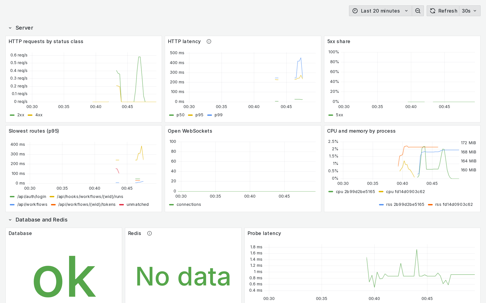
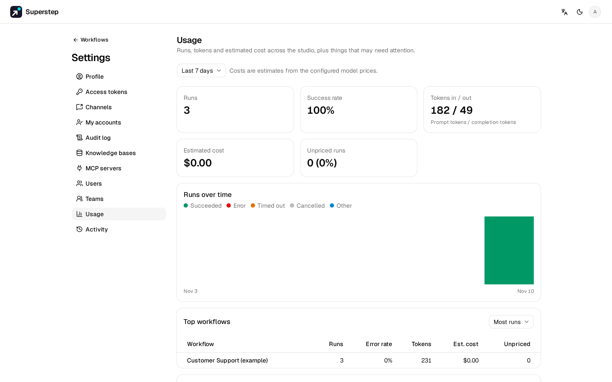

# Quan sát hệ thống

## Health và readiness

`GET /api/health` là **liveness**: trả 200 khi tiến trình còn phục vụ HTTP.
Endpoint này không truy vấn cơ sở dữ liệu. Nó cho biết `llm_mode`, `database`
(tên dialect), `run_bus` và bus có phản hồi không (`run_bus_ok`), `tracing` và
`import_enabled`. Container `web` trả lời `/healthz`.

`GET /api/ready` là **readiness**. Endpoint này không cần đăng nhập và:

- chạy `SELECT 1` trên cơ sở dữ liệu và ping Redis khi có `REDIS_URL`, mỗi
  lệnh có timeout 2 giây, và báo độ trễ;
- báo hàng đợi (số job `ready`, `delayed`, `processing` và tuổi của run
  queued lâu nhất), các worker còn sống (slot đang bận, sức chứa và tuổi của
  heartbeat mới nhất), loại run bus, và `in_memory_in_production` khi
  production chạy không có Redis.

Endpoint trả 503 `SERVICE_NOT_READY` khi cơ sở dữ liệu lỗi, hoặc khi Redis
được cấu hình mà lỗi, kèm cùng báo cáo trong `error.details`. Hàng đợi tồn
đọng hay thiếu worker không làm readiness thất bại; hãy đặt cảnh báo cho
chúng. Cả hai endpoint đều không trả URL, tên máy chủ hay secret.

`HEALTHCHECK` của Docker và template Render, DigitalOcean vẫn dùng
`/api/health`: khởi động lại container không sửa được cơ sở dữ liệu chết. Hãy
trỏ load balancer hoặc rolling deploy tới `/api/ready` khi muốn ngừng gửi
traffic tới instance không kết nối được cơ sở dữ liệu.

## Metric

Metric mặc định tắt. Đặt `STUDIO_OTEL_METRICS=1` cùng một endpoint OTLP
(`OTEL_EXPORTER_OTLP_ENDPOINT`, hoặc `OTEL_EXPORTER_OTLP_METRICS_ENDPOINT`) thì
mọi tiến trình API và worker sẽ đẩy metric OpenTelemetry tới đó.
`OTEL_METRIC_EXPORT_INTERVAL` đặt chu kỳ gửi, tính bằng mili giây (mặc định
60000). Backend không có trang `/metrics` riêng: hãy trỏ nó tới một
OpenTelemetry Collector, rồi để Prometheus hoặc hệ thống khác đọc từ collector.

Mỗi tiến trình báo `service.name` (`OTEL_SERVICE_NAME`, mặc định `superstep`)
và `service.instance.id` riêng.

### Run và model

| Metric | Loại | Nhãn | Nghĩa |
| --- | --- | --- | --- |
| `studio.runs` | counter | `status`, `source`, `workflow_id` | Số run đã kết thúc |
| `studio.run.duration` | histogram, ms | `status`, `source`, `workflow_id` | Thời gian run thực sự chạy |
| `studio.tokens` | counter | `status`, `source`, `workflow_id`, `direction` | Token LLM của mỗi run |
| `studio.cost` | counter, USD | `status`, `source`, `workflow_id` | Chi phí ước tính của mỗi run; run chưa có giá bị bỏ qua |
| `studio.errors` | counter | `status`, `source`, `workflow_id` | Số sự kiện lỗi |
| `studio.llm.tokens` | counter | `model`, `provider`, `workflow_id`, `direction` | Token của mỗi lời gọi model |
| `studio.llm.cost` | counter, USD | `model`, `provider`, `workflow_id` | Chi phí ước tính của các lời gọi có giá |
| `studio.llm.unpriced` | counter | `model`, `provider` | Lời gọi tới model chưa có giá |
| `studio.llm.errors` | counter | `code`, `provider`, `model` | Lời gọi model thất bại, theo mã lỗi |
| `studio.llm.fallbacks` | counter | `primary_provider`, `fallback_provider`, `code` | Lời gọi do model dự phòng trả lời |

HTTP 429 từ provider được tính là `PROVIDER_RATE_LIMITED`, tách riêng khỏi các
lỗi provider khác. Run tạm (ad hoc) dùng `workflow_id="adhoc"`.

### Server

| Metric | Loại | Nhãn | Nghĩa |
| --- | --- | --- | --- |
| `studio.http.server.requests` | counter | `route`, `method`, `status_class` | Số request HTTP |
| `studio.http.server.duration` | histogram, ms | `route`, `method`, `status_class` | Thời gian xử lý request; không đo `/api/health` và `/api/ready` |
| `studio.ws.connections` | up-down counter | không có | Số WebSocket đang mở |
| `studio.process.cpu_time` | counter, s | không có | Thời gian CPU của tiến trình |
| `studio.process.rss` | gauge, byte | không có | Bộ nhớ thường trú của tiến trình |

`route` là mẫu route, ví dụ `/api/workflows/{wid}`, không bao giờ là đường dẫn
thô. Request không khớp route nào có nhãn `unmatched`.

### Cơ sở dữ liệu, Redis, hàng đợi và worker

| Metric | Loại | Nhãn | Nghĩa |
| --- | --- | --- | --- |
| `studio.ready.db` | gauge | không có | 1 khi kiểm tra cơ sở dữ liệu đạt, 0 khi lỗi |
| `studio.ready.db.latency` | gauge, ms | không có | Thời gian kiểm tra cơ sở dữ liệu |
| `studio.ready.redis` | gauge | không có | Tương tự cho Redis; không có khi thiếu `REDIS_URL` |
| `studio.ready.redis.latency` | gauge, ms | không có | Thời gian kiểm tra Redis |
| `studio.queue.depth` | gauge | `state` (`ready`, `delayed`, `processing`) | Số job trong hàng đợi |
| `studio.queue.oldest_age` | gauge, s | không có | Tuổi của run queued lâu nhất |
| `studio.worker.heartbeat_age` | gauge, s | không có | Tuổi của heartbeat worker mới nhất |
| `studio.worker.busy` | gauge | không có | Slot job đang bận của worker này |
| `studio.worker.capacity` | gauge | không có | Số slot job của worker này |
| `studio.jobs.reaped` | counter | không có | Job được đưa lại hàng đợi khi hết hạn lease |
| `studio.jobs.recovered` | counter | không có | Run chưa xong được đưa lại hàng đợi lúc khởi động |
| `studio.run_bus.in_memory` | gauge | không có | 1 khi tiến trình chạy không có `REDIS_URL` |
| `studio.db.pool.in_use` | gauge | không có | Kết nối cơ sở dữ liệu đang được lấy ra từ pool của tiến trình này |
| `studio.db.pool.idle` | gauge | không có | Kết nối rảnh trong pool của tiến trình này |
| `studio.db.pool.overflow` | gauge | không có | Kết nối vượt quá kích thước pool |

Các gauge kiểm tra dùng lại phép kiểm tra của `/api/ready`, tối đa mỗi 5 giây
một lần cho mỗi tiến trình.

### Tình trạng sản phẩm

Chỉ tiến trình có chạy worker mới báo các metric này (service `worker`, hoặc
API khi tự chạy worker). Chúng được làm mới tối đa mỗi 30 giây.

| Metric | Loại | Nghĩa |
| --- | --- | --- |
| `studio.approvals.waiting` | gauge | Bước duyệt đang chờ trả lời |
| `studio.approvals.oldest_age` | gauge, s | Tuổi của bước duyệt chờ lâu nhất |
| `studio.webhooks.failed` | gauge | Lần gửi webhook thất bại trong giờ vừa qua |
| `studio.webhooks.retrying` | gauge | Lần gửi webhook đang chờ thử lại |
| `studio.schedules.overdue` | gauge | Lịch chạy đang bật mà trễ quá 5 phút |
| `studio.schedules.disabled` | gauge | Lịch chạy bị scheduler tắt sau nhiều lần lỗi |

### Nhãn và số lượng series

Nhãn chỉ nằm trong một danh sách cố định: `status`, `source`, `workflow_id`,
`model`, `provider`, `code`, `direction`, `route`, `method`, `status_class`,
`state`, `primary_provider` và `fallback_provider`. Thuộc tính khác bị bỏ trước
khi xuất. Không metric nào mang id người dùng, id run, email, đường dẫn thô
hay nội dung prompt. `workflow_id` tăng theo số workflow; hãy bỏ nhãn này ở
collector nếu hệ thống của bạn không chịu được số series đó.

## Grafana với Compose

Profile `observability` chạy OpenTelemetry Collector, Prometheus, Grafana và
Jaeger cạnh studio. Backend đẩy OTLP tới collector; Prometheus đọc từ
collector; collector chuyển trace sang Jaeger. Cấu hình nằm trong
`deploy/observability/`.

```bash
docker compose --env-file .env --env-file deploy/observability/observability.env \
  --profile observability up --build
```

`deploy/observability/observability.env` đặt
`OTEL_EXPORTER_OTLP_ENDPOINT=http://otel-collector:4318`,
`STUDIO_OTEL_METRICS=1`, chu kỳ gửi 15 giây, `STUDIO_TRACE_URL` của Jaeger và
`STUDIO_GRAFANA_URL=http://localhost:3000`.

| Service | Địa chỉ |
| --- | --- |
| Grafana | `http://localhost:3000` (chỉ trên 127.0.0.1; `GRAFANA_PORT`) |
| Jaeger | `http://localhost:16686` |
| Prometheus, collector | chỉ trong mạng Compose |

Grafana đăng nhập bằng `admin` với `GRAFANA_ADMIN_PASSWORD`, mặc định là
`admin`. Hãy đặt mật khẩu riêng trong `.env` trước khi mở Grafana ra ngoài.
`PROMETHEUS_RETENTION` (mặc định `15d`) đặt thời gian Prometheus giữ dữ liệu.

Dashboard **Superstep overview** trong thư mục **Superstep** có các hàng cho
server (request, độ trễ, tỉ lệ 5xx, route chậm nhất, WebSocket, CPU và bộ
nhớ), cơ sở dữ liệu và Redis, hàng đợi và worker, run và model (run theo
trạng thái, tỉ lệ lỗi, thời gian, token và chi phí theo model và workflow, lời
gọi chưa có giá, lỗi model, model dự phòng) và tình trạng sản phẩm.



Trong Prometheus, tên dùng dấu gạch dưới và không có hậu tố đơn vị:
`studio.http.server.requests` thành `studio_http_server_requests`, và
collector gắn nhãn `job` (tên service) và `instance` (id instance).

### Server Postgres và Redis

Collector cũng tự đọc server Postgres và Redis của stack Compose bằng các
receiver `postgresql`, `sqlquery` và `redis`, nên Prometheus vẫn chỉ thu
thập từ collector. Dashboard hiện số kết nối Postgres theo trạng thái so với
`max_connections`, commit, rollback và deadlock, tỉ lệ trúng cache và dung
lượng cơ sở dữ liệu, cùng bộ nhớ Redis so với `maxmemory`, số client, số thao
tác mỗi giây, số key bị loại và số key. Khi không có Redis, các panel đó để
trống.

Collector đăng nhập Postgres bằng một role chỉ đọc thuộc `pg_monitor` (các
view thống kê, không có dữ liệu bảng). Đặt `POSTGRES_MONITOR_PASSWORD` (và
tuỳ chọn `POSTGRES_MONITOR_USER`, mặc định `superstep_monitor`) trong `.env`;
service chạy một lần `postgres-monitor` tạo hoặc cập nhật role mỗi lần `up`.
Khi mật khẩu trống, không role nào được tạo và các panel Postgres để trống.
Với cơ sở dữ liệu được quản lý, hãy tự tạo role:

```sql
CREATE ROLE superstep_monitor LOGIN PASSWORD 'choose-a-password';
GRANT pg_monitor TO superstep_monitor;
```

## Cảnh báo

Profile tạo sẵn các quy tắc cảnh báo Grafana sau trong thư mục **Superstep**.
Ngưỡng nằm ở đầu file
`deploy/observability/grafana/provisioning/alerting/rules.yaml`, dưới
`x-thresholds`; sửa rồi khởi động lại Grafana. Thêm một contact point trong
Grafana để nhận thông báo.

| Cảnh báo | Bật khi | Mặc định |
| --- | --- | --- |
| Instance down | Không tiến trình nào báo metric: collector bỏ tiến trình im lặng sau 5 phút, rồi quy tắc chờ thêm 5 phút | |
| Database down | `studio.ready.db` bằng 0 trong 1 phút | |
| Redis down | `studio.ready.redis` bằng 0 trong 1 phút | |
| HTTP 5xx share | Tỉ lệ phản hồi 5xx trong 5 phút | trên 5% trong 5 phút |
| Queue backlog (depth) | Số job sẵn sàng trong hàng đợi | trên 100 trong 5 phút |
| Queue backlog (oldest run) | `studio.queue.oldest_age` | trên 300 giây trong 5 phút |
| Worker missing | `studio.worker.heartbeat_age`, hoặc không có heartbeat nào | trên 60 giây trong 2 phút |
| Run error rate | Run kết thúc lỗi hoặc quá thời gian trong 15 phút | trên 20% trong 15 phút |
| Provider auth or unreachable | `studio.llm.errors` với `PROVIDER_AUTH_FAILED` hoặc `PROVIDER_UNREACHABLE` | có lỗi trong 5 phút |
| Provider rate limited (cảnh báo nhẹ) | `studio.llm.errors` với `PROVIDER_RATE_LIMITED` | có lỗi trong 5 phút |
| Daily cost | Mức tăng của `studio.cost` trong 24 giờ | trên 50 USD |
| Overdue schedules | `studio.schedules.overdue` | trên 0 trong 10 phút |
| Webhook failures | `studio.webhooks.failed` (giờ vừa qua) | trên 0 |
| Approvals waiting too long | `studio.approvals.oldest_age` | trên 1 ngày |
| In-memory run bus | `studio.run_bus.in_memory` | bằng 1 trong 5 phút |
| Postgres connections near limit | Số kết nối Postgres so với `max_connections` | trên 80% trong 5 phút |
| Redis memory pressure | Bộ nhớ Redis đã dùng so với `maxmemory`, chỉ khi có đặt `maxmemory` | trên 90% trong 5 phút |

Chi phí theo ngày chỉ tính run có giá; dashboard hiện số lời gọi chưa có giá
bên cạnh. Khi không có Redis, cảnh báo bus in-memory bật là có chủ ý: hãy dùng
`REDIS_URL` khi chạy nhiều hơn một tiến trình.

## Trang Mức sử dụng

**Cài đặt → Mức sử dụng** cho thấy studio được dùng thế nào mà không cần
Grafana. Chỉ người có quyền `users.manage` (admin) thấy trang này.



- Chọn 24 giờ, 7 ngày hoặc 30 ngày qua.
- Thẻ số liệu: số run, tỉ lệ thành công, token vào và ra, chi phí ước tính và
  run chưa có giá.
- Run theo thời gian, xếp chồng theo trạng thái, và 10 workflow nhiều run hoặc
  chi phí cao nhất. Workflow đã xoá hiện bằng id.
- **Tình trạng sản phẩm**: yêu cầu duyệt đang chờ và đã hết hạn, lần gửi
  webhook thất bại và đang thử lại, lịch chạy quá hạn và lịch chạy bị
  scheduler dừng, kèm lý do.

Chỉ run cấp cao nhất được tính; token và chi phí của workflow con thuộc về run
đã gọi nó. Chi phí là ước tính từ bảng giá model. Run dùng model chưa có giá
được tính là chưa có giá và không cộng vào chi phí, khi đó thẻ chi phí ghi
"ít nhất". Thêm giá còn thiếu bằng `STUDIO_PRICES` hoặc `STUDIO_PRICES_FILE`
(xem [Cấu hình](../reference/configuration.md)).

Khi đặt `STUDIO_GRAFANA_URL`, trang có link sang Grafana để xem tình trạng
server, cơ sở dữ liệu và hàng đợi. Cùng dữ liệu có ở `GET /api/admin/usage` và
`GET /api/admin/usage/health`.

## Trace

OpenTelemetry tạo một trace cho mỗi run và một span cho mỗi node, kèm các
thuộc tính `gen_ai.usage.*` và chi phí. Khi chưa cấu hình exporter, trace
không làm gì. Span được gửi đi khi từng node xong; run đang chờ người duyệt
được trace khi nó kết thúc.

| Đích | Biến |
| --- | --- |
| OTLP (Jaeger, Tempo, một collector) | `OTEL_EXPORTER_OTLP_ENDPOINT` và các biến `OTEL_*` chuẩn (`OTEL_EXPORTER_OTLP_HEADERS`, `OTEL_SERVICE_NAME`) |
| LangSmith | `LANGSMITH_API_KEY` và `LANGSMITH_TRACING=true`, thêm `LANGSMITH_PROJECT` và `LANGSMITH_ENDPOINT` nếu cần |
| Link **Mở trace** trong UI | `STUDIO_TRACE_URL`, ví dụ `http://localhost:16686/trace/{trace_id}` |

Khi run được trace sang LangSmith và chưa đặt `STUDIO_TRACE_URL`, **Mở trace**
mở run đó trong LangSmith. Kết quả test cũng có thể gửi sang LangSmith: xem
[Kiểm thử workflow](../run/tests.md).

Khi exporter LangSmith của Studio bật, tracer LangSmith riêng của LangChain bị
tắt, để mỗi lời gọi LLM chỉ được xuất một lần.

## Jaeger với Compose

```bash
# trong .env
OTEL_EXPORTER_OTLP_ENDPOINT=http://jaeger:4318
STUDIO_TRACE_URL=http://localhost:16686/trace/{trace_id}
```

```bash
docker compose --profile tracing up --build   # Jaeger UI: http://localhost:16686
```

Không dùng Compose:

```bash
docker run -p 16686:16686 -p 4318:4318 jaegertracing/all-in-one
```

rồi trỏ backend tới `http://localhost:4318`.

## Log

API ghi log ra stdout. Lỗi trong sự kiện gói trong một dòng, `sk-…`,
`Bearer …` và `api_key=…` được che, và `?token=` hiện thành `token=***` trong
access log của uvicorn.

## Múi giờ của lịch chạy

Backend đi kèm gói `tzdata`, nên lịch chạy nhận mọi múi giờ IANA mà trình
duyệt báo, ví dụ `Asia/Saigon`, kể cả trên image không có dữ liệu múi giờ của
hệ thống. Lịch chạy có múi giờ vẫn không đọc được sẽ bị tắt kèm ghi chú; nó
hiện trong **Tình trạng sản phẩm** và trong `studio.schedules.disabled`.
