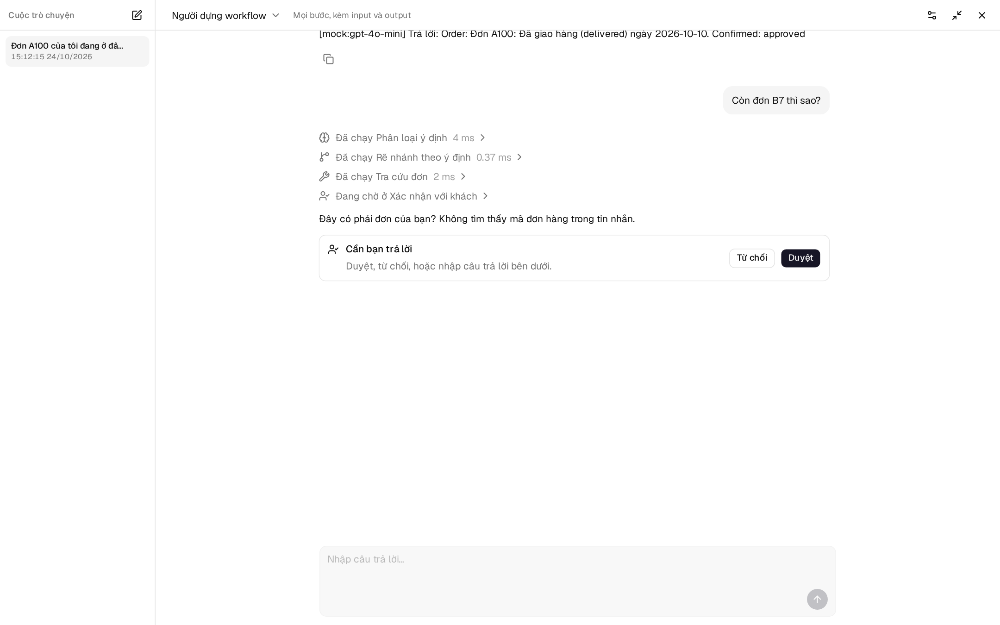
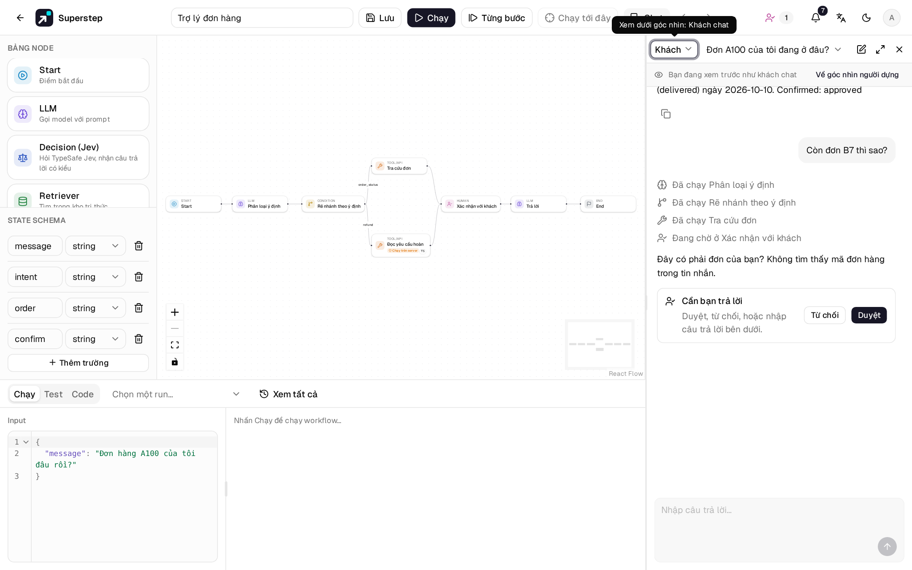
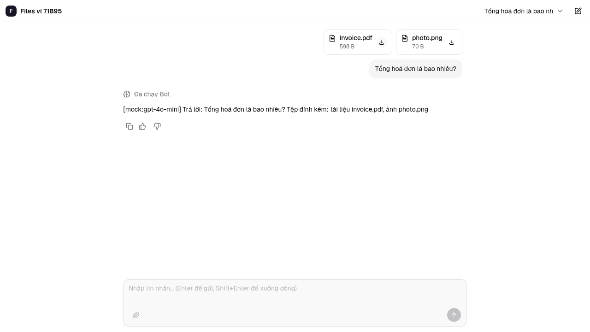
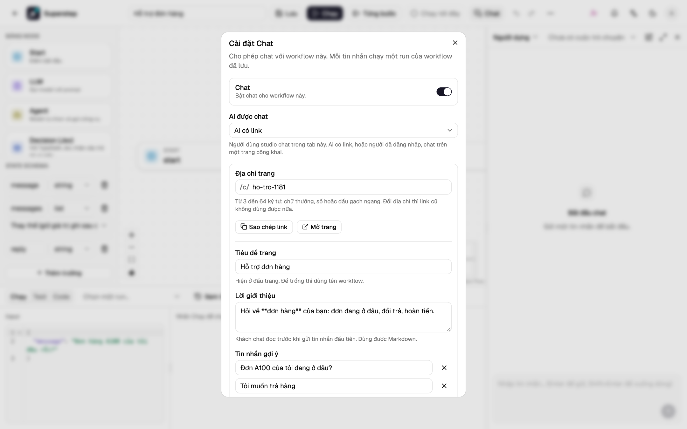
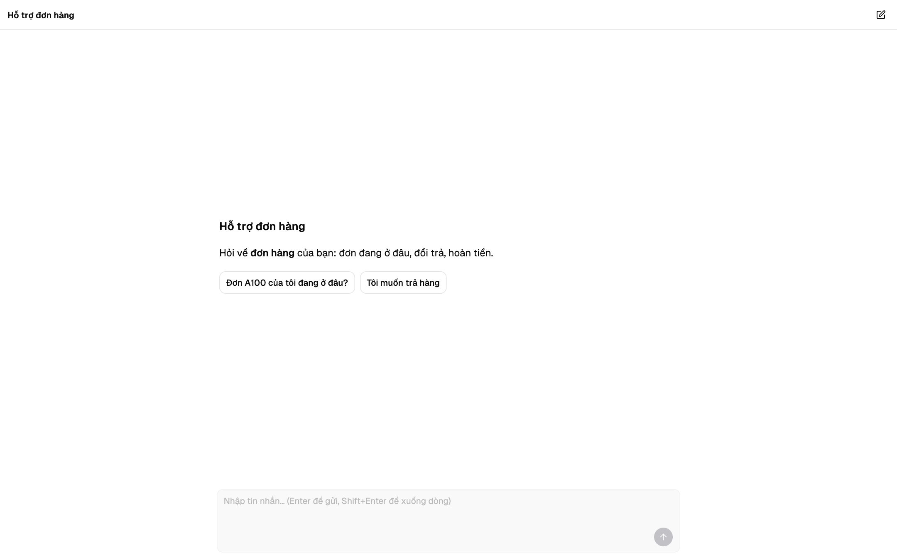
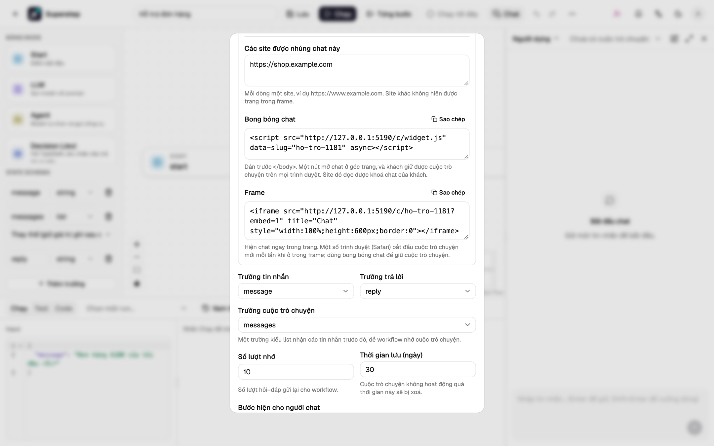

# Chat

Khung **Chat** ở bên phải editor cho bạn trò chuyện với một workflow như
người chat sẽ làm. Mỗi tin nhắn chạy một run của workflow **đã lưu**; các bước
và câu trả lời hiện dần trong lúc run chạy, và cuộc trò chuyện được lưu lại để
workflow có thể nhớ.


## Mở khung chat

- Nút **Chat** trên thanh trên, hoặc ++shift+c++ trên canvas, mở và đóng khung.
  Khung vẫn mở, đúng độ rộng bạn đã kéo (340–760 px), ở lần mở editor sau trên
  trình duyệt này.
- **Cấu hình** vẫn ở cạnh, nên bạn sửa một node rồi thử lại được ngay.
- **Toàn màn hình** (nút mũi tên) hiện chat trên cả cửa sổ, với danh sách các
  cuộc trò chuyện ở bên trái. ++esc++ để quay lại; cuộc trò chuyện và nội dung
  đang gõ vẫn còn.
- Trong khung hẹp, chọn cuộc trò chuyện cũ ở menu chọn cuộc trò chuyện cạnh **Xem dưới góc
  nhìn**, hoặc bắt đầu cuộc mới bằng nút **Chat mới** (biểu tượng bút).



Để người ngoài studio chat với workflow, hãy [công khai chat](#cong-khai-chat) trên
một trang riêng, và nếu muốn thì [nhúng chat vào site của bạn](#nhung-chat-vao-site-cua-ban).

## Bật chat

1. Mở workflow và chọn **⋯ → Cài đặt Chat**, hoặc nút bánh răng trong khung Chat.
   Bạn cần quyền chủ sở hữu để đổi cài đặt (chủ workflow hoặc admin).
2. Bật **Chat** và kiểm tra các trường:
    - **Trường tin nhắn**: trường state nhận mỗi tin nhắn (`string` hoặc `list`).
    - **Trường trả lời**: trường state hiện làm câu trả lời.
    - **Trường cuộc trò chuyện**: một trường `list` nhận các tin nhắn trước đó
      (xem [Bộ nhớ](#bo-nho)). Chọn **Không** cho chat không nhớ.
3. Lưu. Khi lưu, các trường được kiểm tra có trong state của workflow.


| Cài đặt | Tác dụng | Mặc định |
|---|---|---|
| Ai được chat | **Người dùng studio** chat trong khung này. **Ai có link** hoặc **Người đã đăng nhập** thì [công khai chat](#cong-khai-chat) trên một trang riêng. | Người dùng studio |
| Số lượt nhớ | Số lượt hỏi–đáp trước đó (một tin nhắn và câu trả lời của nó) gửi vào trường cuộc trò chuyện. | 10 |
| Bước hiện cho người chat | **Không**, **Tên bước** hoặc **Đầy đủ** (kèm input và output của từng bước). | Tên bước |
| Thời gian lưu (ngày) | Cuộc trò chuyện không có tin nhắn mới quá thời gian này sẽ bị xoá. | 30 |

## Trò chuyện

Nhập tin nhắn rồi nhấn ++enter++ (++shift+enter++ để xuống dòng). Câu trả lời
là Markdown: danh sách, bảng, link và khối code được định dạng; HTML thô và ảnh
từ trang khác không hiện, link mở ở tab mới.

- **Cuộc trò chuyện mới** bắt đầu một cuộc trò chuyện chưa có gì để nhớ. Các
  cuộc trò chuyện cũ vẫn ở danh sách, mới nhất trên cùng, đặt tên theo tin nhắn
  đầu tiên.
- **Xem dưới góc nhìn** ở trên cùng đổi cách xem. *Người dựng workflow* thấy đầy
  đủ mọi bước, kèm input và output (bấm vào một bước để mở); *Khách chat* xem
  trước đúng như khách thấy trên trang chat công khai: những gì **Bước hiện cho
  người chat** cho phép. Khi khung Chat hẹp, nút đổi cách xem hiện nhãn ngắn
  **Người dựng** hoặc **Khách** và chứa luôn **Cài đặt Chat**; khi đang xem như
  khách, một dải phía trên cuộc trò chuyện báo điều đó, kèm **Về góc nhìn người dựng**.


- Mỗi tin nhắn là một run trong lịch sử run (**Chạy → Xem tất cả**) với nhãn
  *Chat*, nên bạn mở được trace đầy đủ ở đó.
- Chat dùng workflow đã lưu: hãy lưu thay đổi trước khi thử.

## Tệp đính kèm

Bật **Cho phép đính kèm tệp** trong Cài đặt chat để người dùng thêm tệp vào tin
nhắn, trong khung Chat, trên trang công khai và trong widget. Mặc định tắt.



- **Loại tệp**: tài liệu (PDF, TXT, MD, CSV) và hình ảnh (PNG, JPEG, WebP).
  Máy chủ đọc loại tệp từ nội dung, không theo tên tệp.
- **Số tệp mỗi tin nhắn** và **Dung lượng tối đa (MB)**: mặc định 5 tệp và
  10 MB. Không được vượt mức trần của máy chủ, `STUDIO_CHAT_ATTACHMENT_MAX_FILES`
  và `STUDIO_CHAT_ATTACHMENT_MAX_MB` (xem
  [Cấu hình](../reference/configuration.md)).
- **Trường state**: một trường `list` của workflow nhận các tệp của mỗi tin
  nhắn, mặc định là `files`. Không được trùng trường tin nhắn hay trường hội
  thoại.

Bấm nút kẹp giấy hoặc thả tệp vào ô tin nhắn. Mỗi tệp được kiểm tra ngay trên
trang trước khi tải lên (loại, dung lượng, số lượng), hiện thành một thẻ có
dung lượng và ảnh thu nhỏ với hình ảnh, và gỡ được trước khi gửi. Nút Gửi chờ
mọi tệp tải lên xong. Tin nhắn có thể chỉ có tệp.

Mỗi run nhận một bản ghi cho mỗi tệp trong trường state:

```json
[{"id": "…", "name": "invoice.pdf", "type": "application/pdf", "size": 5120,
  "text": "Invoice 42 …", "text_cut": false}]
```

`text` chứa nội dung chữ của tài liệu (tối đa 50.000 ký tự, `text_cut` cho biết
có bị cắt không). Nội dung nhị phân của tệp không bao giờ vào state của run. Để
đưa tệp cho mô hình, bật **Đưa tệp đính kèm vào** ở node
[LLM](../guide/nodes.md#llm) hoặc [Agent](../guide/agent.md#cau-hinh).

Tin nhắn đã gửi liệt kê các tệp kèm nút tải xuống. Chỉ người gửi, và người
xây dựng trong [Chat của khách](#chat-cua-khach), mới tải được; tệp luôn được
tải xuống, không mở trong trang. Tệp được lưu cùng cuộc chat và bị xoá cùng
cuộc chat (theo thời gian lưu hoặc khi **Xoá**); tệp đã tải lên mà không gửi
bị xoá sau một giờ. Bản demo công khai không nhận tệp tải lên.

## Bộ nhớ

Khi có trường cuộc trò chuyện, mỗi run nhận *n* lượt hỏi–đáp gần nhất cùng tin
nhắn mới trong trường đó, dạng list các mục `{"role": "user" | "assistant",
"content": "…"}`. Dùng nó trong prompt, ví dụ:

```text
Cuộc trò chuyện đến giờ:
{{state.messages}}

Trả lời tin nhắn cuối của người dùng.
```

## Node Human trong chat

Tuỳ chọn **Người trả lời** của node Human quyết định ai trả lời khi workflow
chạy từ chat:

- **Người chat** (mặc định): câu hỏi hiện trong chat với **Duyệt** và **Từ chối**;
  hoặc nhập câu trả lời vào ô tin nhắn. Câu trả lời vào trường output của node và run chạy tiếp.
- **Người duyệt**: chat báo đang chờ duyệt, còn câu hỏi đến trang
  [Duyệt](human-approval.md) (và các kênh của nó) như thường lệ. Chat hiện câu
  trả lời khi run chạy tiếp.

Bước duyệt công cụ của [node Agent](../guide/agent.md#duyet-truoc-khi-goi-cong-cu)
luôn do người duyệt trả lời: người chat không duyệt hành động của chính agent.

Không gửi được tin nhắn mới khi chat đang chờ trả lời. [Hạn chờ](human-approval.md#han-cho)
của node áp dụng cho cả hai cách; khi quá hạn, hành động khi hết hạn quyết định
điều gì xảy ra.

## Công khai chat

Chọn **Ai được chat** là **Ai có link** hoặc **Người đã đăng nhập**, và giữ
**Chat** bật. Chat có một trang riêng ở `/c/<địa-chỉ>`, nơi người chưa từng mở
studio cũng chat được với workflow.



| Cài đặt | Tác dụng | Mặc định |
|---|---|---|
| Địa chỉ trang | Phần `<địa-chỉ>` trong `/c/<địa-chỉ>`: từ 3 đến 64 ký tự gồm chữ thường, số hoặc dấu gạch ngang, chưa có chat khác dùng. Đổi địa chỉ thì link cũ không dùng được nữa. | id của workflow |
| Tiêu đề trang | Hiện ở đầu trang. | tên workflow |
| Logo | Ảnh PNG, JPEG hoặc WebP, tối đa 256 KB. Bấm **Tải logo lên** để chọn, rồi **Lưu**. Logo hiện ở đầu trang, phía trên lời giới thiệu và trên tab trình duyệt. | chữ cái đầu của tiêu đề, và một hình minh họa phía trên lời giới thiệu |
| Lời giới thiệu | Khách chat đọc trước khi gửi tin nhắn đầu tiên. Dùng được Markdown. | trống |
| Tin nhắn gợi ý | Tối đa 4 nút để khách chat bấm vào bắt đầu. | không có |
| Số tin nhắn mỗi ngày | Số tin nhắn của khách chat mỗi ngày (giờ UTC) cho chat này, để một trang đông khách hay bị lạm dụng không đẩy chi phí model lên quá cao. `0` là không giới hạn. | 500 |

Nút **Sao chép link** và **Mở trang** hiện ra khi chat đã công khai.



Trên trang:

- **Ai có link**: khách chat không cần tài khoản. Trình duyệt giữ một cookie
  riêng cho chat này, nên khách thấy lại các cuộc trò chuyện cũ khi quay lại, và
  không ai khác đọc được chúng.
- **Người đã đăng nhập**: mọi tài khoản của studio này đều chat được, kể cả tài
  khoản không được mở workflow. Khách chưa đăng nhập được đưa tới trang đăng
  nhập rồi quay lại chat.
- Mỗi tin nhắn chạy workflow đã lưu dưới danh nghĩa **chủ workflow**: dùng
  credential, knowledge base và MCP server của chủ workflow, như chat qua Slack và
  Telegram. Các run nằm trong Lịch sử của workflow.
- Trang chỉ hiện những gì **Bước hiện cho người chat** cho phép. Trang không bao
  giờ hiện workflow, state hay chủ của workflow.
- [Node Human](#node-human-trong-chat) hoạt động như trong khung chat: khách chat
  trả lời câu hỏi dành cho **Người chat**, còn lại thì chờ người duyệt.
- Trang theo ngôn ngữ (tiếng Anh hoặc tiếng Việt) và chế độ sáng hay tối của
  trình duyệt khách.

**Giới hạn.** Ngoài số tin nhắn mỗi ngày của chat, server còn giới hạn theo
từng khách và từng địa chỉ IP (mặc định 10 và 30 tin nhắn mỗi phút). Khách vượt
giới hạn được báo khi nào thử lại, và không run nào được chạy. Người vận hành đổi
các giới hạn này bằng các cài đặt `STUDIO_PUBLIC_CHAT_RATE_*` (xem
[Cấu hình](../reference/configuration.md)). Bản demo công khai không công khai
chat nào.

Để gỡ trang, chọn lại **Ai được chat** là **Người dùng studio**, hoặc tắt
**Chat**. Trang khi đó báo chat không mở.

### Chat của khách

Khi chat được công khai, khung chat có thêm danh sách **Khách** (trong khung hẹp,
là một nhóm trong ô chọn cuộc trò chuyện). Danh sách hiện từng cuộc trò chuyện
của khách ở chế độ chỉ xem, có đủ mọi bước, cho tới khi **Thời gian lưu** xoá
nó. Danh sách không hiện tên hay id của khách. Khách không được báo rằng cuộc
trò chuyện được lưu, nên hãy ghi điều đó trong lời giới thiệu nếu cần.

Dưới mỗi câu trả lời đã xong, khách có thể đánh dấu hữu ích hoặc chưa hữu ích.
Đánh dấu chưa hữu ích có thể kèm một câu ngắn về chỗ chưa đúng. Khách đổi hoặc
bỏ đánh dấu được. Chat nhúng cũng có các nút này, vì đó chính là trang này.

Trong tab Chat, người dựng thấy đánh dấu và câu nhận xét trên câu trả lời.
**Không thích** trong danh sách Khách chỉ giữ các cuộc trò chuyện có đánh dấu
đó. Một dòng phía trên cuộc trò chuyện cho biết số lượt thích, số lượt không
thích, và tỷ lệ không thích, trong 7 ngày và 30 ngày gần nhất. **Lưu thành test
case** trên câu trả lời đã được đánh dấu mở một test nháp của run đó. Khi bật
theo dõi LangSmith, đánh dấu cũng được gửi lên trace của run dưới tên
`user_rating`.

## Nhúng chat vào site của bạn

Chat mở cho **Ai có link** cũng hiện được trên một site khác.

1. Thêm site vào **Các site được nhúng chat này**, mỗi dòng một site, ví dụ
   `https://www.example.com` (`http://localhost:<cổng>` cũng được, để thử).
   Site khác không hiện được trang trong frame.
2. Sao chép một trong hai đoạn mã hiện ra:
    - **Bong bóng chat**: dán trước `</body>`. Một nút tròn ở góc trang mở chat.
      Khách giữ được cuộc trò chuyện trên site đó ở mọi trình duyệt.
    - **Frame**: hiện chat ngay trong trang, ở chỗ bạn đặt nó. Một số trình
      duyệt (Safari) xoá dữ liệu mà frame lưu, nên khách có thể phải bắt đầu lại
      mỗi lần ghé; dùng bong bóng chat để giữ cuộc trò chuyện.



```html
<script src="https://studio.example.com/c/widget.js" data-slug="ho-tro" async></script>
```

Bong bóng nhận `data-position="left"` để nằm bên trái, và `data-open="true"` để
mở sẵn. Bong bóng giữ khoá chat của khách trong bộ nhớ của chính site đó, nên
script trên site đọc được khoá và mở được các cuộc trò chuyện của khách: chỉ
nhúng bong bóng vào site bạn tin cậy với các cuộc trò chuyện đó.

Phần còn lại của studio không hiện được trong frame trên bất kỳ site nào.

## Lỗi

| Mã | Ý nghĩa |
|---|---|
| `CHAT_NOT_ENABLED` | Chat đang tắt cho workflow này. |
| `CHAT_SETTINGS_INVALID` | Một cài đặt bị sai; `field` cho biết cài đặt nào. |
| `CHAT_SESSION_NOT_FOUND` | Cuộc trò chuyện không tồn tại, hoặc không phải của bạn. |
| `CHAT_MESSAGE_EMPTY` / `CHAT_MESSAGE_TOO_LONG` | Tin nhắn trống, hoặc dài quá 4000 ký tự. |
| `CHAT_RUN_WAITING` | Chat đang chờ câu trả lời cho một node Human. |
| `CHAT_ANSWER_BY_REVIEWER` | Bước này do người duyệt trả lời, ở trang Duyệt. |
| `CHAT_NOT_PUBLISHED` | Trang công khai đang tắt, hoặc địa chỉ đã đổi. |
| `CHAT_SLUG_INVALID` / `CHAT_SLUG_TAKEN` | Địa chỉ trang sai dạng, hoặc đã có chat khác dùng. |
| `CHAT_SIGN_IN_REQUIRED` | Chat này dành cho người đã đăng nhập. |
| `CHAT_DAILY_LIMIT` | Chat đã hết lượt tin nhắn hôm nay. |
| `CHAT_EMBED_ORIGIN_INVALID` | Một site nhúng không phải địa chỉ dạng `https://example.com`. |
| `CHAT_LOGO_INVALID` | Logo không phải ảnh PNG, JPEG hoặc WebP, hoặc lớn hơn 256 KB. Không nhận SVG. |
| `CHAT_ATTACHMENTS_OFF` | Chat này không nhận tệp đính kèm. |
| `CHAT_ATTACHMENT_TYPE` | Loại tệp không được phép trong chat này, hoặc nội dung không phải PDF, ảnh hay văn bản UTF-8. |
| `CHAT_ATTACHMENT_TOO_LARGE` | Tệp vượt giới hạn dung lượng của chat. |
| `CHAT_ATTACHMENT_TOO_MANY` | Tin nhắn có nhiều tệp hơn mức chat cho phép. |
| `CHAT_ATTACHMENT_NOT_FOUND` | Tệp không tồn tại, hoặc không phải của bạn. |
| `CHAT_ATTACHMENT_LIMIT` | Một giới hạn trong Cài đặt chat vượt mức trần của máy chủ. |
| `CHAT_ATTACHMENT_DEMO` | Bản demo công khai không nhận tệp tải lên. |
| `RATE_LIMITED` | Khách hoặc địa chỉ IP này gửi quá nhiều tin nhắn; `retry_after` cho biết khi nào thử lại. |

Xem thêm [Chạy từ chat](chat-triggers.md) cho Slack và Telegram.
