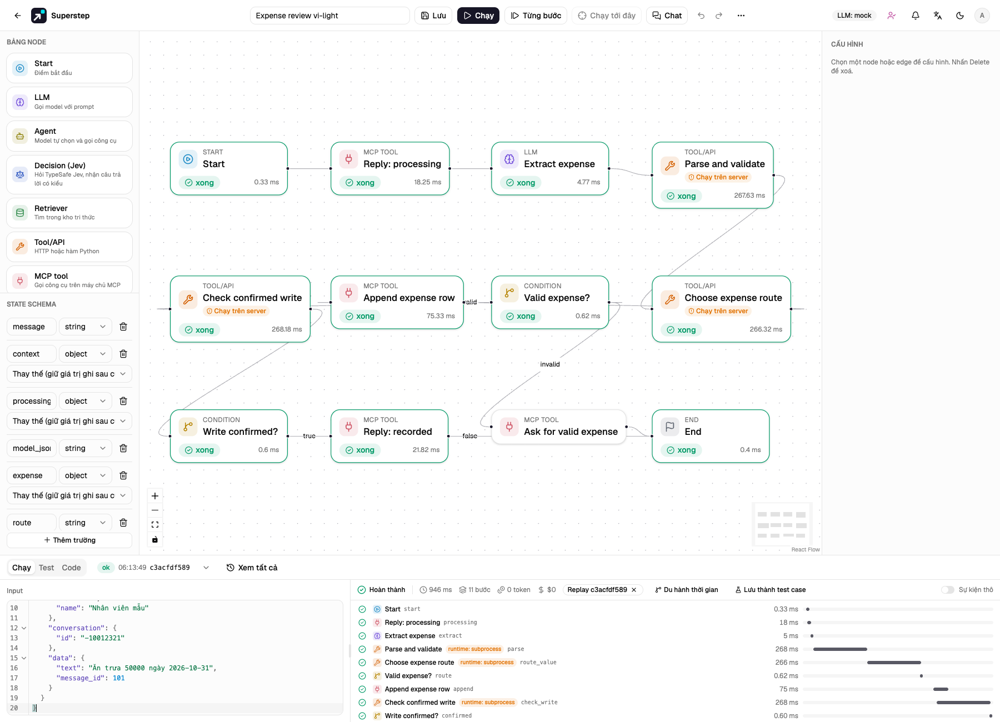

# Workflow ghi khoản chi từ Telegram

Nhập [template khoản chi](https://github.com/quinguyen1502/superstep/blob/develop/examples/telegram-expenses.template.json)
bằng **Workflow mới → Nhập mẫu**, rồi chọn thẻ vừa nhập. Mẫu dùng các node MCP,
LLM, Code và Condition hiện có.

Luồng trả lời đang xử lý, trích xuất và kiểm tra một khoản chi, ghi một dòng,
rồi chỉ báo đã ghi sau khi xác nhận thành công. Thiếu/sai số tiền và tin không
phải khoản chi đi vào nhánh phản hồi. “Pending approval” chỉ là trạng thái trên sheet;
mẫu chưa có quy trình phê duyệt.

Ảnh là lần kiểm thử với provider giả lập và dữ liệu mẫu.

## Chuẩn bị máy chủ và tài khoản

- Tài khoản có `code.write` (mặc định là admin) cần xem xét và nhập template Code.
  Bật Python Code bằng `STUDIO_ENABLE_CODE_NODES=1`.
- Khi triển khai, dùng [Code runtime Docker hoặc remote](../guide/code-mode.md).
  Parser chỉ dùng thư viện chuẩn Python. Subprocess chỉ dùng trong kiểm thử
  cục bộ với code tin cậy.
- Chạy worker, cấu hình `STUDIO_PUBLIC_URL` HTTPS công khai và kiểm thử bằng
  bot/sheet riêng. Không đặt credential thật trong template JSON.
- Tạo credential OpenRouter chính và Ollama dự phòng trong Cài đặt; chọn model
  thực sự có sẵn. Tên model trong mẫu là ví dụ. [Model dự phòng](../guide/nodes.md)
  thử tối đa hai model mỗi lần chạy node, không che lỗi xác thực hay quyền.

## Kết nối Telegram và Sheets

1. Trong **Cài đặt → Kênh**, lưu kết nối bot Telegram. Bot phải nhận được tin
   thường trong nhóm đã chọn; cấu hình privacy mode phù hợp.
2. Trong **Cài đặt → MCP**, tạo kết nối quản lý Telegram, chọn kết nối bot trên
   và **ID cuộc chat nhận tin cố định** của nhóm. Khám phá công cụ.
3. Tạo service account Google, bật Sheets API, chia sẻ spreadsheet riêng cho
   email đó với quyền chỉnh sửa và tạo tab `Expenses`. Trong Cài đặt → MCP,
   tạo kết nối Google Sheets với spreadsheet/tab đó, **7 cột dữ liệu** và khoá
   JSON service account. Khám phá công cụ.
4. Đặt các tiêu đề sau. Giữ nguyên H để adapter lưu ID thao tác.

| Cột | Tiêu đề | Giá trị |
| --- | --- | --- |
| A | expense_date | YYYY-MM-DD từ tin nhắn nếu có |
| B | employee | Tên người gửi trong sự kiện đã xác thực, hoặc ID nếu thiếu tên |
| C | description | Nội dung model đã qua kiểm tra |
| D | category | Loại khoản chi đã qua kiểm tra |
| E | amount_vnd | Số tiền VND nguyên dương |
| F | status | Pending approval |
| G | submitted_at | Thời gian gửi tin tại UTC+07:00 |
| H | operation_id | ID thao tác cố định do adapter thêm |

Sáu cột khoản chi cũ được giữ lại; G lưu thời gian gửi, H dùng đối soát. Dữ liệu
được ghi RAW nên chuỗi giống công thức vẫn là văn bản. Chuyển tab trước khi
đạt 100.000 dòng và giữ nguyên cột ID.

## Cấu hình graph vừa nhập

- Ở **Extract expense**, chọn credential/model chính và dự phòng. Tham chiếu
  tài nguyên trong tệp được để trống có chủ ý.
- Ở **Reply: processing**, **Reply: recorded**, **Ask for valid expense**, chọn
  kết nối quản lý Telegram.
- Ở **Append expense row**, chọn kết nối Sheets. Giữ tham số `values` là
  `{{state.expense.values}}`.
- Trong **⋯ → Chạy từ chat**, chọn bot, đúng nhóm và **Sự kiện (chạy với quyền
  chủ trigger)**. Loại chính xác là `message.text`. Nhập các ID Telegram được
  phép; `*` chủ động cho phép mọi người trong nhóm dùng tài nguyên chủ trigger
  mà không cần tài khoản studio.
- Ánh xạ `message` vào `data.text`, `context` vào `$`. Metadata là dữ liệu
  không tin cậy, không có quyền chọn credential hoặc nơi gửi/ghi.

Mẫu mới nhập báo lỗi cấu hình tới khi chọn đủ kết nối và model dự phòng. Lưu
sau khi giải quyết các lỗi. Chưa đăng ký webhook sản xuất khi n8n còn quản lý bot.

## Quy tắc dữ liệu và cách thấy lỗi

Parser nhận JSON với `is_expense` boolean, `amount` dạng số, `description`,
`category` và `expense_date` nếu có. Có thể nhận JSON trong code fence, nhưng
không thực thi nội dung model. Số tiền phải nguyên dương, tối đa
1.000.000.000.000 VND. Chuỗi số, boolean, số lẻ đi vào nhánh yêu cầu bổ sung.
Nội dung và loại khoản chi có giới hạn độ dài. Có thể sửa quy tắc nghiệp vụ này
trong Code sau khi xem xét.

Ngày rõ ràng phải là YYYY-MM-DD. Nếu không nêu ngày khoản chi, dùng ngày gửi
tin tại UTC+07:00 Việt Nam. Thời gian gửi vẫn tách riêng tại G; model không thể
ghi đè nó hoặc danh tính người gửi. JSON sai và cả hai model lỗi hiện trong
Lịch sử/trace, không ghi sheet.

Node append có hai lần thử. Sau phản hồi chưa rõ ở lần đầu, lần hai chỉ đối
soát thao tác cũ, không append lại. Nếu tìm thấy dòng đã ghi, luồng có thể gửi
xác nhận. Bị từ chối hoặc chưa rõ kết quả sẽ dừng trước nhánh thành công.
**Thao tác gần đây → Kiểm tra kết quả bên ngoài** có thể kiểm tra sau; thao tác
này không tự chạy lại workflow lỗi hay gửi tin cuối. Không tạo run mới để vượt
qua trạng thái chưa rõ. Kiểm tra dịch vụ bên ngoài trước.

Run kiểm thử/model giả lập không gửi tin hay ghi dữ liệu qua kết nối quản lý.
Model giả lập mặc định không trích xuất JSON khoản chi; dùng provider kiểm thử
hoặc JSON chuẩn bị sẵn để kiểm tra schema nghiệp vụ này. Test trong repository
giả lập provider nhưng chạy parser thật bằng subprocess.

Từ `backend/`, chạy `.venv/bin/python -m pytest -q tests/test_expense_integration.py`.
Từ `frontend/`, chạy
`E2E_EXPENSE_FIXTURE=1 E2E_CODE_RUNTIME=subprocess npm run e2e -- expense-workflow.spec.ts`.
Fixture trình duyệt bắt buộc bật cờ trên và thay model/Google HTTP bằng giả lập;
Telegram dùng API giả lập cục bộ. Không ghi dữ liệu lên provider thật.

## Kiểm tra và chuyển hệ thống

Kiểm tra khoản chi hợp lệ, thiếu/sai số tiền, tin không liên quan, JSON sai,
model chính lỗi, Sheets từ chối, mất phản hồi và gửi sự kiện lại. Đảm bảo tin
thành công đi sau đúng một lần append đã xác nhận, ngày và người gửi chính xác.
Xem trace và Thao tác gần đây cùng với sheet. ID sự kiện trùng và worker chạy
lại dùng lại kết quả đã lưu.

Khi chuyển thật, tạm dừng nhận khoản chi, đợi n8n xử lý hết tác vụ chờ và đối
soát sheet. Ghi nhận mốc update/message cuối đã xử lý. Tắt workflow cũ, đăng ký
webhook Superstep, kiểm tra bằng một tin mới có kiểm soát rồi mở lại việc gửi.
Mỗi bot Telegram có một webhook. Lịch sử chống trùng của n8n không được nhập;
phát lại tin cũ có thể tạo khoản chi mới. Nếu quay lại hệ thống cũ, tắt binding
Superstep và khôi phục callback cũ sau khi đối soát. Đăng ký thật và ghi dữ liệu
thật cần người vận hành duyệt; các test của mẫu không thực hiện chuyển hệ thống.
