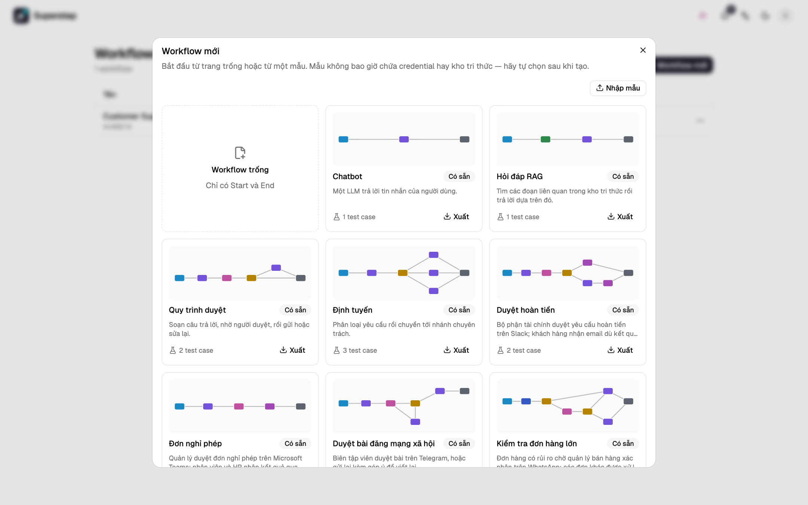
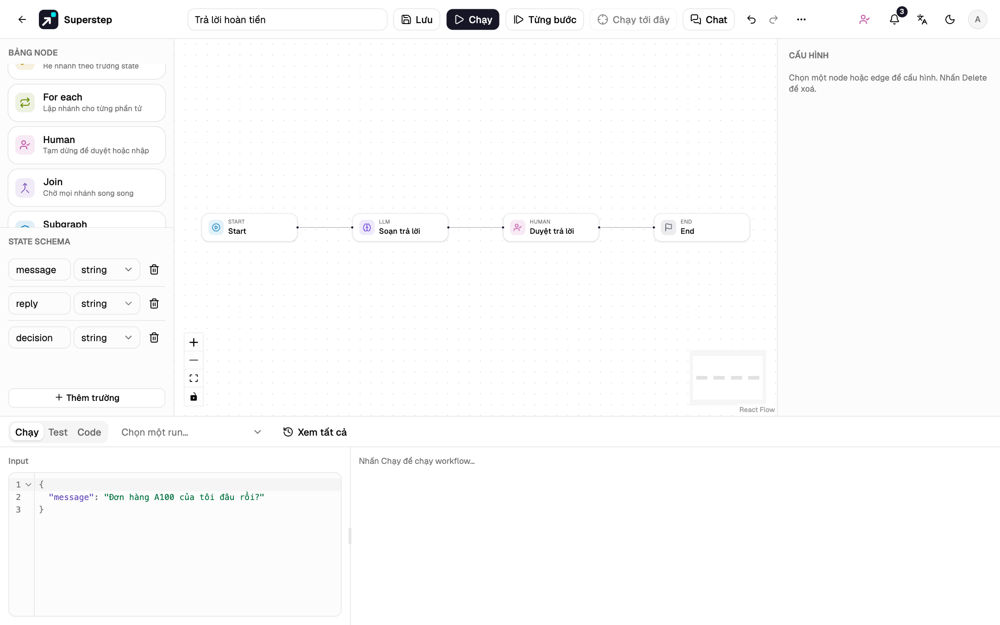
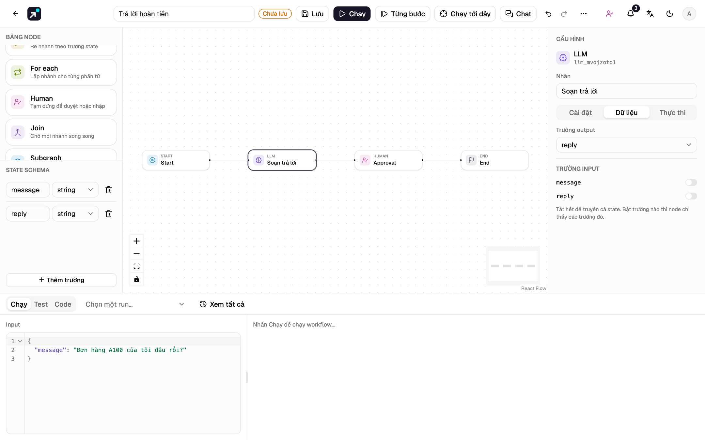
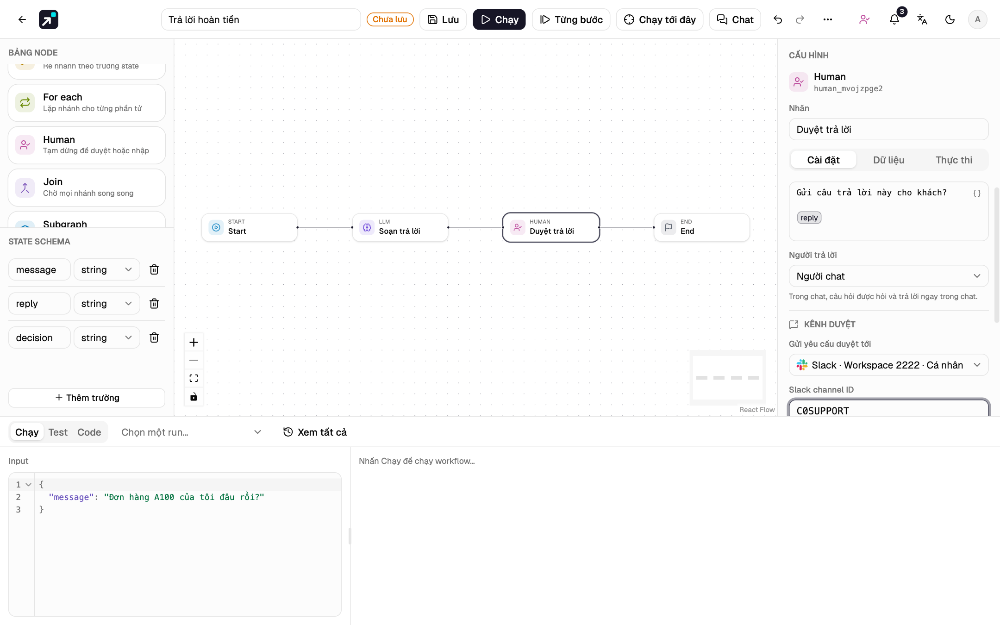
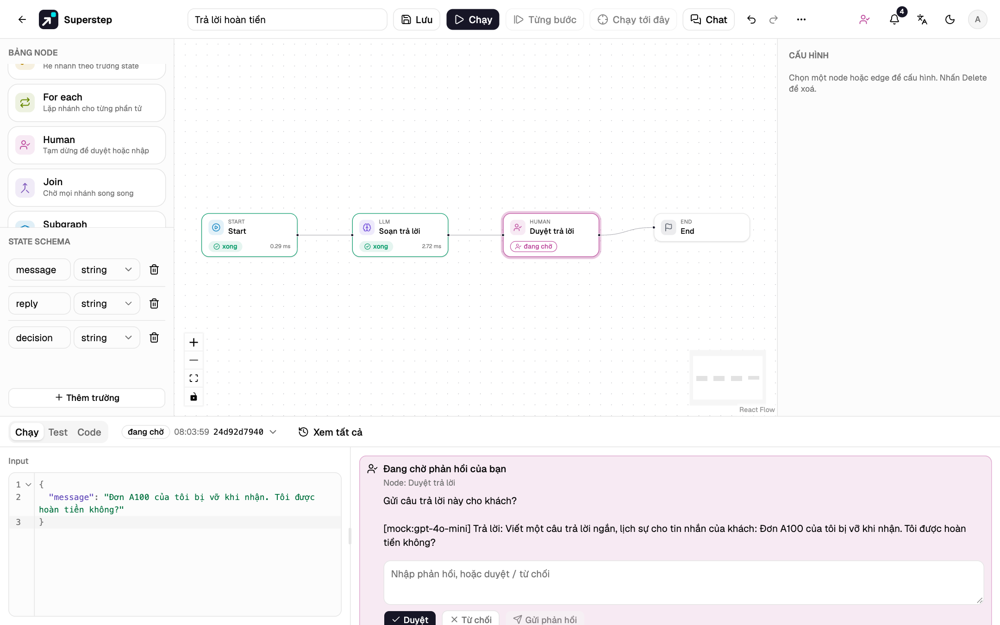
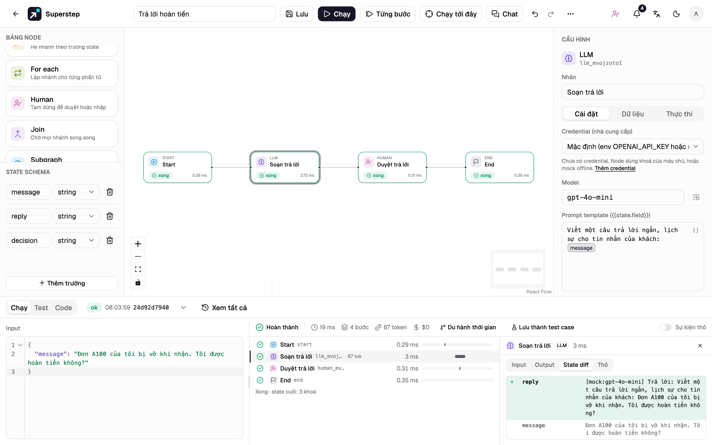
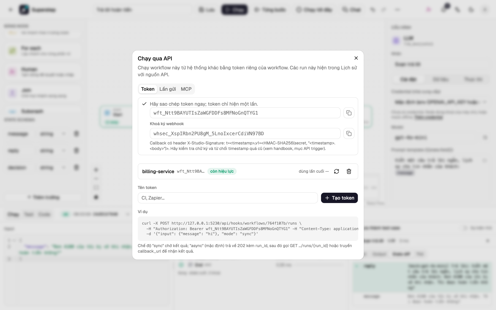
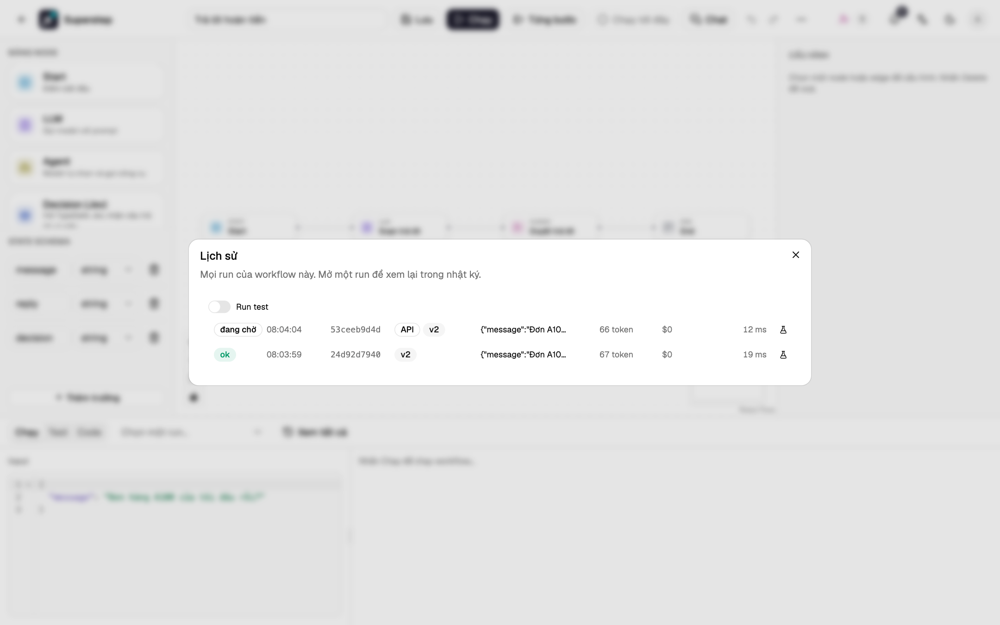

# Bắt đầu nhanh

Dựng một workflow soạn câu trả lời cho tin nhắn của khách, chờ một người duyệt,
và có thể được dịch vụ khác gọi qua HTTP.

| | |
| --- | --- |
| **Bạn sẽ dựng** | Start → LLM (soạn trả lời) → Human (duyệt) → End |
| **Bạn sẽ dùng** | Trình soạn thảo, state schema, trace của run, API token và lịch chạy |
| **Thời gian** | Khoảng 10 phút |
| **Video** | [Video ở trang chủ](../index.md#video) đi qua đúng các bước này |

## Trước khi bắt đầu

- Studio đang chạy: `./dev.sh` từ bản clone của repo (xem
  [Cài đặt](install.md)). Giao diện ở <http://localhost:5173>.
- Một tài khoản: tạo bằng **Đăng ký** ở trang đăng nhập. Vai trò mặc định
  `editor` là đủ cho hướng dẫn này.
- Không cần key của model. Khi chưa có credential, node LLM trả lời bằng bản
  mock offline cố định, lặp lại phần cuối của prompt.

## 1. Tạo workflow trống

1. Ở trang **Workflows**, chọn **Workflow mới**.
2. Trong thư viện mẫu, chọn **Workflow trống**. Trình soạn thảo mở ra với một
   node Start, một node End và một cạnh nối chúng.
3. Đổi tên ở ô tên trên thanh tiêu đề, ví dụ `Trả lời hoàn tiền`.



## 2. Thêm và nối các node

1. Kéo **LLM** từ **Node palette** thả vào canvas. Cuộn palette xuống tới
   **Human** và kéo nó đặt cạnh node LLM.
2. Chọn cạnh từ Start tới End và nhấn ++delete++.
3. Nối các node: kéo từ handle bên phải của **Start** tới handle bên trái của
   **LLM**, rồi **LLM** tới **Human**, rồi **Human** tới **End**.
4. Nhấn ++shift+l++ để sắp xếp lại bố cục (hoặc **⋯ → Tự sắp xếp bố cục**).

!!! success "Kiểm tra"
    Canvas có bốn node trên một hàng: Start → LLM → Human → End.



## 3. Cấu hình node LLM

State là bản ghi có kiểu mà mọi node đọc và ghi. Workflow mới có một trường
`message`, chứa input của run.

1. Chọn node **LLM**. Cấu hình của nó mở ở panel **Cấu hình**.
2. Đặt **Nhãn** là `Soạn trả lời`.
3. Thay **Prompt template** bằng:

    ```text
    Viết một câu trả lời ngắn, lịch sự cho tin nhắn của khách: {{state.message}}
    ```

    `{{state.message}}` hiện thành một thẻ. Gõ `{{` để chọn trường trong state;
    trường không có trong state bị đánh dấu là không xác định.

4. Ở **State schema** trong panel trái, chọn **Thêm trường** và đặt tên trường
   mới là `reply`.
5. Mở tab **Dữ liệu** và đặt **Trường output** là `reply`. Node ghi câu trả
   lời vào đó.



## 4. Cấu hình node Human

1. Chọn node **Human** và đặt **Nhãn** là `Duyệt trả lời`.
2. Đặt **Câu hỏi cho người duyệt** là:

    ```text
    Gửi câu trả lời này cho khách?

    {{state.reply}}
    ```

3. Thêm trường `decision` vào state, rồi ở tab **Dữ liệu** chọn nó làm
   **Trường output**. Trường này
   nhận `approved`, `rejected` hoặc câu trả lời được gõ vào.
4. Tuỳ chọn: quay lại tab **Cài đặt**, ở **Kênh duyệt**, đặt **Gửi yêu cầu duyệt tới** một kênh
   Slack, Telegram, WhatsApp, email hoặc Teams đã kết nối, rồi điền đích gửi
   (với Slack là channel id). **Người duyệt (email)** liệt kê những người khác
   được trả lời. Kênh được kết nối ở **Cài đặt → Kênh**; xem
   [Kênh duyệt](../operate/channels.md). Làm theo hướng dẫn này chỉ cần
   **Chỉ trong Studio**.

    

5. Chọn **Lưu** (++ctrl+s++ hoặc ++cmd+s++). Backend kiểm tra graph và lưu
   thành một phiên bản mới.

!!! info "Kiểm tra graph"
    Lưu và Chạy đều kiểm tra graph trước: node không tới được, tham chiếu tới
    trường không có trong state, cạnh trỏ tới node không tồn tại đều được liệt
    kê trước khi chạy. Xem [Trình soạn thảo](../guide/editor.md).

## 5. Chạy và duyệt

1. Trong tab **Chạy** ở phía dưới, nhập vào **Input** (bên trái):

    ```json
    {"message": "Đơn A100 của tôi bị vỡ khi nhận. Tôi được hoàn tiền không?"}
    ```

2. Chọn **Chạy** (++ctrl+enter++). Node LLM chạy xong, và run dừng ở node
   Human với trạng thái `waiting`.

    

3. Đọc câu hỏi và câu trả lời đã soạn, rồi chọn **Duyệt**. Run chạy tiếp từ
   checkpoint và kết thúc.

!!! tip "Trả lời từ chat hoặc email"
    Khi node Human có kênh, cùng yêu cầu đó cũng được gửi tới kênh: nút
    **Duyệt** và **Từ chối** trên Slack và Telegram, hai nút trả lời trên
    WhatsApp, và link trong email và Teams mở về studio. Chỉ chủ của run và
    những người duyệt được liệt kê mới trả lời được, và chỉ một lần. Trả lời
    trong studio sẽ đóng yêu cầu ở mọi nơi. Xem
    [Duyệt bởi người](../run/human-approval.md#duyet-qua-chat).

!!! success "Kiểm tra"
    Nhật ký (bên phải input) hiện **Hoàn thành** với bốn bước: Start, Soạn trả lời, Duyệt
    trả lời và End.

## 6. Đọc trace

Chọn **Soạn trả lời** trên canvas hoặc trong nhật ký. Bước đó mở ra với
**Input**, **Output**, **State diff** và sự kiện **Raw**. State diff cho thấy
`reply` được bước này thêm vào.



## 7. Gọi qua HTTP

1. Mở **⋯ → API**, nhập tên token, ví dụ `billing-service`, rồi chọn **Tạo
   token**. Token (`wft_…`) và secret ký (`whsec_…`) chỉ hiện một lần; hãy
   sao chép ngay.

    

2. Khởi chạy run từ terminal. Thay `<wid>` bằng id của workflow trên thanh địa
   chỉ, và `wft_…` bằng token của bạn:

    ```bash
    curl -X POST http://localhost:5173/api/hooks/workflows/<wid>/runs \
      -H "Authorization: Bearer wft_…" -H "Content-Type: application/json" \
      -d '{"input": {"message": "Đơn A100 của tôi bị vỡ khi nhận. Tôi được hoàn tiền không?"}}'
    ```

    Phản hồi là `202` kèm `run_id` và `"status": "queued"`.

3. Mở **Chạy → Xem tất cả** (tải lại trang trước). Run gọi qua API có nhãn **API**
   và trạng thái `waiting`: nó dừng ở node Human, giống run chạy trong studio.



## 8. Đặt lịch chạy

1. Mở **⋯ → Lịch chạy**.
2. Nhập tên và biểu thức cron `0 9 * * 1-5` (9 giờ sáng các ngày trong tuần).
   Hộp thoại hiện trước các run kế tiếp theo múi giờ đã chọn.
3. Chọn **Thêm lịch**.

## Bạn đã học được

- Workflow là một graph gồm các node có kiểu trên một state chung; node đọc
  state bằng `{{state.field}}` và ghi vào một **Trường output**
  ([State và tham chiếu](../guide/state.md)).
- Mỗi lần lưu là một phiên bản, và mỗi run ghi lại phiên bản nó dùng
  ([Phiên bản](../guide/versions.md)).
- Node Human dừng run ở trạng thái `waiting` và chạy tiếp từ checkpoint; yêu
  cầu duyệt có thể gửi cả tới chat hoặc email
  ([Duyệt bởi người](../run/human-approval.md)).
- Mỗi bước của run giữ input, output và state diff
  ([Run và trace](../run/traces.md)).
- Token của workflow cho phép dịch vụ khác khởi chạy run, còn lịch chạy khởi
  chạy theo thời gian biểu ([API trigger](../run/api-triggers.md),
  [Lịch chạy](../run/schedules.md)).

## Tiếp theo

- Thêm model: [Nhà cung cấp LLM](../operate/providers.md).
- Rẽ nhánh theo quyết định bằng node **Condition**: [Các loại node](../guide/nodes.md).
- Lưu test case với input, câu trả lời Human và những gì run phải cho ra:
  [Kiểm thử workflow](../run/tests.md).
- Xem workflow dưới dạng Python LangGraph và chạy nó độc lập:
  [Xuất ra Python](../guide/python-export.md).
- Gửi yêu cầu duyệt tới Slack, Telegram, WhatsApp, email hoặc Teams:
  [Kênh duyệt](../operate/channels.md).
- Chạy đủ stack với Postgres, Redis và worker:
  [Triển khai bằng Compose](../operate/deploy.md).
